# 📋 BÁO CÁO KỸ THUẬT TUẦN 1
**Học viên:** Nguyễn Tiến Tuấn  
**Chuyên đề:** Database (PostgreSQL) & Hướng đối tượng (OOP / DI)  
**Thời gian:** 03/10/2026  
**Dự án thực tế áp dụng:** [Sentia Hub Backend](https://github.com/Tunhoclaptrinh/EruSentia-Server/tree/b851e1576ae48fe62efcec10dd2d912e011a6220)
**Mốc nguồn đối chiếu sau dọn repo:** [`b851e15`](https://github.com/Tunhoclaptrinh/EruSentia-Server/tree/b851e1576ae48fe62efcec10dd2d912e011a6220) — [cách mở và tải toàn bộ bản nguồn](SOURCE_SNAPSHOT.md)
**Kho lưu trữ nộp bài:** [TYP tại mốc tuần 1](https://github.com/Tunhoclaptrinh/trainning-typ-2026/tree/typ-2026-week-1)

> Hiệu đính sau review ngày 20/10/2026: [những điểm đã sửa và giới hạn bằng chứng](REVIEW_UPDATES.md). Ảnh/số đo lịch sử giữ nguyên; nội dung giải thích được sửa trên nhánh hiện tại, tag cũ không đổi.

> Báo cáo lưu kết quả và ảnh chụp của lần thực hành ngày 03/10/2026. Mã nguồn thực thi được quản lý tại [EruSentia-Server](https://github.com/Tunhoclaptrinh/EruSentia-Server/tree/b851e1576ae48fe62efcec10dd2d912e011a6220); xem [hướng dẫn tái hiện](README.md#báo-cáo-và-hướng-dẫn-tái-hiện). Schema chính có 9 bảng; tổng 11 bảng trong ảnh bao gồm `users_no_index` và `template_slots` dùng riêng cho bài thực hành.

---

## 📌 Nội dung & Mục tiêu tuần 1

| # | Hạng mục | Kết quả | Chi tiết |
|---|----------|---------|----------|
| 1 | CSDL quan hệ & DDL/DML | ✅ Hoàn thành | Thiết kế schema chuẩn, seed 10 users + 8 categories, sinh 1,000 templates đo kiểm |
| 2 | Truy vấn dữ liệu phức tạp | ✅ Hoàn thành | INNER JOIN 4 bảng, GROUP BY, Aggregate, HAVING |
| 3 | Tối ưu hóa truy vấn bằng Index | ✅ Hoàn thành | Minh họa hai execution plan; số đo cũ chưa đủ cho kết luận tăng tốc có kiểm soát |
| 4 | Phân trang (Pagination) | ✅ Hoàn thành | Offset Paging, phân tích điểm nghẽn Deep Offset |
| 5 | Quản lý đồng thời & Locking | ✅ Hoàn thành | Pessimistic Lock (`FOR UPDATE`) & Optimistic Lock (Version) |
| 6 | Toàn vẹn giao dịch (Transaction) | ✅ Hoàn thành | ACID, kiểm soát Savepoint và Partial Rollback |
| 7 | Lập trình hướng đối tượng (OOP) | ✅ Hoàn thành | 4 tính chất OOP áp dụng vào Domain Model |
| 8 | Dependency Injection & IoC | ✅ Hoàn thành | Tách rời khớp nối, DI Container & kiến trúc NestJS |

---

## 🏗️ Môi trường kỹ thuật

- **DBMS:** PostgreSQL 16 (chạy container Docker `sentia_postgres_dev` qua port `5432`)
- **Database Management Tool:** Adminer Web UI (container `sentia_adminer_dev` qua port `8080`)
- **Runtime:** Node.js v22 + TypeScript (`tsx` execution engine)
- **Hạ tầng:** Docker Desktop trên Windows Subsystem for Linux (WSL 2)

```
$ docker ps --format "table {{.Names}}\t{{.Status}}\t{{.Ports}}"

NAMES                  STATUS                    PORTS
sentia_adminer_dev     Up                        0.0.0.0:8080->8080/tcp
sentia_postgres_dev    Up (healthy)              0.0.0.0:5432->5432/tcp
```

---

## PHẦN 1: DATABASE (POSTGRESQL)

---

### 1.1 Khởi tạo CSDL & Schema

Cơ sở dữ liệu `sentia_hub_db` được khởi tạo thông qua `docker/docker-compose.dev.yml` kết hợp các file migration DDL.

**Danh sách bảng trong hệ thống:**
```
             List of relations
 Schema |     Name      | Type  |  Owner
--------+---------------+-------+----------
 public | audit_logs    | table | postgres
 public | categories    | table | postgres
 public | documents     | table | postgres
 public | forks         | table | postgres
 public | notifications | table | postgres
 public | profiles      | table | postgres
 public | ratings       | table | postgres
 public | template_slots| table | postgres
 public | templates     | table | postgres
 public | users         | table | postgres
 public | users_no_index| table | postgres
(11 rows)
```

**Thống kê dữ liệu thực tế:**
- Bảng `users`: 10 tài khoản nòng cốt nghiệp vụ ban đầu (admin, creator, user trong `03_seed.sql`).
- Bảng `categories`: 8 chuyên mục chính.
- Bảng `templates`: 1,012 templates mẫu (12 template chuẩn nghiệp vụ + 1,000 template sinh tự động phục vụ test phân trang).
- Bảng `users_no_index`: 100,010 bản ghi phục vụ đo kiểm hiệu năng (sinh tự động bằng `generate_series` trong `04_week01_benchmark.sql`).

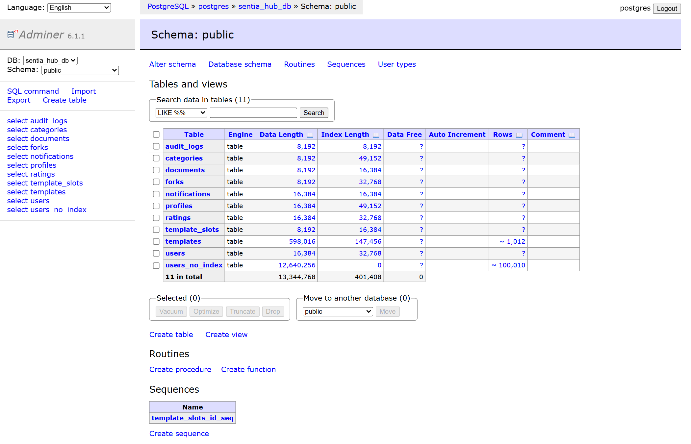
*Hình 1: Bảng điều khiển Adminer kết nối PostgreSQL `sentia_hub_db`, hiển thị toàn bộ 11 bảng, cấu trúc dung lượng và số dòng.*

---

### 1.2 Truy vấn SQL cơ bản & nâng cao

#### Thiết kế Schema & Quy ước
- **UUID Primary Key (`gen_random_uuid()`):** Trong schema này UUID do DB sinh mặc định; cũng có thể sinh ở client. Giảm tính đoán được của ID tuần tự, nhưng không thay thế kiểm tra quyền truy cập.
- **Soft Delete (`deleted_at`):** Giữ row và thời điểm đánh dấu xóa; lịch sử ai làm gì cần audit log riêng. FK không tự lọc row soft-delete.

---

#### 1.2.1 SELECT & WHERE — Lọc tài khoản active

Lấy 5 tài khoản đang hoạt động, sắp xếp mới nhất:
```sql
SELECT id, email, role, is_active, created_at
FROM users
WHERE is_active = TRUE
ORDER BY created_at DESC
LIMIT 5;
```

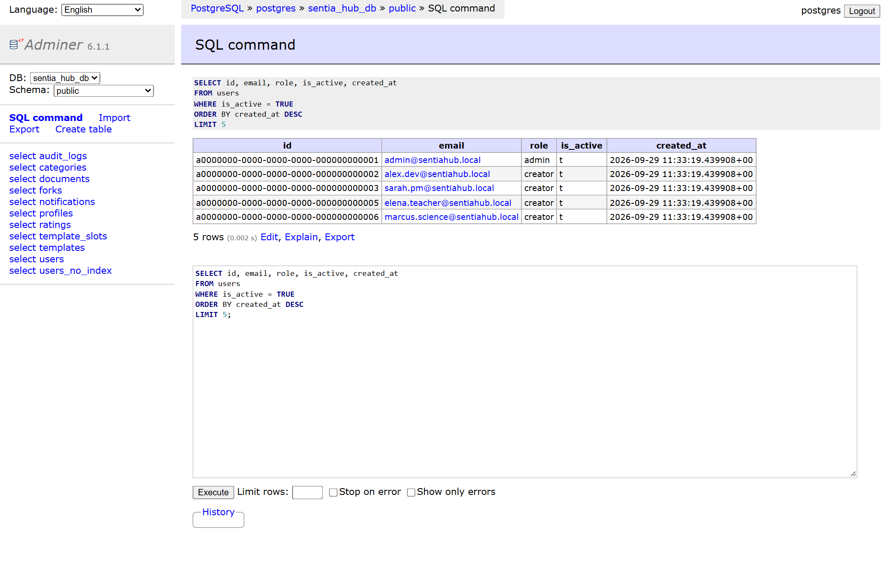
*Hình 2: Truy vấn lấy 5 tài khoản active trên giao diện quản trị Adminer.*

---

#### 1.2.2 INNER JOIN 4 bảng — Thông tin template, tác giả và danh mục

Liên kết bảng `templates`, `profiles` (qua `users`) và `categories` để hiển thị danh sách template chi tiết:
```sql
SELECT
    t.title,
    t.is_public,
    t.rating_avg,
    t.forks_count,
    p.username      AS author,
    c.name          AS category
FROM templates t
INNER JOIN users u      ON t.author_id = u.id
INNER JOIN profiles p   ON p.user_id = u.id
INNER JOIN categories c ON t.category_id = c.id
WHERE t.deleted_at IS NULL
ORDER BY t.created_at DESC
LIMIT 8;
```

**Nhận xét:** Query có 4 bảng và 3 phép JOIN, chỉ trả rows khớp đủ các điều kiện. FK đã bảo vệ tham chiếu tác giả/category; user chưa có profile vẫn có thể hợp lệ nhưng bị loại khỏi kết quả JOIN này.

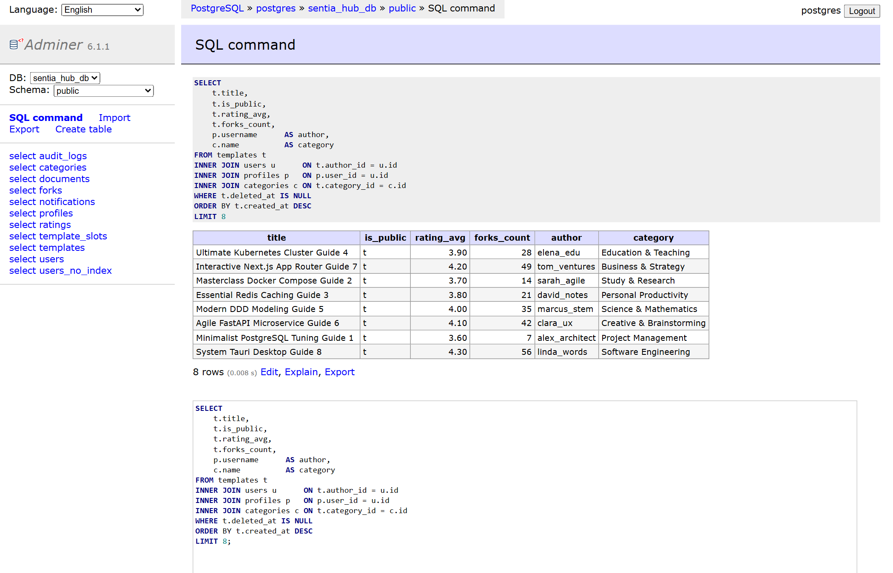
*Hình 3: Kết quả thực thi INNER JOIN hiển thị đầy đủ template kèm tác giả và danh mục.*

---

#### 1.2.3 GROUP BY + Aggregate — Thống kê theo chuyên mục

Tính tổng số lượng, số template công khai, điểm đánh giá trung bình và số lượt fork tối đa cho từng category:
```sql
SELECT
    c.name                                         AS category,
    COUNT(t.id)                                    AS total_templates,
    COUNT(CASE WHEN t.is_public = TRUE THEN 1 END) AS public_count,
    ROUND(AVG(t.rating_avg)::NUMERIC, 2)          AS avg_rating,
    MAX(t.forks_count)                             AS max_forks
FROM categories c
LEFT JOIN templates t ON t.category_id = c.id AND t.deleted_at IS NULL
GROUP BY c.id, c.name
ORDER BY total_templates DESC;
```

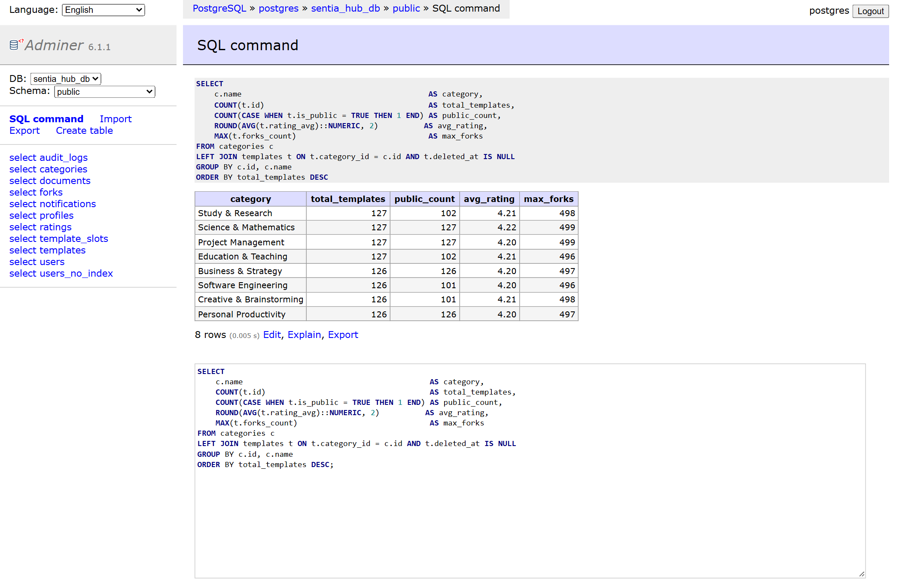
*Hình 4: Tổng hợp dữ liệu theo chuyên mục với các hàm COUNT, AVG, MAX.*

---

#### 1.2.4 HAVING — Lọc tác giả có đóng góp lớn

Lọc ra những creator sở hữu từ 100 templates trở lên:
```sql
SELECT
    p.username,
    p.reputation_score,
    COUNT(t.id) AS template_count
FROM profiles p
JOIN users u     ON p.user_id = u.id
JOIN templates t ON t.author_id = u.id
WHERE t.deleted_at IS NULL
GROUP BY p.id, p.username, p.reputation_score
HAVING COUNT(t.id) >= 100
ORDER BY template_count DESC;
```

**Lưu ý kỹ thuật:** Mệnh đề `WHERE` lọc từng dòng trước khi gom nhóm, trong khi `HAVING` lọc trên kết quả tổng hợp sau khi `GROUP BY` đã hoàn thành.

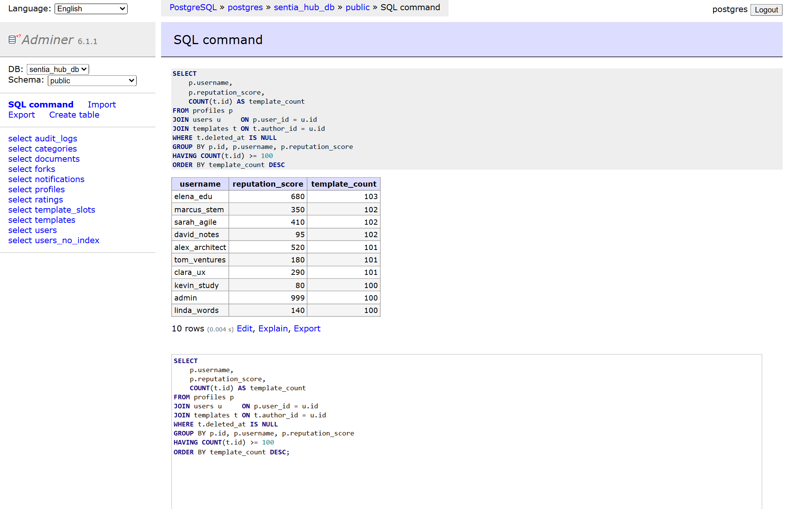
*Hình 5: Lọc các tác giả có từ 100 templates bằng điều kiện HAVING.*

---

### 1.3 Hiệu năng Index — Benchmark thực tế trên 100,000 bản ghi

Script benchmark tạo bản sao dữ liệu bằng `CREATE TABLE AS`, không sao chép constraints/index. Hai ảnh lịch sử dưới đây dùng **hai email khác nhau** và không có ảnh xác nhận số dòng của cả hai bảng tại cùng thời điểm:
1. `users_no_index`: 100,010 bản ghi, không có index trên cột `email`.
2. `users`: Có index B-Tree độc nhất (`users_email_key`) trên cột `email`; kích thước bảng tại lúc chụp ảnh index chưa được xác nhận.

#### Trường hợp 1: Không có Index (Sequential Scan)
```sql
EXPLAIN ANALYZE
SELECT * FROM users_no_index
WHERE email = 'bench_50000@erusentia.test';
```

- **Cơ chế:** `Seq Scan` xét **100,010 rows**: trả 1 row, loại 100,009 rows bởi filter.
- **Thời gian thực thi:** **~7.312 ms**.

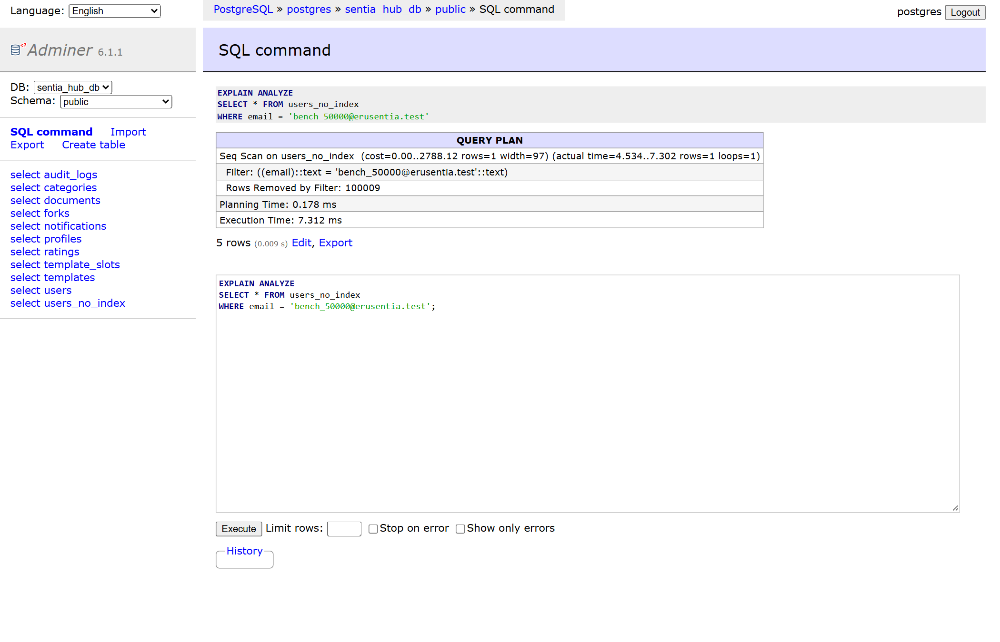
*Hình 6: Execution Plan: Seq Scan trả 1 row, Rows Removed by Filter = 100,009; tổng xét 100,010 rows.*

---

#### Trường hợp 2: Có Index B-Tree (Index Scan)
```sql
EXPLAIN ANALYZE
SELECT * FROM users
WHERE email = 'admin@sentiahub.local';
```

- **Cơ chế:** Tra cứu trực tiếp trên cây chỉ mục B-Tree (`Index Scan`), trả **1 row**; còn đọc các page của index/heap, không suy ra tổng I/O là 1.
- **Thời gian thực thi:** **~0.112 ms**.

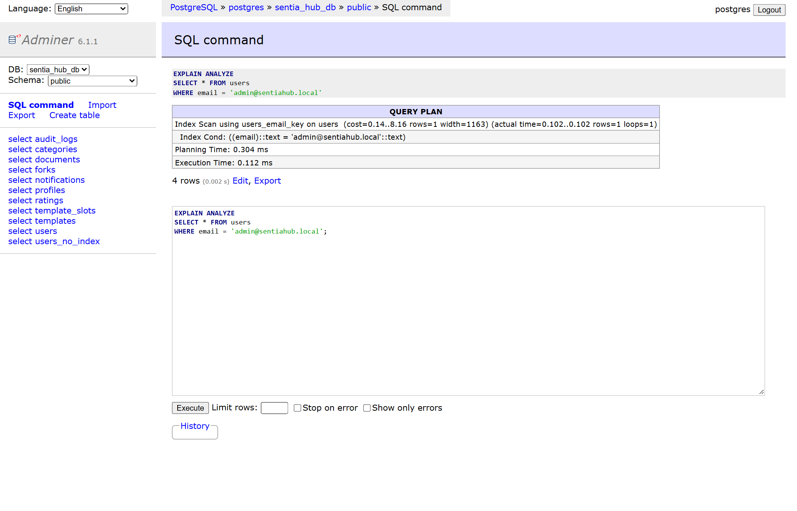
*Hình 7: Execution Plan: Tra cứu B-Tree Index (Index Scan) chỉ trong 0.112 ms.*

---

#### Đối chiếu hai ảnh lịch sử (không phải benchmark có kiểm soát)

| Chỉ số quan sát | Ảnh Seq Scan | Ảnh Index Scan |
|------------------|--------------|----------------|
| Email truy vấn | `bench_50000@erusentia.test` | `admin@sentiahub.local` |
| Kết quả | 1 row; 100,009 rows bị filter | 1 row; không đo tổng page I/O |
| Execution Time | ~7.312 ms | ~0.112 ms |

Tỷ số hai thời gian khoảng 65,3, nhưng không thể quy toàn bộ chênh lệch cho index vì
query/dataset/cache chưa được kiểm soát. B-tree có nhiều nhánh trên một page; không
suy ra số lần đọc bằng `log₂(n)` hoặc kết luận “giảm 100,000 lần I/O”.

Để đo lại: chạy script benchmark trên DB thực hành riêng, xác nhận số dòng hai bảng,
`ANALYZE` cả hai, truy vấn **cùng email** `bench_50000@erusentia.test` và thu
`EXPLAIN (ANALYZE, BUFFERS)` nhiều lần. [Hướng dẫn index](docs/03_index.md#37-thực-hành-benchmark-trên-erusentia)
có câu lệnh đối chiếu. Chưa có ảnh/số đo mới cho protocol này trong báo cáo.

---

### 1.4 Phân trang (Pagination)

#### Offset-based cơ bản
```sql
SELECT id, title, created_at FROM templates
WHERE deleted_at IS NULL
ORDER BY created_at DESC, id DESC
LIMIT 5 OFFSET 0;
```

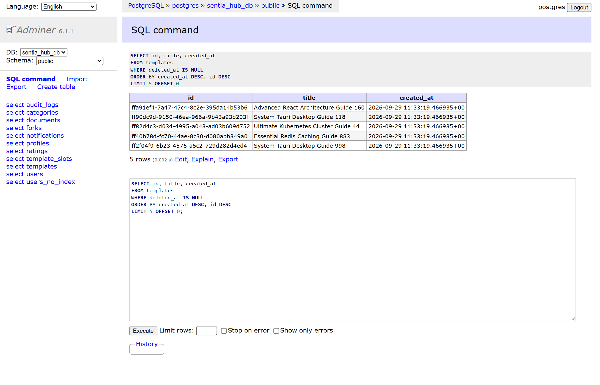
*Hình 8: Lấy dữ liệu phân trang trang đầu tiên.*

---

#### Điểm nghẽn khi OFFSET lớn (Deep Paging)
```sql
EXPLAIN ANALYZE
SELECT id, title, created_at FROM templates
WHERE deleted_at IS NULL
ORDER BY created_at DESC, id DESC
LIMIT 5 OFFSET 500;
```

**Đánh giá:**
Ở `OFFSET 500`, node Limit cần nhận ít nhất 505 rows nếu đủ kết quả rồi bỏ 500 rows đầu. Scan/Sort phía dưới có thể xử lý nhiều hơn; Sort không bắt buộc nếu có index khớp ORDER BY. Với hệ thống lớn, giải pháp tối ưu là chuyển sang **Cursor-based pagination** (`WHERE (created_at, id) < (cursor_created_at, cursor_id) LIMIT N`).

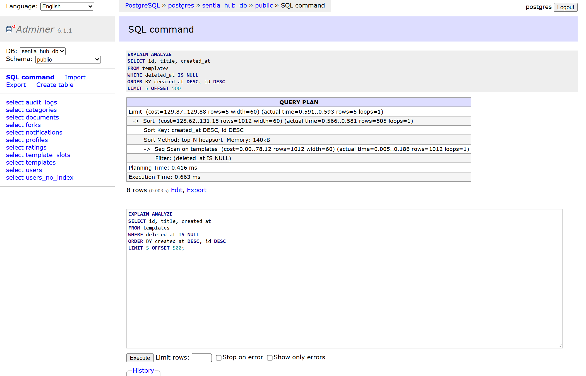
*Hình 9: EXPLAIN ANALYZE minh họa việc DB phải duyệt qua 505 dòng trước khi cắt kết quả.*

---

### 1.5 Cơ chế Locking trong CSDL

Tạo bảng `template_slots` mô phỏng số lượng slot giới hạn:
```sql
CREATE TABLE template_slots (
    id SERIAL PRIMARY KEY,
    name VARCHAR(100),
    slots INT NOT NULL DEFAULT 0,
    version INT NOT NULL DEFAULT 0,
    updated_at TIMESTAMPTZ DEFAULT NOW()
);
INSERT INTO template_slots (id, name, slots, version) VALUES (1, 'Limited Edition AI Pack', 1, 0);
INSERT INTO template_slots (id, name, slots, version) VALUES (2, 'Pro React Bundle', 10, 0);
```

#### 1.5.1 Pessimistic Lock (Khóa bi quan với SELECT FOR UPDATE)
Thích hợp cho giao dịch tài chính, giữ chỗ, bán vé có tỷ lệ xung đột cao:
```sql
BEGIN;
SELECT id, name, slots, version FROM template_slots WHERE id = 1 FOR UPDATE;
UPDATE template_slots SET slots = slots - 1, version = version + 1 WHERE id = 1;
COMMIT;
SELECT id, name, slots, version FROM template_slots WHERE id = 1;
```

- Transaction chiếm giữ row lock độc quyền.
- Slot được trừ từ 1 xuống 0, version tăng lên 1 trong transaction. Ảnh ghi lại một session; cần demo hai session theo hướng dẫn để quan sát blocking. Ứng dụng vẫn phải kiểm tra slot còn trước khi trừ.

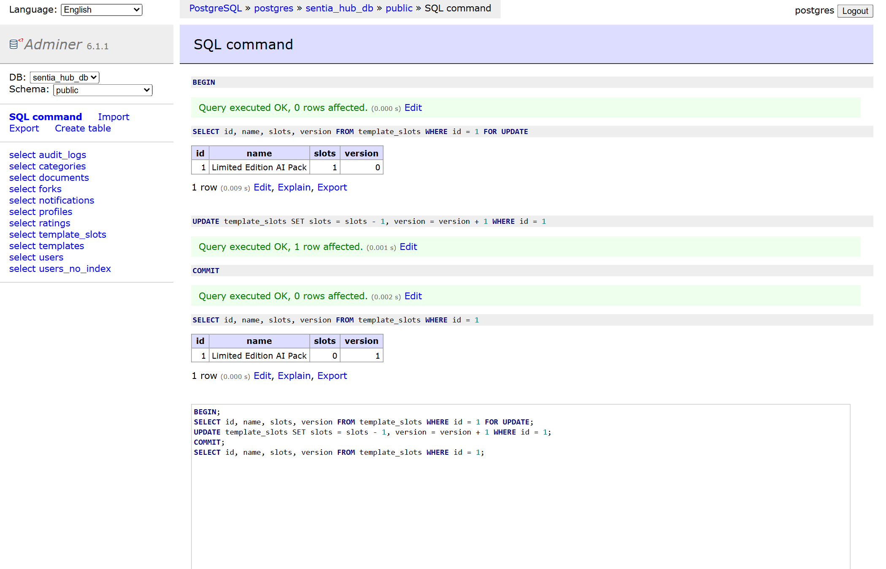
*Hình 10: Khóa bi quan với `FOR UPDATE` bảo vệ toàn vẹn tài nguyên.*

---

#### 1.5.2 Optimistic Lock (Khóa lạc quan với Version Column)
Thích hợp cho hệ thống đọc nhiều, tỷ lệ xung đột thấp:
```sql
SELECT id, name, slots, version FROM template_slots WHERE id = 2;
-- Chủ động thử một version không khớp (999); không chứng minh có session đồng thời:
UPDATE template_slots SET slots = 8, version = version + 1 WHERE id = 2 AND version = 999;
SELECT id, name, slots, version FROM template_slots WHERE id = 2;
```

- Câu lệnh trả về `0 rows affected` vì điều kiện version không khớp.
- Ảnh chứng minh điều kiện version không khớp thì không cập nhật; chưa chứng minh luồng cạnh tranh giữa hai session hoặc retry trong ứng dụng.
- Optimistic lock vẫn lấy row lock khi UPDATE và có thể deadlock. [Hướng dẫn hai terminal](docs/05_locking.md) bổ sung các bước tái hiện; ảnh cũ không được coi là bằng chứng đã chạy hai terminal.

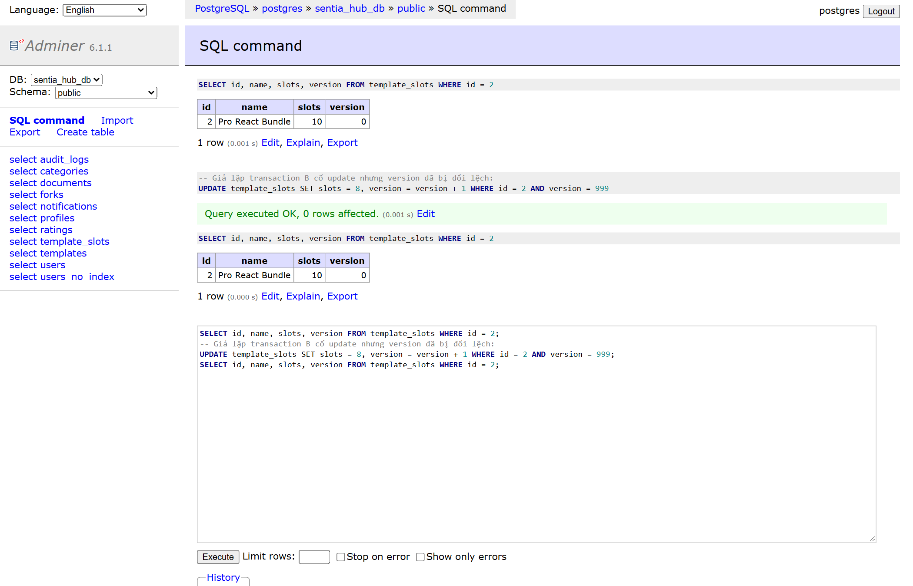
*Hình 11: Khóa lạc quan phát hiện xung đột phiên bản, ngăn chặn ghi đè.*

---

### 1.6 Toàn vẹn giao dịch (ACID) & Savepoint

```sql
BEGIN;
UPDATE users SET is_active = TRUE WHERE id = 'a0000000-0000-0000-0000-000000000004';
SAVEPOINT profile_point;
UPDATE profiles SET reputation_score = reputation_score + 1000 WHERE user_id = 'a0000000-0000-0000-0000-000000000004';
ROLLBACK TO SAVEPOINT profile_point;
COMMIT;
SELECT u.email, u.is_active, p.reputation_score
FROM users u
JOIN profiles p ON p.user_id = u.id
WHERE u.id = 'a0000000-0000-0000-0000-000000000004';
```

**Phân tích tính chất ACID:**
- **Atomicity:** Toàn bộ lệnh trong transaction hoặc thành công hoặc bị rollback. Điểm savepoint cho phép rollback từng phần.
- **Consistency:** DB bảo vệ constraints đã khai báo; ứng dụng phải kiểm tra các quy tắc nghiệp vụ còn lại.
- **Isolation:** SELECT thường ở READ COMMITTED không thấy row chưa commit của session khác; các lần đọc có thể khác snapshot, và các lệnh ghi có thể chờ lock.
- **Durability:** Với cấu hình bền vững mặc định, WAL được flush trước khi xác nhận commit; ảnh savepoint không phải thử nghiệm crash recovery.

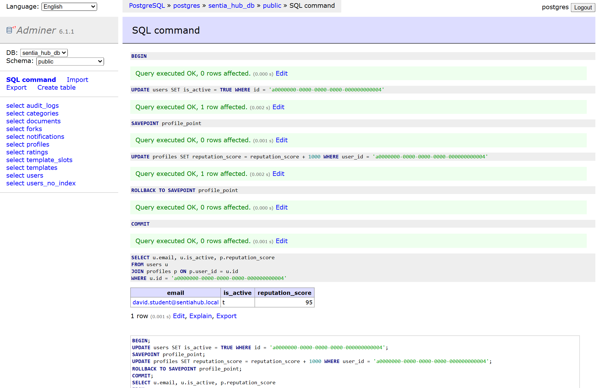
*Hình 12: Thao tác Savepoint hủy bỏ lệnh cộng điểm thưởng nhưng bảo toàn lệnh active tài khoản.*

---

## PHẦN 2: LẬP TRÌNH HƯỚNG ĐỐI TƯỢNG (OOP)

**Mã nguồn:** [Demo OOP trong backend](https://github.com/Tunhoclaptrinh/EruSentia-Server/blob/b851e1576ae48fe62efcec10dd2d912e011a6220/src/week01-practice/oop/demo.ts)

### Kiểm chứng mã nguồn
```
$ pnpm demo:oop  # Chạy từ repo EruSentia-Server
```

**Kết quả Console Output:**
```
============================================================
OOP Demo — EruSentia Domain Objects
============================================================

📦 1. ENCAPSULATION
  Created user: tientuan@email.com (normalized from input)
  ✅ Email changed to: tientuan.dev@erusentia.com
  ✅ User promoted to creator
  Role: creator
  🚫 Expected error: Already creator

🧬 2. INHERITANCE
  Template(id=t-001, title="React Dashboard Starter Kit", public=false)
  ✅ Template "React Dashboard Starter Kit" published
  Template(id=t-001, title="React Dashboard Starter Kit", public=true)
  ✅ Reputation: +10 → total: 10
  ✅ Reputation: +5 → total: 15

🔀 3. POLYMORPHISM
  📧 [Email] → user:u-001: Your template "React Dashboard Starter Kit" has been published!
  🔔 [In-App] → user:u-001: Your template "React Dashboard Starter Kit" has been publish...

🎭 4. ABSTRACTION
  Validating "  bad title  " (with spaces):
  ❌ Error: Title has leading/trailing spaces
  Validating "React Dashboard Starter Kit":
  ✅ Validation passed

============================================================
✅ All OOP demos completed successfully!
```

### Vận dụng 4 tính chất OOP vào hệ thống
1. **Encapsulation (Đóng gói):** 
   - Đặt các thuộc tính `email`, `role` ở chế độ `private`. 
   - Mọi thay đổi trạng thái phải thông qua các phương thức nghiệp vụ (`changeEmail()`, `promoteToCreator()`) có kèm kiểm tra hợp lệ.
2. **Inheritance (Kế thừa):**
   - Class `BaseEntity` định nghĩa các thuộc tính và hành vi dùng chung (`id`, `createdAt`, `updatedAt`, `touch()`).
   - `Template`, `Profile`, `User` kế thừa từ `BaseEntity`, giúp code gọn gàng, tái sử dụng cao.
3. **Polymorphism (Đa hình):**
   - Định nghĩa interface `Notifiable` với phương thức `notify()`.
   - Các kênh thông báo (`EmailNotifier`, `InAppNotifier`) triển khai phương thức này theo cơ chế riêng. Hàm gửi tin chỉ nhận vào mảng `Notifiable[]`.
4. **Abstraction (Trừu tượng):**
   - Sử dụng Abstract Class `ContentValidator` kết hợp Template Method Pattern. Khung kiểm tra được chuẩn hóa, lớp con chỉ cần bổ sung quy tắc cụ thể qua `getErrors()`.

---

## PHẦN 3: DEPENDENCY INJECTION (DI) & IoC

**Mã nguồn:** [Demo DI trong backend](https://github.com/Tunhoclaptrinh/EruSentia-Server/blob/b851e1576ae48fe62efcec10dd2d912e011a6220/src/week01-practice/di/demo.ts)

### Kiểm chứng mã nguồn
```
$ pnpm demo:di  # Chạy từ repo EruSentia-Server
```

**Kết quả Console Output:**
```
============================================================
DI & IoC Demo — EruSentia
============================================================

🔌 1. Production DI (PostgresRepository injected)
    [Postgres] findById(u-001)
  Result: {"id":"u-001","email":"u-001@db.com","role":"user"}

🧪 2. Testing DI (InMemoryRepository injected — no DB needed!)
    [InMemory] save(tientuan@test.com)
    [InMemory] findById(test-1) → tientuan@test.com
  Result: {"id":"test-1","email":"tientuan@test.com","role":"creator"}

❌ 3. Error case: user not found
    [InMemory] findById(non-existent) → null
  Expected error: User non-existent not found

📦 4. DI Container (auto wiring)
    [InMemory] save(alex@erusentia.com)
  Registered via container: {"id":"u-1791042510978","email":"alex@erusentia.com","role":"user"}
  Singleton check: same instance = true

============================================================
✅ DI & IoC demos completed!
```

### Kiến trúc giải pháp

Repository tên Postgres trong demo là **stub trả dữ liệu giả**, không kết nối PostgreSQL; nhãn “Production” trong output lịch sử không chứng minh triển khai production.
- **Tight Coupling:** Service tự `new PostgresUserRepository()` gắn service với implementation cụ thể. Nếu implementation kết nối DB thật thì test phụ thuộc DB; stub hiện tại không có phụ thuộc mạng.
- **Dependency Injection:** Tách rời khởi tạo và sử dụng. `UserService` nhận interface `IUserRepository` qua constructor. Khi chạy kiểm thử tự động, dễ dàng đưa `InMemoryUserRepository` vào mà không cần kết nối mạng hay Docker.
- **IoC Container:** Demo chỉ đăng ký factory/singleton và wiring thủ công; không tự phân tích constructor, chưa có scope/cycle detection đầy đủ như NestJS. NestJS minh họa cơ chế liên quan qua `@Injectable()` và `@Module()`.

---

## 📊 Tổng kết

| Tiêu chí | Trạng thái | Ghi chú |
|---|---|---|
| Môi trường Docker | Hoàn thành | PostgreSQL 16 & Adminer hoạt động ổn định |
| Thiết kế CSDL & Seed dữ liệu | Hoàn thành | 9 bảng nghiệp vụ + 2 bảng lab trong ảnh; 1,012 templates mẫu |
| SQL Queries (JOIN, GROUP BY, HAVING) | Hoàn thành | Đầy đủ 4 truy vấn mẫu cùng kết quả chụp thực tế |
| Đo kiểm hiệu năng Index | Hoàn thành | Hai plan lịch sử; cần đo lại cùng query/dataset để kết luận mức tăng tốc |
| Kỹ thuật phân trang & Điểm nghẽn | Hoàn thành | Phân tích chi tiết Offset Scan vs Cursor Paging |
| Cơ chế Locking | Hoàn thành | Có ảnh một session và version không khớp; hướng dẫn hai session bổ sung, chưa có ảnh đồng thời |
| Giao dịch ACID & Savepoint | Hoàn thành | Ảnh chứng minh rollback về savepoint; chưa kiểm chứng đầy đủ isolation/durability |
| Demo 4 tính chất OOP | Hoàn thành | Mã nguồn TypeScript chạy hoàn chỉnh |
| Demo DI Container | Hoàn thành | Chuyển đổi thành công từ Tight Coupling sang DI Container |

## Phạm vi đáp ứng đề bài

Lý thuyết có đủ 8 chuyên đề; SQL/seed và demo OOP/DI có mã thực thi trong backend.
Phần OOP/DI được vận dụng bằng TypeScript, đối chiếu NestJS; đây là điều chỉnh theo stack
EruSentia, không phải bằng chứng đã làm bài Java thuần/Spring trong đề gốc. Nếu yêu cầu
chấm bắt buộc Java/Spring thì phần đó còn cần bổ sung. Bằng chứng khóa đồng thời hai session
và benchmark có kiểm soát còn thiếu ảnh mới; các hướng dẫn hiện có giúp tái hiện, không thay
thế bằng chứng chạy thực tế. Tuần 1 chưa có HTTP API, NestJS module, ORM hoặc Redis adapter.
