# 09 — Cấu hình và thực hành Postman ở Local mode

Kiểm chứng ngày 03/11/2026, Postman Desktop Linux **12.35.1**. Bộ ảnh là ảnh chụp
nguyên bản của ứng dụng đang chạy, cùng bố cục 1600 × 1000. Collection và environment
ở **Native Git Local mode**; không import lên Cloud, không Push/Share hoặc công bố tài liệu.

Đây là hướng dẫn tái hiện bộ minh chứng đã ghi nhận. Phiên Postman, thư mục demo và
API/database test tạm đã được dọn; các lệnh bên dưới tạo lại tài nguyên thực hành.
Server hiện có Swagger UI tại `/docs` và OpenAPI JSON tại `/docs-json` để tiếp tục
thực hành mà không cần Postman. Bộ ảnh dưới ghi lại lượt kiểm chứng Postman trước đó.

## 1. Chuẩn bị Postman và API

Muốn thao tác Desktop, tải từ [Postman chính thức](https://www.postman.com/downloads/).
Ubuntu hỗ trợ `sudo snap install postman`; mở ứng dụng bằng tài khoản thường.
Lần chụp dùng portable, không cài Snap thường trực. Native Git Local mode cần đăng
nhập, nhưng đăng nhập không đồng nghĩa phải đưa file dự án lên Cloud: nội dung local
chỉ được đồng bộ khi chủ động Push. [Tài liệu local mode](https://learning.postman.com/docs/use/native-git/setup).

Mã server và tests nằm trong repo erusentia-server, không cài backend thứ hai ở TYP.
Chạy thử không cần DB trong thư mục server:

```bash
TEMPLATE_STORE=memory HOST=127.0.0.1 PORT=3001 pnpm dev
```

Bộ ảnh dùng PostgreSQL và database riêng `week2_test_20261103_postman_clean`, được
chuẩn bị từ SQL hiện có. Để tái hiện ORM, chuẩn bị DB test/schema/seed theo README
server, đặt DB_DATABASE rõ ràng, rồi chạy:

```bash
TEMPLATE_STORE=postgres HOST=127.0.0.1 PORT=3001 \
DB_DATABASE=week2_test_local pnpm dev
```

Các DB_HOST/DB_PORT/DB_USERNAME/DB_PASSWORD còn lại lấy từ .env hoặc environment theo
README server. Không reset DB nghiệp vụ. Chỉ chạy một mode trên cùng cổng; kiểm tra
terminal thực sự báo listen ở 127.0.0.1:3001 trước khi bấm Send.

## 2. Tạo bản collection local để mở trong Postman 12

Nguồn chuẩn trong server:

- `tools/postman/templates.postman_collection.json`: v2.1, 12 request/30 assertion.
- `tools/postman/erusentia-local.postman_environment.json`: chỉ có baseUrl localhost.
- `tools/postman/prepare-local.cjs`: tạo bản v3 tương đương cho Native Git Local mode.

Trong thư mục server, chạy:

```bash
node tools/postman/prepare-local.cjs
# Hoặc dùng một thư mục mới do bạn chọn
node tools/postman/prepare-local.cjs /tmp/eru-week2-postman-another
```

Lệnh in đường dẫn vừa tạo; mặc định Ubuntu là `/tmp/eru-week2-postman-local`.
Nếu thư mục đã có dữ liệu, script dừng và giữ nguyên; mở lại thư mục đó hoặc chọn
đường dẫn mới khi muốn tạo lại từ source. Script không cần dependency, không gọi
mạng, không khởi tạo Git repo hoặc tạo binding Cloud. JSON-compatible YAML của bản
sinh ra vẫn là YAML 1.2; không chỉnh riêng hai bản collection bằng tay.

Trong Postman:

1. Chọn **Local Files → Open Folder**, chọn đúng đường dẫn lệnh đã in.
2. Trong cửa sổ chọn thư mục Ubuntu, có thể nhấn **Ctrl+L**, dán đường dẫn, Enter,
   rồi Open/Select. Thư mục /tmp nằm ngoài project; đây là thư mục demo trên máy.
3. Sau khi mở, chọn **Local Items** (biểu tượng khối ở sidebar), không phải tiếp tục
   mở file YAML bằng text editor trong Local Files.
4. Kiểm tra góc dưới trái có **Local mode**; danh sách chỉ có collection/environment
   EruSentia demo. Không chọn Push to Cloud hoặc dùng AI để đọc/gửi nội dung dự án.
5. Trước khi gửi request, vào **App settings → AI**, tắt **Control AI-powered
   features within Postman**. Tùy chọn này đã được tắt ở cuối phiên chụp minh chứng.

Local mode nói về nơi quản lý file và việc Push tài nguyên; không có nghĩa toàn bộ
ứng dụng đã ngắt mạng. Postman vẫn đăng nhập và có các tính năng mạng/AI riêng.

Thư mục /tmp có thể được dọn khi reboot. Có thể truyền đường dẫn local lâu dài vào
script nếu muốn giữ bộ thực hành. File sinh ra là bản local, không cần commit thêm
các file đó vào TYP hoặc lưu bản sao thủ công của từng request.

## 3. Collection variables: các biến dùng chung

Mở **EruSentia Week 2 — Templates (local) → Variables**.

| Biến | Giá trị / mục đích |
|---|---|
| baseUrl | http://127.0.0.1:3001, không thêm /templates hoặc dấu / cuối |
| authorId | a0000000-0000-0000-0000-000000000002, author seed |
| categoryId | c0000000-0000-0000-0000-000000000001, category seed |
| templateId | Để trống ban đầu; POST lưu UUID mới từ response |
| runSlug | Để trống ban đầu; pre-request của POST sinh UUID để tách lần chạy |

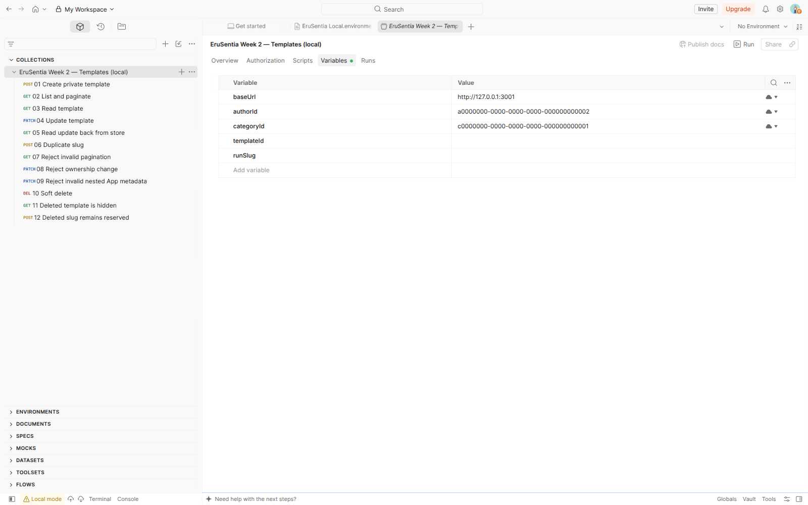

Không dùng ID chụp trong báo cáo làm fixture. Khi chạy lần mới, request đầu tự tạo
slug mới và thay templateId. authorId/categoryId là tham chiếu SQL, chưa phải danh
tính người dùng được xác thực (auth thuộc tuần 3).

## 4. Chọn environment và cấu hình baseUrl

Ở selector trên bên phải, chọn **EruSentia Local PostgreSQL**:

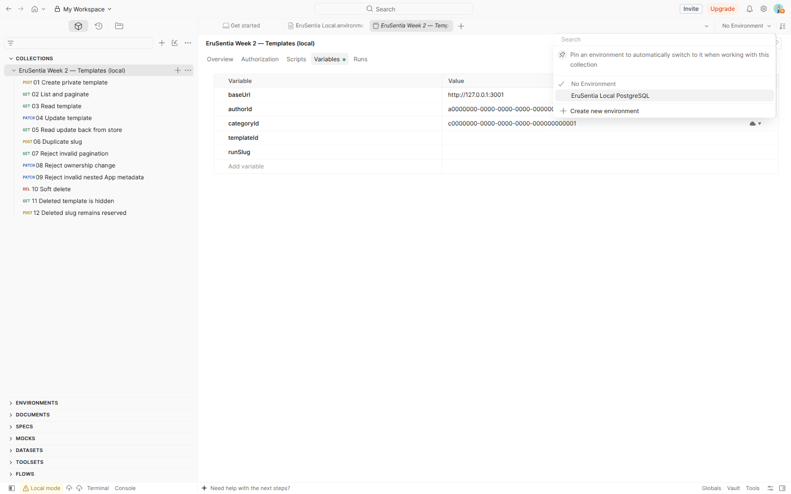

Mở **Environments → EruSentia Local PostgreSQL** trong sidebar. Bảng cần có:

| Variable | Value |
|---|---|
| baseUrl | http://127.0.0.1:3001 |

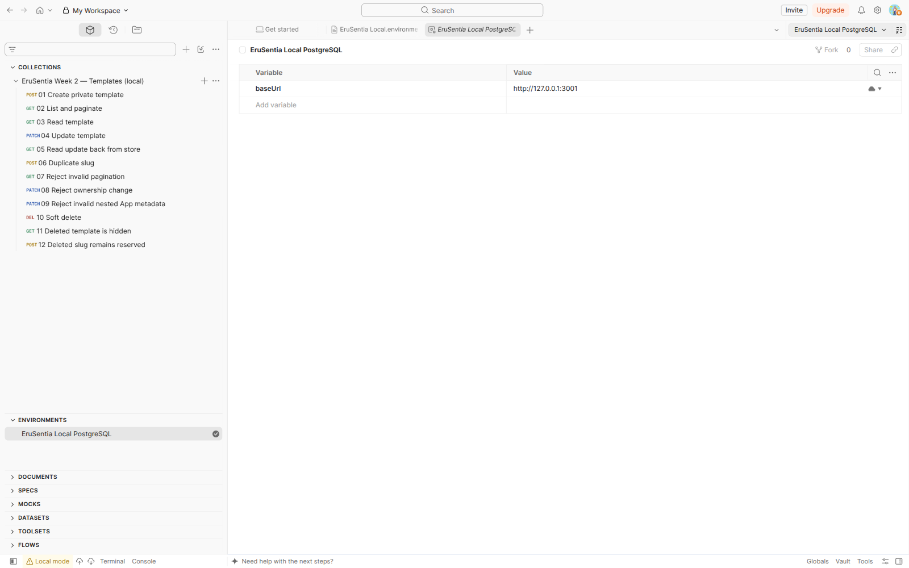

Bấm vào ô Value để chỉnh địa chỉ; ảnh tiếp theo cho thấy editor giá trị đang mở.
Nếu server chạy cổng 3002, đổi giá trị thành http://127.0.0.1:3002. Sau khi chỉnh,
bấm ra ngoài ô và kiểm tra environment đang được chọn vẫn đúng.

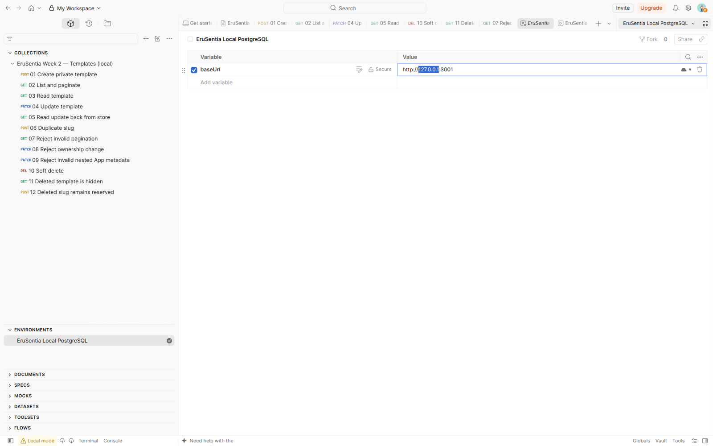

Environment cùng tên biến được ưu tiên hơn collection variable. Chỉ để baseUrl ở
environment; authorId/categoryId vẫn dùng giá trị collection. Nếu để No Environment,
baseUrl fallback về collection; vì vậy phải nhìn selector và tooltip thay vì chỉ
thấy request thành công rồi cho rằng đã dùng đúng environment.
Nguồn: [Postman variable scopes](https://learning.postman.com/docs/use/send-requests/variables/variables/).

## 5. Kiểm tra URL được phân giải trước khi gửi

Mở request **01 Create private template**, URL là `{{baseUrl}}/templates`.
Hover vào `{{baseUrl}}`: tooltip phải hiện **http://127.0.0.1:3001** và scope
**Environment**. Đây là bước kiểm tra cấu hình đã thực sự được áp dụng:

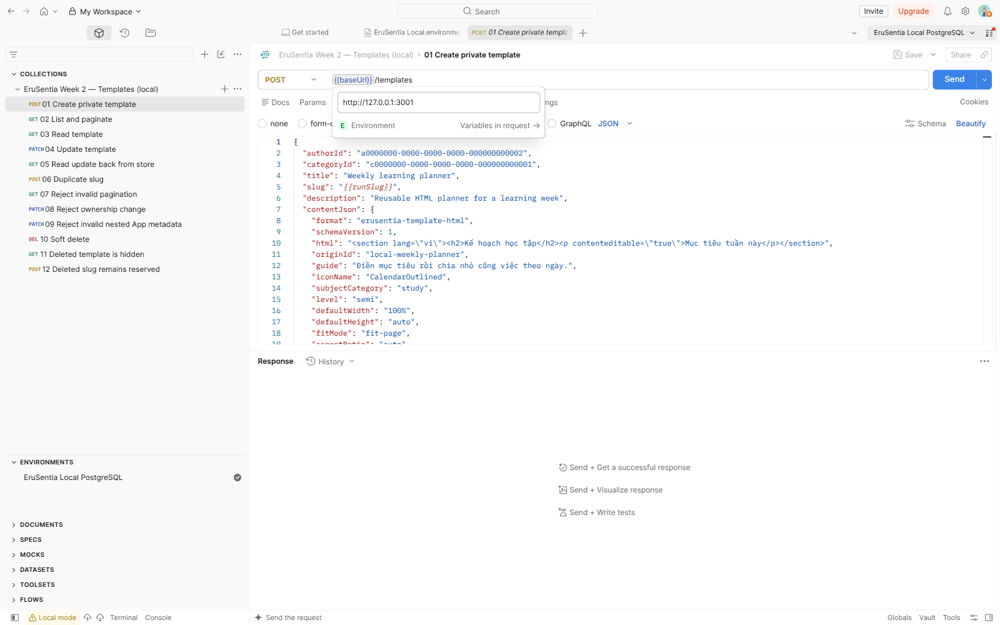

Body chọn raw → JSON; Content-Type là application/json. Giữ boolean false là JSON
boolean, không phải chuỗi "false". Payload demo có HTML envelope/metadata tương ứng
App hiện tại, không sao chép HTML riêng của sản phẩm. App vẫn chưa gọi API.

## 6. Chuỗi thao tác gửi request thật

Các ảnh dưới thuộc một lần thao tác thủ công, bản ghi UUID
`6de7fe79-f8f9-4801-844b-fe66b49881ab`. Biến templateId được POST điền tự động.
Ảnh giữ URL dạng biến đúng cách dùng Postman; ID và timestamp là bằng chứng của
lần chạy, không phải dữ liệu cố định để chạy lại. Thời gian hiển thị không phải benchmark.

### Tạo mới: 01 Create private template → Send

POST trả 201 Created, UUID mới và contentJson. Body/response được giữ nguyên trong ảnh.

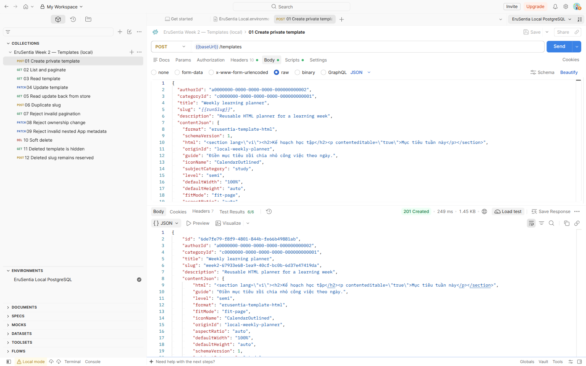

### Danh sách: 02 List and paginate → Send

GET dùng page=1, size=5 và tag={{runSlug}} để chỉ lấy dữ liệu của lần chạy. Response
có data/page/size/totalPages/totalElements. Trong ảnh, mảng data được thu gọn bằng
chức năng JSON viewer để thấy rõ metadata; response không bị chỉnh sửa.

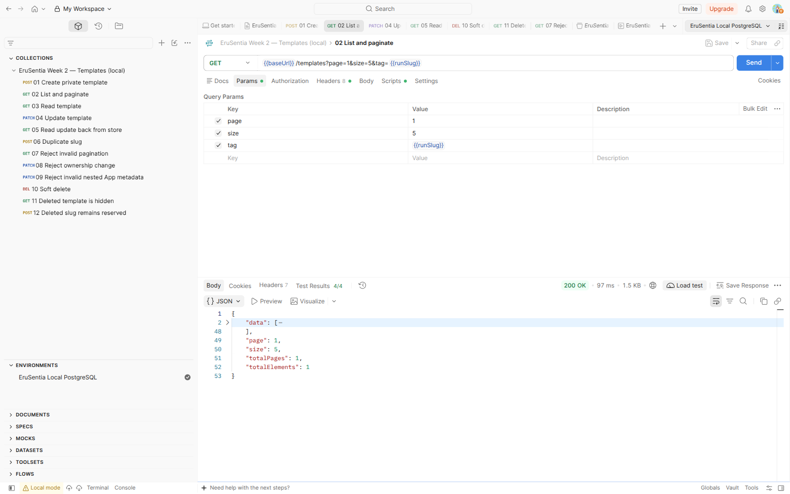

### Cập nhật: 04 Update template → Send

PATCH trả 200 với title mới và HTML/metadata mới. contentJson được thay cả envelope.

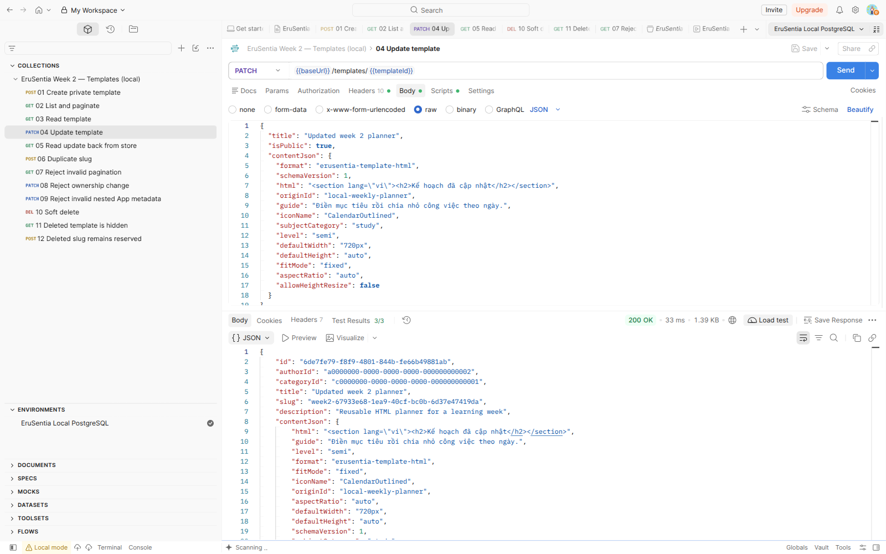

Gửi tiếp **05 Read update back from store** để kiểm tra dữ liệu đã lưu, không chỉ
nhìn response PATCH. Title đã đổi và description vẫn được giữ.

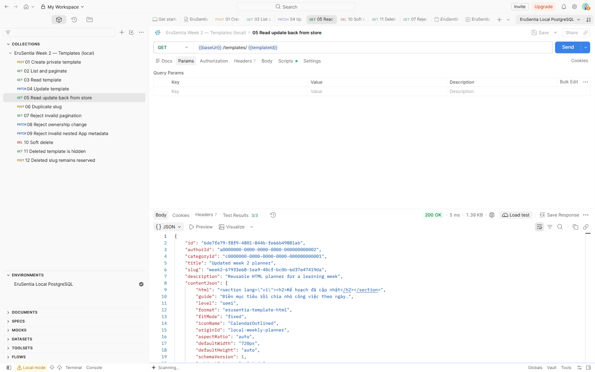

### Xóa: 10 Soft delete → Send

DELETE trả 204, response body rỗng. DB vẫn có physical row với deleted_at đã đặt.

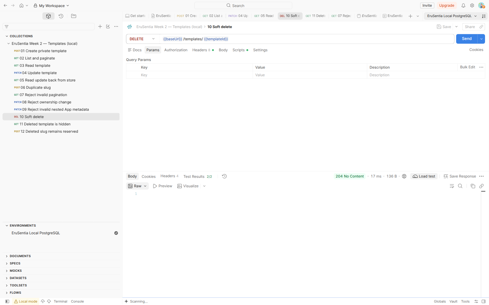

### Đọc lại: 11 Deleted template is hidden → Send

GET cùng templateId trả 404 NOT_FOUND sau khi xóa.

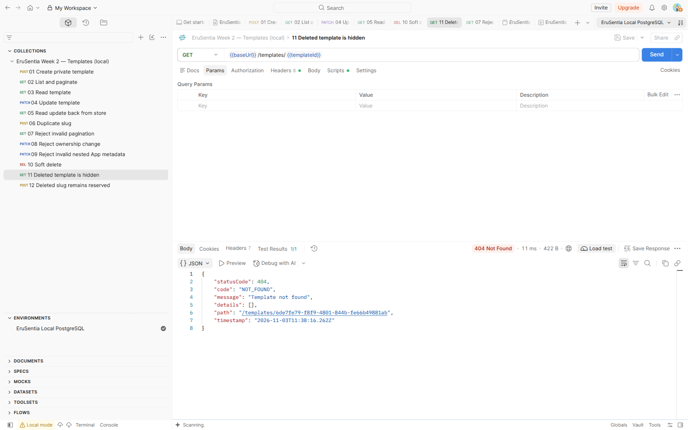

### Validation: 07 Reject invalid pagination → Send

page=0 và size=999 trả 400 cùng details đúng quy tắc validation.

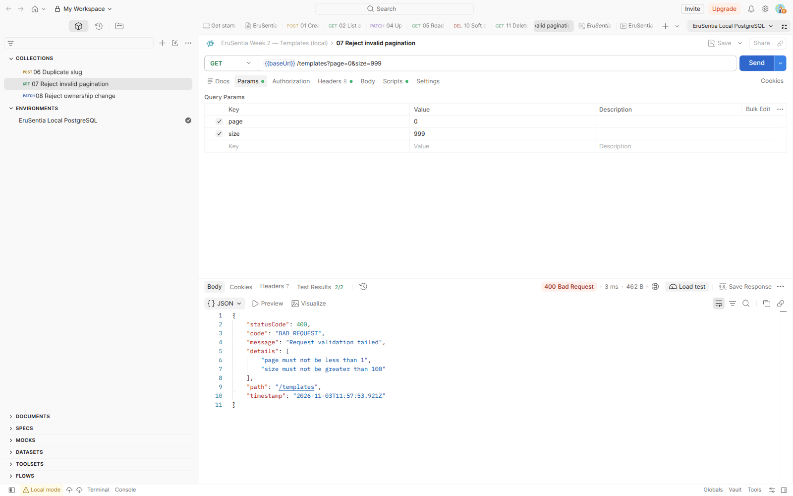

## 7. Xem assertion của từng request

Sau POST, chọn **Test Results** ở phần Response. Sáu assertion của request tạo mới
đã PASS, gồm status, boolean false, category, bảo toàn HTML/metadata và views_count=0.

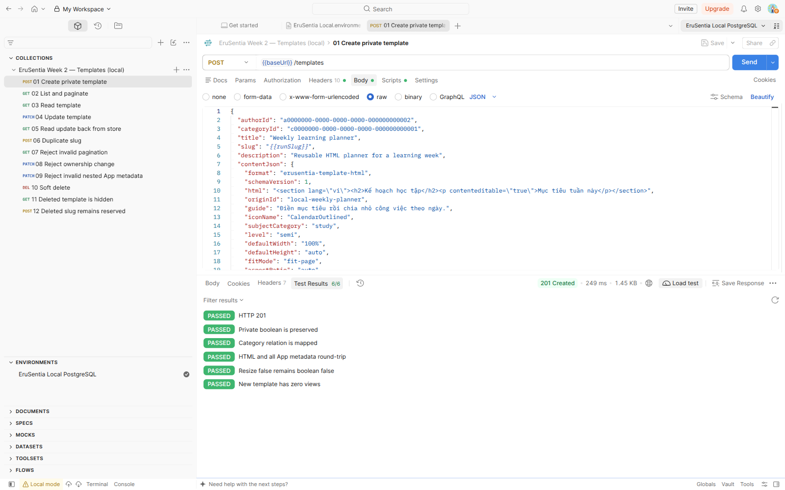

Script nằm ở **Scripts → Post-response**. Ví dụ rút gọn:

```javascript
pm.test("HTTP 201", () => pm.response.to.have.status(201));
const body = pm.response.json();
pm.collectionVariables.set("templateId", body.id);
pm.test("Boolean false is preserved", () => pm.expect(body.isPublic).to.eql(false));
```

Nguồn script thực thi là collection trong server; bản v3 giữ nguyên code trước/sau
request và body từ bản v2.1. Không chỉ kiểm tra status rồi bỏ qua dữ liệu trả về.

## 8. Chạy cả collection bằng Runner local

Mở collection, chọn **Run**:

1. Giữ đúng environment EruSentia Local PostgreSQL.
2. Chọn đủ **12 of 12** request theo thứ tự 01 → 12.
3. Run type = **Functional**, Run method = **Local**, Iterations = **1**.
4. Chọn **Start run**. Không chọn Postman CLI/CI/CD hoặc Push/Share.

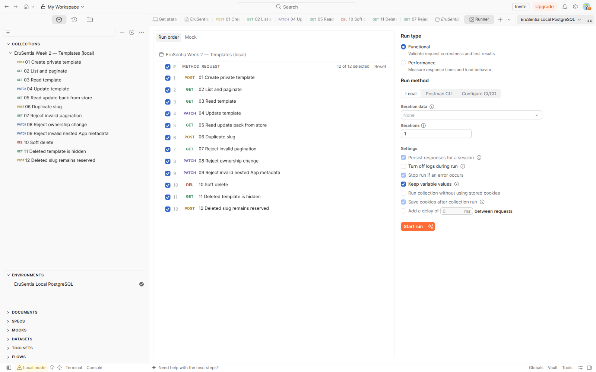

Kết quả thực tế: **30 assertion PASS, 0 FAIL, 0 ERROR**, trên 12 request. Grid hiển
thị số pass/fail theo từng request, mỗi ô xanh là kết quả của iteration duy nhất.

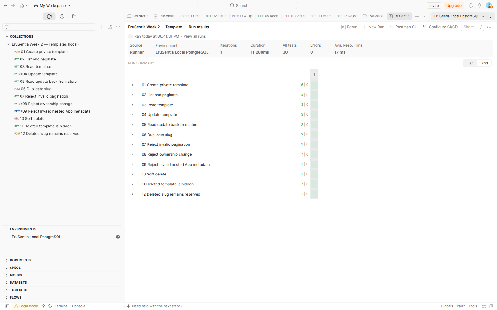

Run này tự tạo bản ghi khác với chuỗi thủ công: UUID
`a67237e4-00d8-4ad5-96e2-b2d9a6ab6414`, rồi soft-delete ở request 10. Các tình huống
400/404/409 là kết quả mong đợi, không phải FAIL nếu assertion tương ứng đạt.

| Nhóm request | Điều kiểm chứng |
|---|---|
| 01–03 | Tạo/đọc, relation projection, page envelope, HTML và false |
| 04–05 | PATCH, thay cả contentJson, đọc lại từ store |
| 06 | Slug trùng trả 409 CONFLICT |
| 07–09 | Query sai, ownership field và nested metadata không hợp lệ |
| 10–12 | 204 body rỗng, 404 sau xóa, slug đã xóa còn được giữ |

Không chạy từ giữa collection nếu chưa tạo templateId. Nếu dừng trước DELETE,
row demo có thể còn; dùng DB riêng và xem kết quả từng request trước lần chạy mới.

## 9. Chạy lại không cần Desktop

Có thể dùng collection v2.1 và environment JSON bằng Newman local, không đăng nhập
CLI hoặc gửi kết quả lên Cloud:

```bash
# Trong thư mục server; API cần đang chạy
pnpm dlx newman@6.2.3 run tools/postman/templates.postman_collection.json \
  -e tools/postman/erusentia-local.postman_environment.json --bail
```

Đã kiểm chứng trước đó 12 request/30 assertion trên cả memory và PostgreSQL. Newman
chỉ chạy v2.1, không chạy bản v3 Native Git. Theo [Postman](https://learning.postman.com/docs/reference/newman-cli/command-line-integration-with-newman/),
Newman không còn nhận cập nhật; phần này giữ command tái hiện đã kiểm chứng, không
cài global hoặc thay format nguồn chính. GUI Runner local và Newman CLI là hai
lượt kiểm chứng riêng.

[Mã nguồn và snapshot](../SOURCE_SNAPSHOT.md) · [Báo cáo và đối chiếu SQL](../WEEK2_REPORT.md).
