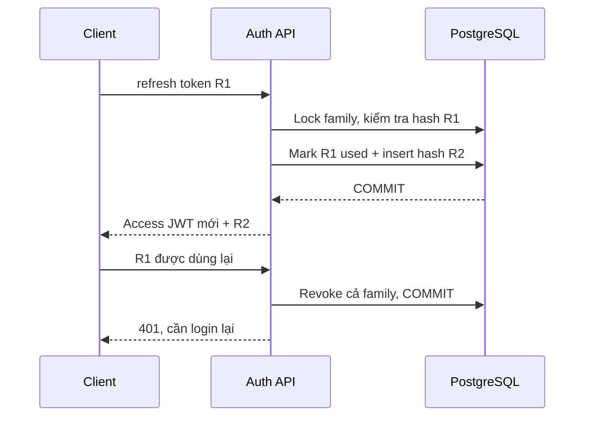

# 06 — Refresh token, rotation, replay và logout

## Vì sao có hai loại token?

Access JWT sống 15 phút để giới hạn thời gian sử dụng. Refresh token cho phép lấy
access token mới mà không gửi password cho mỗi lần hết hạn. Refresh sống lâu hơn
nên cần kiểm tra trạng thái, thu hồi và xử lý replay; không phải JWT dài hạn vô điều kiện.

Ở bài này refresh là 32 byte ngẫu nhiên base64url, dài 43 ký tự. Chỉ SHA-256 hex của
nó được lưu trong DB. Token đủ entropy khác password do con người chọn; lookup
bằng hash nhanh trong trường hợp này không thay thế Argon2id cho password.

## Dữ liệu phiên

Mỗi login tạo một family mới trong auth_refresh_sessions. Các row có id, user_id,
family_id, token_hash, expires_at, used_at, revoked_at và created_at. Một lần refresh
thêm row thế hệ mới, giữ family và thời hạn tuyệt đối 7 ngày của login ban đầu.
Token cũ được đánh dấu used, không xóa ngay để còn phát hiện replay.

## Transaction và concurrency

PostgresAuthStore lấy transaction advisory lock theo hash của family ID, sau đó
row lock và kiểm tra used/revoked/expiry/user active. Mọi rotation và logout của
cùng family dùng chung quy tắc khóa. Token-row lock đơn lẻ không đủ cho race giữa
replay parent và refresh child: transaction có thể bỏ sót một child vừa insert.

Nếu phát hiện replay, transaction cập nhật revoked_at rồi trả null. AuthService
chỉ ném UnauthorizedException sau khi transaction kết thúc; ném bên trong callback
sẽ rollback cả việc thu hồi, trái mục tiêu bảo vệ phiên.

Hai request cùng một refresh cho một 200, một 401; family cuối cùng bị thu hồi nên
cặp token từ response 200 cũng không còn dùng được. Client cần gộp/tuần tự hóa refresh.
Nếu response bị mất sau khi token đã được tiêu thụ, dùng lại token đó có thể buộc
login lại; bài chưa triển khai cơ chế grace window hoặc retry idempotent.

## Logout và access token cũ

Logout nhận refresh token, thu hồi family của phiên đó và trả 204, kể cả token đã
thu hồi hoặc token không được biết. Những login khác vẫn hoạt động. Guard tra
family mỗi request nên access JWT của family bị thu hồi nhận 401 ở request sau.
Request đã vượt guard có thể hoàn tất; không có cơ chế hủy request đang chạy.

Refresh family hết hạn không được gia hạn bằng rotation. User inactive/soft-delete
bị từ chối cả access và refresh. Lịch sử token cũ có thể tăng dần; purge/retention
chưa được xây dựng ở tuần 3.

## Kiểm chứng

Cùng contract HTTP chạy trên memory và PostgreSQL: rotation, reuse, hai refresh
đồng thời, parent/child race, logout/refresh race, hết hạn, khóa/xóa account và
không thu hồi nhầm phiên khác. DB suite kiểm tra token_hash 64 hex và refresh qua
app mới. Memory chỉ có tính atomic trong một process, không thay bảo đảm transaction DB.

Nguồn: [RFC 9700 §4.14](https://www.rfc-editor.org/rfc/rfc9700.html#section-4.14),
[PostgreSQL advisory locks](https://www.postgresql.org/docs/16/explicit-locking.html#ADVISORY-LOCKS),
[TypeORM transactions](https://typeorm.io/docs/advanced-topics/transactions/).

[Trước](05_guards_and_ownership.md) · [Tiếp: Swagger](07_swagger_practice.md)
