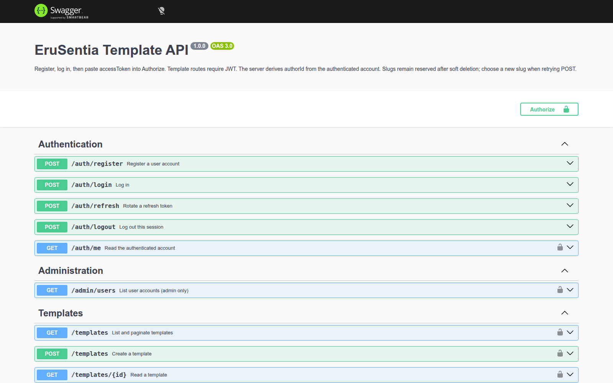
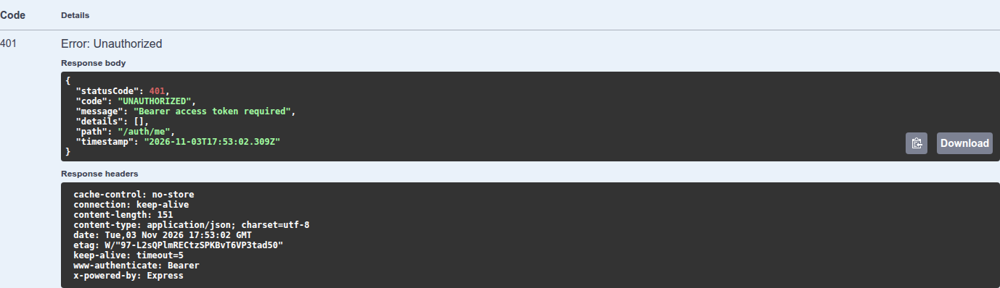
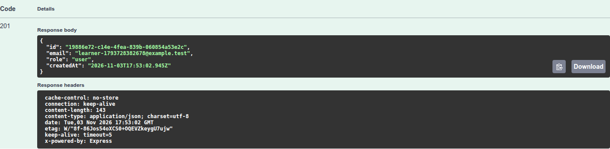
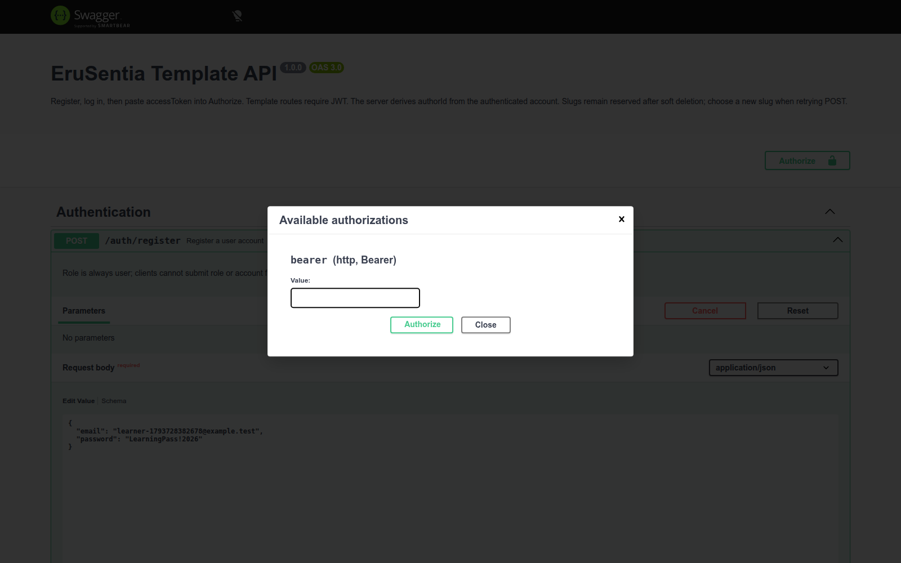
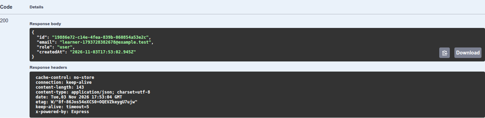
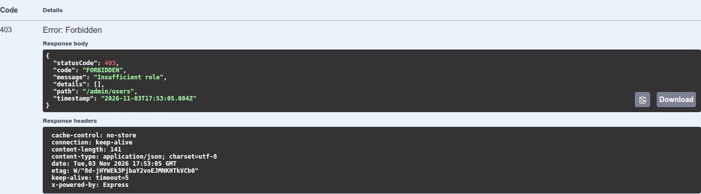
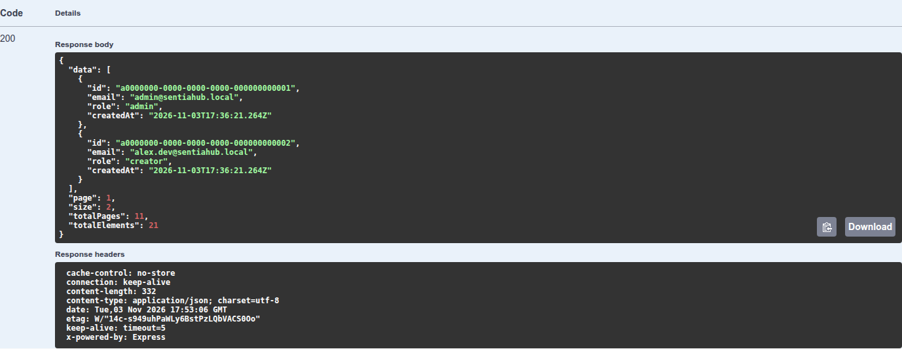
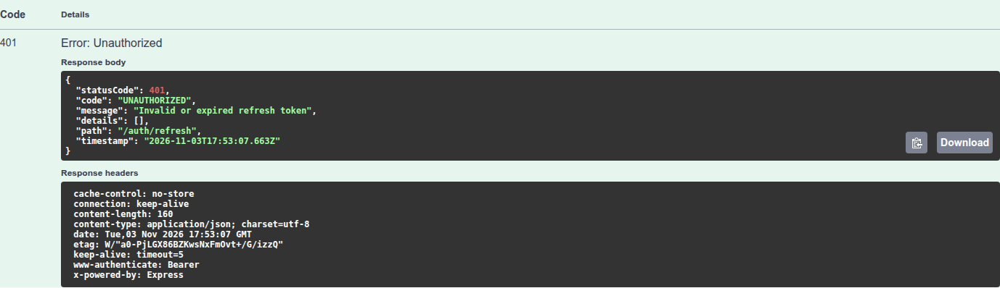
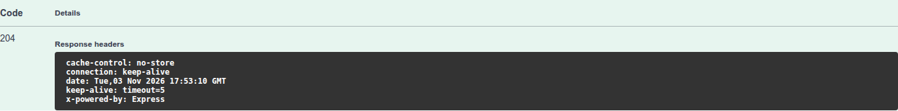

# 07 — Thực hành authentication bằng Swagger

Ngày kiểm chứng **04/11/2026**, API NestJS trên PostgreSQL Docker **16.15**. App chưa
tích hợp API. Các ảnh chụp từ Swagger UI thật; ảnh response lấy riêng bảng Server
response để không đưa request headers/cURL hoặc token vào báo cáo. Không thêm khung,
số khoanh hoặc sửa dữ liệu response. Overview và hộp Authorize chụp toàn giao diện.
Timestamp có hậu tố Z và header GMT trong ảnh dùng UTC; ngày thực hành ghi theo
Asia/Bangkok (UTC+7), nên có thể khác ngày hiển thị trong response.

## 1. Chuẩn bị

Trong repo erusentia-server, theo README để cài dependency, đặt JWT_SECRET và chạy
DB. Database PostgreSQL tuần 2 cần áp dụng `pnpm db:auth` trước khi dùng auth. Thực
hành ghi dữ liệu nên dùng database riêng. Bản demo dùng
`week3_test_20261104_swagger`, nạp SQL 01/02/03/05 trực tiếp.

```bash
# Chạy sau khi đã chuẩn bị DB/schema/index/seed/migration auth.
TEMPLATE_STORE=postgres HOST=127.0.0.1 PORT=3001 \
DB_DATABASE=week3_test_local pnpm dev
```

Memory cũng dùng được để register/login/CRUD, nhưng không có admin cài sẵn và mất
dữ liệu sau restart. Với PostgreSQL, tạo admin mới bằng `pnpm auth:admin` theo
README server; password nhập tại terminal, không ghi vào tài liệu.

Mở **http://127.0.0.1:3001/docs**. Có 11 operation, chia thành Authentication,
Administration và Templates. JSON đặc tả nằm tại `/docs-json`.



## 2. Thử protected API khi chưa có JWT

Mở GET /auth/me → Try it out → Execute, chưa chọn Authorize. Response 401 có code
UNAUTHORIZED và WWW-Authenticate: Bearer. Đây là kiểm tra guard đang có hiệu lực.



## 3. Đăng ký

POST /auth/register nhận email/password. Chọn email demo mới, password 12–128 ký tự.
Không thêm role, isActive hoặc passwordHash. Email sẽ trim/lowercase. Response 201
chỉ có id/email/role/createdAt, với role=user.



Gửi lại cùng email nhận 409. Các credential trên bộ demo thuộc database thử nghiệm,
không phải tài khoản App hoặc mật khẩu admin mặc định.

## 4. Login và Authorize

POST /auth/login bằng tài khoản vừa tạo → Execute. Lần thực hành trả 200 với
accessToken, refreshToken, tokenType=Bearer, expiresIn=900, refreshExpiresAt và user.
Không chèn ảnh response chứa token nguyên văn vào báo cáo.

Bấm **Authorize**, dán riêng accessToken vào ô Value, chọn Authorize rồi Close.
Không thêm chữ Bearer: Swagger tự tạo header. Ảnh dưới ghi hộp nhập lúc chưa dán token.



Gửi lại GET /auth/me: response 200 chứa đúng user vừa đăng ký. Authorize áp dụng cho
các operation có Bearer security; không thay username/password của request login.



## 5. Phân quyền user và admin

Giữ JWT user, gửi GET /admin/users → 403 FORBIDDEN:



Login bằng tài khoản admin đã cấp qua CLI. Mở Authorize, Logout giá trị authorization
cũ trong dialog, dán accessToken admin rồi Authorize/Close. **Logout trong dialog chỉ
xóa header của Swagger, không gọi endpoint /auth/logout của server.**

GET /admin/users?page=1&size=2 trả 200, có trang dữ liệu tài khoản an toàn. Endpoint
không trả password_hash, refresh token hoặc dữ liệu đăng nhập.



## 6. Tạo Template bằng danh tính JWT

Chọn POST /templates, body theo example hiện có. Không có authorId; server lấy
user từ JWT. Dùng slug mới cho mỗi lần tạo vì soft-delete giữ UNIQUE(slug).
Lưu id từ POST để GET/PATCH/DELETE. Với isPublic=false, người khác không đọc được;
public được đọc nhưng không được sửa/xóa trái ownership. Admin được quản lý mọi row.

Các ca giả mạo authorId, đọc/count private và sửa/xóa trái quyền được kiểm chứng
trong HTTP tests memory/PostgreSQL; bộ ảnh này tập trung flow auth.

## 7. Refresh và thử replay

Login lại user nếu cần một phiên mới. POST /auth/refresh với refreshToken vừa nhận:
trả 200, accessToken và refreshToken đều đổi, refreshExpiresAt giữ nguyên. Lưu cặp
mới, cập nhật Authorize bằng accessToken mới.

Gửi lại **refresh token cũ**: 401. Đây là thử replay có chủ đích; family vừa thử bị
thu hồi và cần login lại.



Dùng accessToken từ lần refresh thành công gọi /auth/me cũng trả 401 vì family đã
bị thu hồi; không chỉ riêng token refresh cũ mất hiệu lực.


## 8. Logout server

Login mới, Authorize accessToken mới. POST /auth/logout với refreshToken của phiên
này → 204, không có body. Đây là endpoint server, khác nút Logout trong dialog.



Gọi lại GET /auth/me với accessToken của phiên vừa logout → 401:


Login khác vẫn hoạt động; logout không đăng xuất mọi thiết bị. Chưa có endpoint
quản lý danh sách phiên hoặc logout-all ở bài hiện tại.

## 9. Sau thực hành

Browser/API và DB demo tạm được dọn sau khi lấy minh chứng. Chạy lại bằng dữ liệu/ID
mới; không sao chép UUID, token hoặc timestamp từ ảnh thành fixture. Không có số đo
hiệu năng hoặc kiểm thử tải suy ra từ các ảnh status.

[Mục lục](00_GUIDE_INDEX.md) · [Báo cáo](../WEEK3_REPORT.md) · [Nguồn](../SOURCE_SNAPSHOT.md).
