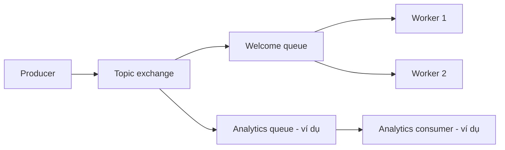

# 02 — Queue, competing consumers và publish/subscribe

## Point-to-point / work queue

Producer gửi message đến một queue thông qua exchange. Nhiều consumer có thể cùng
đọc queue để chia việc: một delivery bình thường giao cho một consumer trong nhóm,
không phải mọi consumer đều nhận. Message chưa ack có thể được giao lại, vì vậy
không hiểu câu “một consumer xử lý” thành “chắc chắn chỉ xử lý một lần”.

Bài triển khai erusentia.welcome với prefetch=1 trên mỗi consumer. Khi thêm worker,
các worker cạnh tranh nhận việc; không cần thêm bản sao email cho mỗi worker.

## Publish/subscribe

Một event được nhiều subscriber độc lập quan tâm. Với RabbitMQ, mỗi subscriber
nghiệp vụ thường có queue riêng, bind cùng exchange theo routing phù hợp. Ví dụ
user.registered có thể đến queue welcome và queue analytics; mỗi nhóm lại có nhiều
consumer chia việc trong queue của mình.

Analytics chỉ là ví dụ lý thuyết, chưa được triển khai. Demo hiện tại có một subscriber
welcome, không khẳng định đã chạy fan-out nhiều nghiệp vụ.

## Exchange và topic

| Exchange RabbitMQ | Routing |
|---|---|
| Direct | Binding key khớp routing key |
| Fanout | Đến mọi queue đã bind, bỏ qua routing key |
| Topic | Binding pattern; * một từ, # không hoặc nhiều từ, phân tách bằng dấu chấm |
| Headers | Khớp header thay vì routing key |

Topic exchange RabbitMQ không đồng nhất Kafka topic. Kafka topic có partitions;
ordering thường trong một partition, consumer group phân chia partitions. RabbitMQ
queue/exchange và Kafka log không có ánh xạ một-một hoàn toàn.

## Lựa chọn trong EruSentia

Topic exchange erusentia.events nhận user.registered.v1; queue welcome bind đúng key.
Một subscriber hiện đủ yêu cầu; mô hình cho phép mở rộng nhưng không thêm analytics
chỉ để tăng số thành phần. Welcome email giữa các user không cần thứ tự toàn cục.

Nguồn: [RabbitMQ pub/sub](https://www.rabbitmq.com/tutorials/tutorial-three-javascript),
[topic tutorial](https://www.rabbitmq.com/tutorials/tutorial-five-javascript),
[Kafka introduction](https://kafka.apache.org/intro).

[Trước](01_message_queue.md) · [Tiếp: RabbitMQ](03_rabbitmq_architecture.md)
