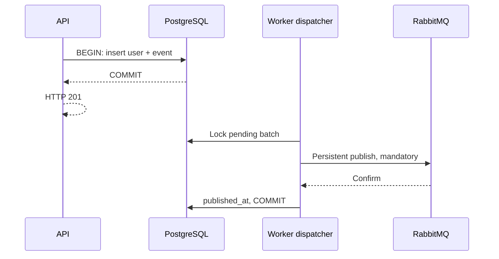

# 04 — Transactional outbox và đăng ký tài khoản

## Vấn đề dual-write

Ghi user rồi publish thẳng RabbitMQ có hai failure window: DB commit nhưng publish
lỗi thì mất event; publish trước rồi DB rollback thì consumer thấy sự kiện cho tài
khoản không tồn tại. Một transaction PostgreSQL không tự bao phủ RabbitMQ hoặc SMTP.

Bài thêm message_outbox vào cùng database. PostgresAuthStore tạo user và event trong
cùng transaction khi queue bật. Outbox insert lỗi thì user cũng rollback. Duplicate
email vẫn 409, không tạo thêm event. CLI tạo admin không phát welcome event.

## Dispatcher

Worker poll pending mỗi giây, batch tối đa 10, ORDER BY created_at/id với FOR UPDATE
SKIP LOCKED. Sau khi RabbitMQ confirm và không mandatory return, mới đặt published_at
và commit. Nếu batch publish một phần rồi lỗi, transaction rollback: những message
đã tới broker có thể được publish lại. Consumer phải xử lý duplicate.

API không kết nối RabbitMQ để đăng ký; broker có thể đang tắt. DB vẫn là dependency
bắt buộc. Không gọi 201 trước khi user/outbox commit. “Trả ngay” ở đây nghĩa không
chờ tác vụ email, không phải zero latency hoặc fire-and-forget trong RAM.

## Event contract

Payload user.registered.v1 gồm event UUID, user UUID, type, schemaVersion=1 và thời
điểm phát. Không mang credential/email/token. messageId khớp event.id. Consumer đọc
email từ users hiện tại và đối chiếu event gốc trong outbox, giới hạn body 4096 byte.

## Trạng thái và phạm vi

published_at chỉ xác nhận broker đã nhận; email status nằm ở welcome_email_deliveries.
Hai bảng bổ sung cộng auth thành 12 bảng khi áp đủ migrations. Không sửa schema/
index/seed gốc; không bật ORM synchronize hoặc tự chạy migration lúc bootstrap.

Outbox vẫn tăng nếu broker lỗi lâu. Chưa có retention/alerting/CDC; bản này dùng poll
để thấy flow rõ ràng và kiểm chứng failure window, không giả định đã tối ưu tải lớn.

Nguồn: [PostgreSQL explicit locking](https://www.postgresql.org/docs/16/explicit-locking.html),
[TypeORM transactions](https://typeorm.io/docs/advanced-topics/transactions/),
[RabbitMQ publisher confirms](https://www.rabbitmq.com/docs/confirms).

[Trước](03_rabbitmq_architecture.md) · [Tiếp: ack/retry/DLQ](05_ack_retry_dlq.md)
