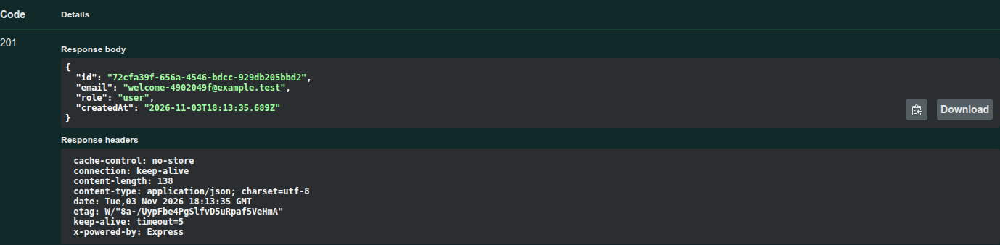
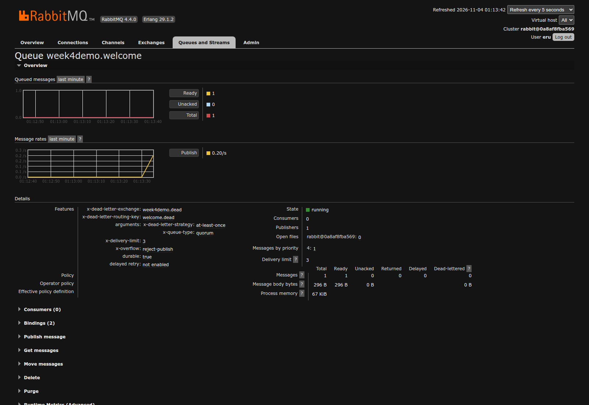
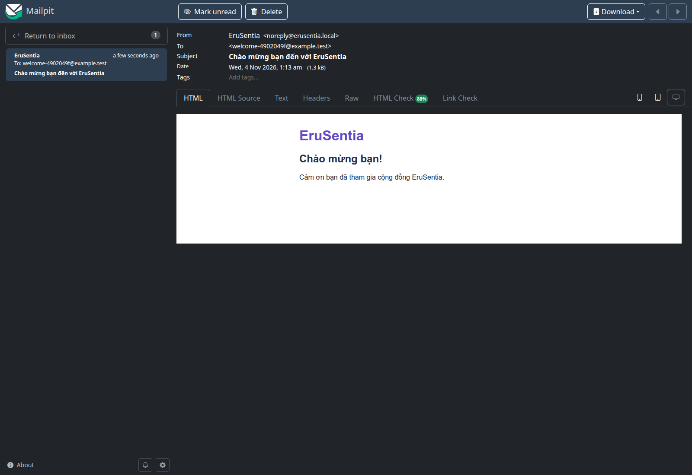
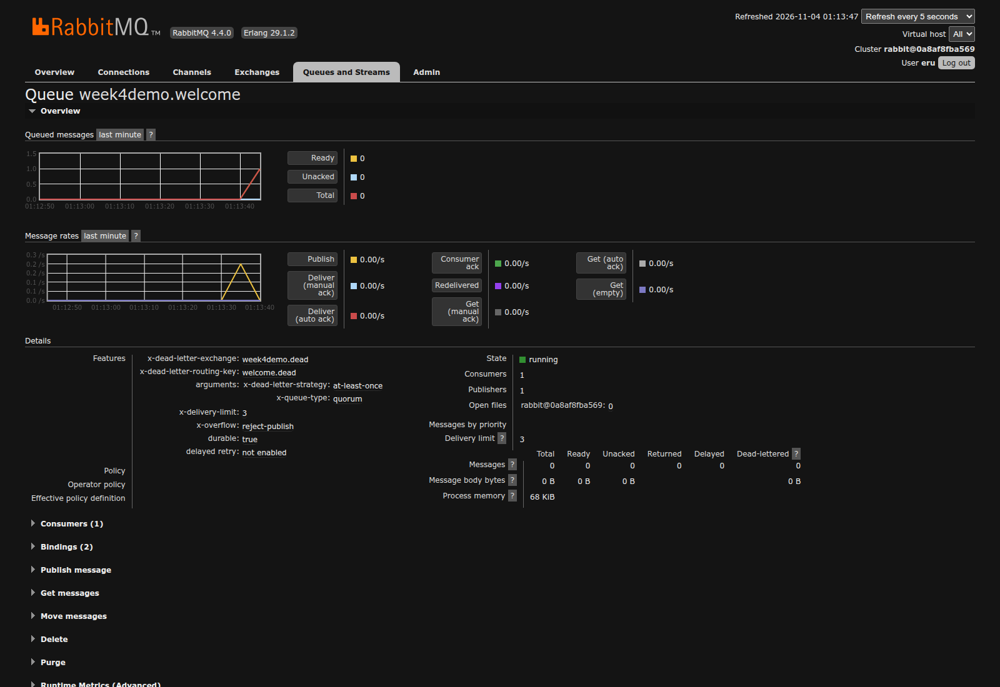
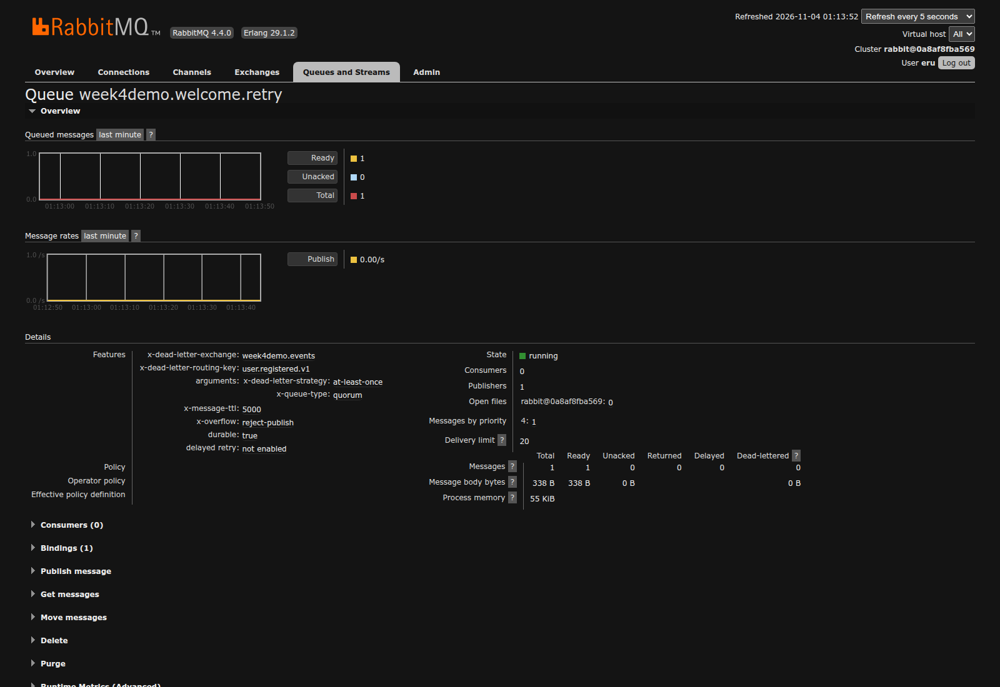
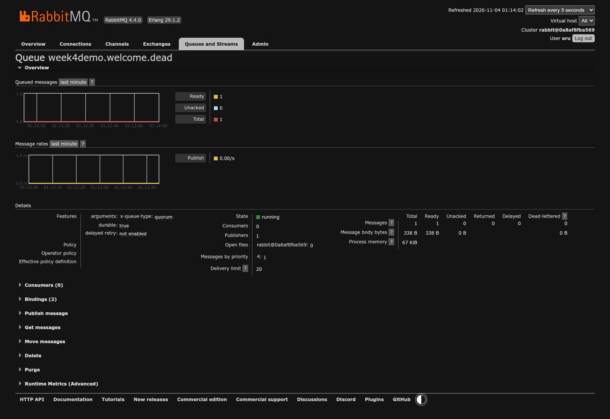

# 07 — Thực hành API → RabbitMQ → welcome email

**Ngày kiểm chứng:** 04/11/2026, Asia/Bangkok. NestJS/PostgreSQL + RabbitMQ 4.4.0 +
Mailpit 1.32.0 trên Ubuntu. App chưa tích hợp API. Ảnh chụp giao diện thật bằng
trình duyệt, không khoanh vùng, không sửa response hoặc dựng email giả.

## 1. Chuẩn bị một database riêng

Trong repo erusentia-server, cài dependency theo README và khởi động PostgreSQL dev.
Ví dụ dưới chỉ dùng database demo mới; không reset sentia_hub_db:

```bash
pnpm install --frozen-lockfile
docker compose -f docker/docker-compose.queue.yml up -d --wait
docker exec sentia_postgres_dev createdb -U postgres week4_demo_local
export DB_HOST=127.0.0.1 DB_PORT=5432 DB_USERNAME=postgres
export DB_PASSWORD=postgres_dev_password DB_DATABASE=week4_demo_local
export QUEUE_ENABLED=true QUEUE_NAMESPACE=week4demo
pnpm db:schema
pnpm db:indexes
pnpm db:seed
pnpm db:auth
pnpm db:queue
pnpm dev
```

Đặt JWT_SECRET ổn định trong .env riêng nếu muốn giữ access JWT qua restart. Development
thiếu key dùng key tạm và cảnh báo; không đưa key vào báo cáo. Hai terminal API/worker
phải dùng cùng DB_* và QUEUE_NAMESPACE. QUEUE_ENABLED=true không dùng với memory.

Mở Swagger `http://127.0.0.1:3001/docs`, RabbitMQ `http://127.0.0.1:15672` và Mailpit
`http://127.0.0.1:8025`. RabbitMQ dùng eru/eru_dev_password của Compose local. Không
cần cài Postman hoặc đăng nhập Cloud. Mailpit không gửi email ra Internet.

## 2. Đăng ký trước khi chạy worker

POST /auth/register → Try it out → nhập email demo mới và password 12–128 ký tự →
Execute. Không thêm role/passwordHash. Register public nên không cần Bearer JWT.



Ảnh chỉ chụp bảng response, không có token hoặc Authorization. Lượt demo trả 201
trong khi consumer chưa chạy; outbox có pending event. User và event commit chung,
không phải một task chỉ giữ trong RAM.

Có thể đối chiếu trong DB demo đã chọn:

```sql
SELECT id, event_type, created_at, published_at
FROM message_outbox ORDER BY created_at DESC LIMIT 5;
SELECT event_id, user_id, status, message_id, processed_at
FROM welcome_email_deliveries ORDER BY processed_at DESC LIMIT 5;
```

## 3. Message chờ trong RabbitMQ

Worker CLI gộp dispatcher và consumer nên chạy bình thường có thể consume quá nhanh
để nhìn Ready. Ảnh minh chứng tách hai bước bằng chính WelcomeWorker.dispatch và
startConsumer của server: publish trước, consumer bắt đầu sau. Không sửa dữ liệu UI.

Trong RabbitMQ chọn Queues and Streams → week4demo.welcome. Thời điểm chụp Ready=1,
Unacked=0 và Consumers=0; message đã được confirm, chưa có worker nhận.



Tên queue demo dùng namespace week4demo; khi chạy mặc định tên là erusentia.welcome.
Không cần giữ UUID/queue demo trên máy sau khi lấy minh chứng.

## 4. Chạy worker và nhận email

Ở terminal thứ hai, export cùng DB_* / QUEUE_* như terminal API rồi chạy:

```bash
QUEUE_ENABLED=true pnpm worker:welcome
```

Worker poll outbox, publish rồi consumer gửi email qua SMTP localhost:1025.
Mailpit hiện đúng email người dùng đăng ký, sender noreply@erusentia.local và subject
“Chào mừng bạn đến với EruSentia”. Nội dung dưới được gửi thật qua SMTP trong demo.



RabbitMQ sau xử lý: Ready=0, Unacked=0, Consumers=1. DB ghi status=sent cho event ID.
Đối chiếu cả ba nơi thay vì kết luận thành công chỉ vì queue rỗng.



201 chỉ xác nhận đăng ký; email đến sau. Welcome không phải email verification,
không tạo luồng đăng nhập App hoặc chứng minh gửi thư tới hộp thư Internet.

## 5. Retry và DLQ với lỗi SMTP thật

Để thử có chủ đích, dừng worker bằng Ctrl+C rồi chạy lại với SMTP_PORT=1 (cổng local
không có SMTP), giữ nguyên API và namespace. Đăng ký email demo mới.

```bash
QUEUE_ENABLED=true SMTP_PORT=1 pnpm worker:welcome
```

Demo chụp lỗi kết nối SMTP thật bị từ chối. Sau lỗi đầu, message chuyển sang
week4demo.welcome.retry, Ready=1; TTL 5000 ms, không có consumer trên retry queue.



Sau ba lần xử lý thất bại, message nằm ở week4demo.welcome.dead, Ready=1, không có
ledger sent/email cho sự kiện lỗi. Bộ test kiểm tra x-attempt=3 và messageId gốc.



Dừng worker thử lỗi, bỏ override SMTP_PORT=1 và chạy lại với 1025 khi kết thúc.
DLQ không tự replay khi SMTP được sửa; cần kiểm tra nguyên nhân rồi replay có kiểm
soát, giữ event ID/body và reset retry counter. Bài chưa có endpoint replay; integration
test đã kiểm tra recovery bằng chính AMQP transport của server.

## 6. Kiểm thử tự động và giới hạn minh chứng

- pnpm test: config/event/CLI + HTTP hồi quy; DB/MQ opt-in.
- DB suite tuần 3: CRUD/auth vẫn đúng khi queue tắt.
- Queue suite: atomic rollback, publish failure giữ pending, SMTP thật, duplicate,
  hai worker cùng event mới, delayed retry, DLQ, malformed event, redelivery trước
  ack, account inactive và worker CLI/SIGTERM.

Các ca transient/permanent mailer failure trong test dùng dependency có kiểm soát;
ảnh lỗi SMTP dùng kết nối thật bị từ chối. Không đồng nhất các fixture với email
đã gửi thật. Test duplicate không chứng minh exactly-once SMTP ở crash window.
Không có số đo hiệu năng/load test từ ảnh.

## 7. Dọn sau thực hành

Dừng API/worker/browser demo; drop đúng DB demo do mình tạo khi không cần nữa.
Chỉ xóa queues/exchanges theo namespace demo và email demo, không purge toàn vhost
hoặc mailbox chung. Giữ container/volume PostgreSQL dev và các snapshot tuần trước.

Lượt chụp này đã dọn DB/namespace/email và file capture tạm sau khi hoàn tất. Khi
tái hiện, dùng dữ liệu/UUID/timestamp mới; không coi ảnh là dữ liệu seed để copy.

[Mục lục](00_GUIDE_INDEX.md) · [Báo cáo](../WEEK4_REPORT.md) · [Nguồn](../SOURCE_SNAPSHOT.md).
