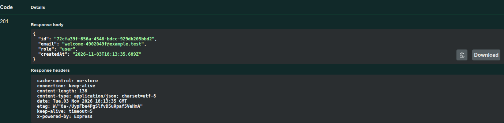
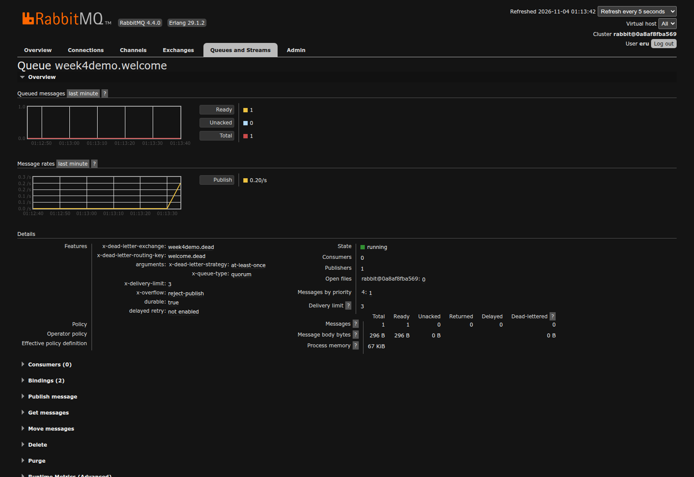
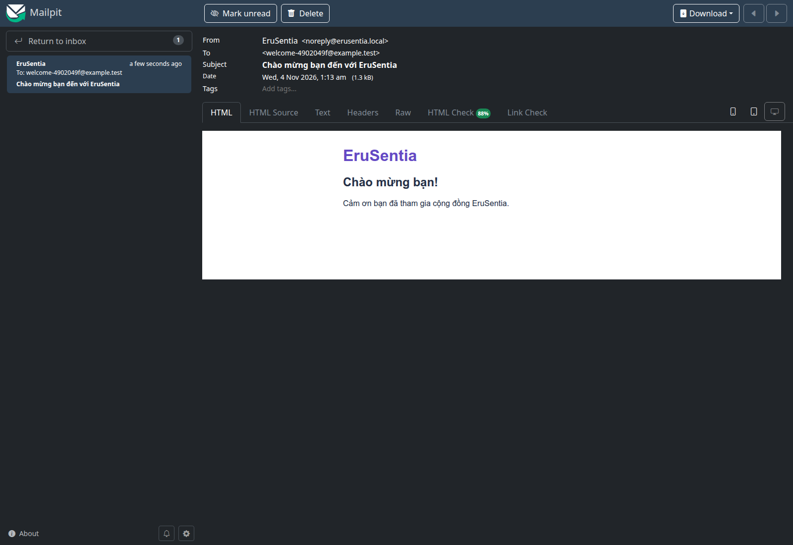
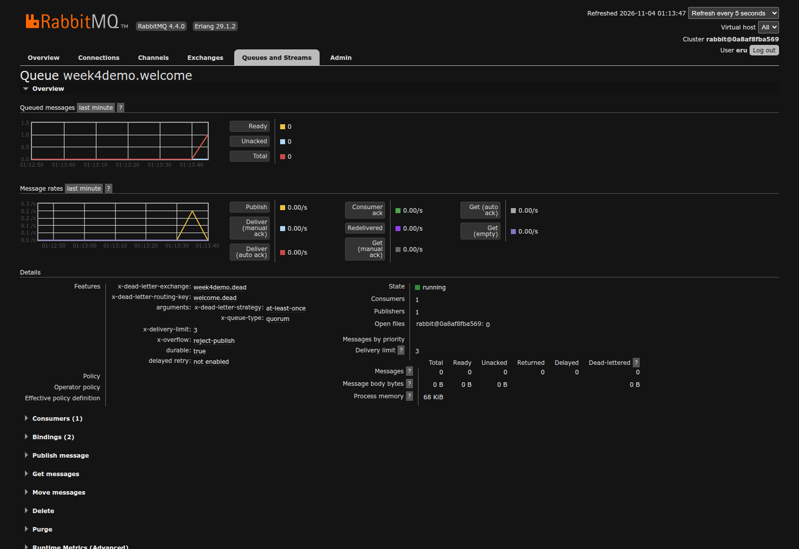
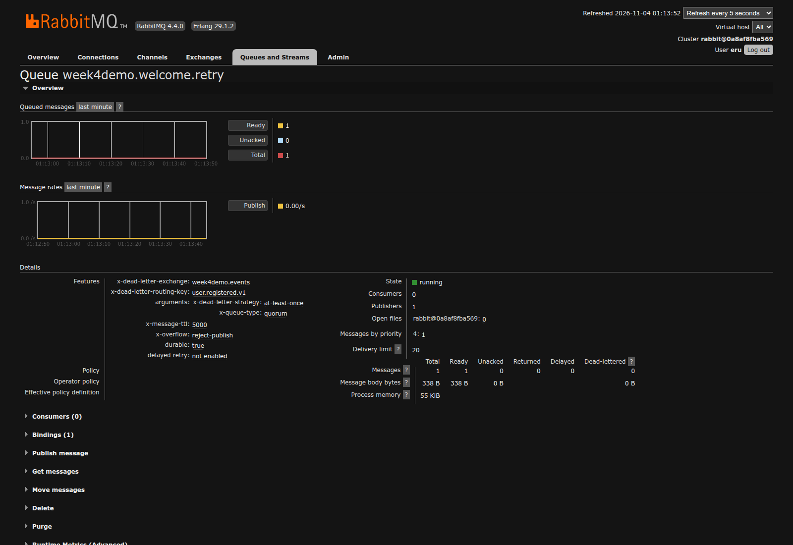
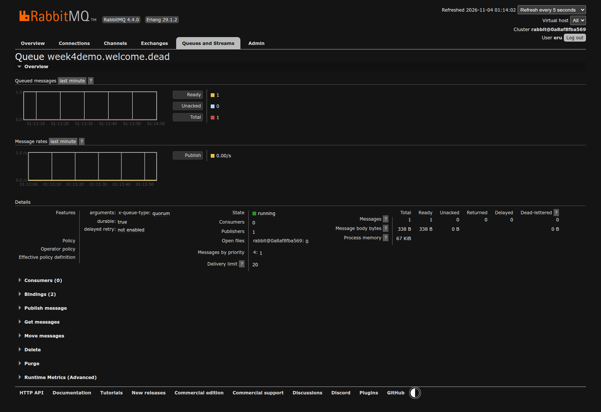

# 07 — Thực hành API → RabbitMQ → welcome email

**Ngày kiểm chứng:** 04/11/2026, Asia/Bangkok. NestJS/PostgreSQL + RabbitMQ 4.4.0 +
Mailpit 1.32.0 trên Ubuntu. App chưa tích hợp API. Ảnh chụp giao diện thật bằng
trình duyệt, không khoanh vùng, không sửa response hoặc dựng email giả.

## Trước khi bắt đầu: bài này chứng minh điều gì?

Mục tiêu là quan sát một việc xảy ra **bất đồng bộ** (không cần hoàn thành ngay
trong cùng lần chờ của request): người dùng đăng ký, API lưu tài khoản và sự kiện
vào PostgreSQL rồi trả kết quả; sau đó worker (tiến trình nền) đưa sự kiện qua
RabbitMQ và gửi email thử tới Mailpit.

```text
Swagger → API đăng ký → PostgreSQL: user + outbox → HTTP 201
                                  ↓ sau đó
                       worker → RabbitMQ → worker → Mailpit
```

- **PostgreSQL** lưu tài khoản, outbox (danh sách sự kiện đang chờ phát) và
  ledger (bảng ghi kết quả xử lý email).
- **RabbitMQ** nhận và giữ message (thông điệp) để worker xử lý; giao diện
  management dùng để xem queue (hàng đợi), không phải hộp thư.
- **Worker** có hai nhiệm vụ: dispatcher đọc outbox và phát message; consumer
  nhận message và xử lý gửi email. Trong lệnh chạy bình thường, hai nhiệm vụ này
  nằm trong cùng tiến trình worker.
- **Mailpit** là hộp thư thử ở máy local, nhận email qua SMTP để ta xem nội dung;
  nó không gửi thư đến Gmail hay hộp thư Internet.

**Phân biệt hai môi trường:** phần dưới và ảnh minh họa là cấu hình tuần 4 ở
[commit đã chốt](../SOURCE_SNAPSHOT.md), dùng PostgreSQL host `5432`, RabbitMQ UI
`15672`, Mailpit UI `8025`. Project stack mới dùng các cổng khác như PostgreSQL
`5433`, RabbitMQ UI `15673`, Mailpit UI `8026`. Không trộn thông số của hai stack;
đọc thêm [hướng dẫn local hiện tại](../../../erusentia-server/docs/LOCAL_DEVELOPMENT.md)
nếu muốn dùng project stack mới. Ảnh là bằng chứng của lần chạy ngày 04/11, không
phải kết quả tự động của lần bạn chạy hôm nay.

## 1. Chuẩn bị một database riêng

Trong repo erusentia-server, cài dependency theo README và khởi động PostgreSQL dev.
Ví dụ dưới chỉ dùng database demo mới; không reset sentia_hub_db:

```bash
pnpm install --frozen-lockfile
docker compose -f docker/docker-compose.dev.yml up -d --wait postgres
docker compose -f docker/docker-compose.queue.yml up -d --wait
docker exec sentia_postgres_dev createdb -U postgres week4_demo_local
export DB_HOST=127.0.0.1 DB_PORT=5432 DB_USERNAME=postgres
export DB_PASSWORD=postgres_dev_password DB_DATABASE=week4_demo_local
export TEMPLATE_STORE=postgres
export QUEUE_ENABLED=true QUEUE_NAMESPACE=week4demo
pnpm db:schema
pnpm db:indexes
pnpm db:seed
pnpm db:auth
pnpm db:queue
pnpm dev
```

**Giải thích từng nhóm lệnh:**

1. `pnpm install --frozen-lockfile` cài dependency đúng lockfile của source đang
   dùng. Hai lệnh `docker compose ... up -d --wait` khởi động PostgreSQL dev và
   RabbitMQ/Mailpit, rồi chờ health check nếu được cấu hình.
2. `createdb ... week4_demo_local` tạo **một database mới** trong container
   PostgreSQL; nếu database này đã tồn tại, lệnh sẽ báo lỗi. Không đổi sang tên
   database có dữ liệu cần giữ và không chạy lệnh reset để khắc phục máy móc.
3. `export DB_*` chọn địa chỉ, tài khoản và database cho **terminal hiện tại**.
   `TEMPLATE_STORE=postgres` chọn PostgreSQL; `QUEUE_ENABLED=true` bật luồng queue;
   `QUEUE_NAMESPACE=week4demo` đặt tiền tố tên queue để phân biệt bài demo.
4. `db:schema`, `db:indexes`, `db:seed`, `db:auth`, `db:queue` lần lượt chuẩn bị
   schema, index, dữ liệu mẫu, bảng phiên và bảng queue trên database đã chọn.
   Đây là các thao tác ghi database: phải kiểm tra `DB_DATABASE` trước khi chạy.
5. `pnpm dev` mở API ở terminal này; để terminal chạy trong suốt demo. Mở terminal
   khác cho worker ở bước 4. `export` ở terminal đầu **không tự chuyển sang**
   terminal thứ hai.

Các cổng và mật khẩu minh họa là cấu hình phát triển local trong Compose của bài.
Nếu tên container, cổng hoặc mật khẩu đã đổi, đối chiếu file Compose/cấu hình
thực tế. Nếu cổng 5432 đã có PostgreSQL khác, kiểm tra kỹ trước khi tạo database.

Đặt JWT_SECRET ổn định trong .env riêng nếu muốn giữ access JWT qua restart. Development
thiếu key dùng key tạm và cảnh báo; không đưa key vào báo cáo. Hai terminal API/worker
phải dùng cùng DB_* và QUEUE_NAMESPACE. QUEUE_ENABLED=true không dùng với memory.

Mở Swagger `http://127.0.0.1:3001/docs`, RabbitMQ `http://127.0.0.1:15672` và Mailpit
`http://127.0.0.1:8025`. RabbitMQ dùng eru/eru_dev_password của Compose local. Không
cần cài Postman hoặc đăng nhập Cloud. Mailpit không gửi email ra Internet.

## 2. Đăng ký trước khi chạy worker

POST /auth/register → Try it out → nhập email demo mới và password 12–128 ký tự →
Execute. Không thêm role/passwordHash. Register public nên không cần Bearer JWT.

**Bấm cụ thể:**

1. Mở `http://127.0.0.1:3001/docs`; tìm nhóm **Authentication** rồi mở dòng
   `POST /auth/register`.
2. Bấm **Try it out**. Trong ô request body, thay nội dung bằng ví dụ dưới đây;
   thay email bằng một địa chỉ demo chưa tồn tại trong database demo:

   ```json
   {
     "email": "hoc-vien-week4@example.test",
     "password": "LearningPass!2026"
   }
   ```

3. Bấm **Execute** và xem **Server response**. `201` nghĩa là API đã tạo user
   thành công theo contract. Nếu email đã tồn tại, dùng email demo mới; `409` là
   xung đột, không phải bằng chứng RabbitMQ hỏng. `400` thường cần kiểm tra dữ
   liệu đầu vào; `500` cần xem log API và database.
4. Tại thời điểm này **chưa chạy worker**: event nằm ở outbox, email chưa cần
   xuất hiện. `201` không có nghĩa worker đã gửi email.



Ảnh chỉ chụp bảng response, không có token hoặc Authorization. Lượt demo trả 201
trong khi consumer chưa chạy; outbox có pending event. User và event commit chung,
không phải một task chỉ giữ trong RAM.

Có thể đối chiếu trong DB demo đã chọn:

```sql
SELECT id, event_type, created_at, published_at
FROM message_outbox ORDER BY created_at DESC LIMIT 5;
SELECT event_id, user_id, status, message_id, processed_at
FROM welcome_email_deliveries ORDER BY processed_at DESC LIMIT 5;
```

Chạy các câu trên trong một công cụ SQL đang nối đúng `week4_demo_local`. Ví dụ,
từ terminal khác trên máy host, nếu container demo có đúng tên ở trên:

```bash
docker exec -it sentia_postgres_dev psql -U postgres -d week4_demo_local
```

Trong màn hình `psql`, dán từng câu `SELECT` rồi nhấn Enter; gõ `\q` để thoát.
Hàng event mới có `published_at` rỗng (`NULL`) khi dispatcher chưa phát; bảng
ledger có thể chưa có dòng tương ứng. `NULL` là chưa có giá trị, không phải chuỗi
chữ `"NULL"`. Không cần hiển thị password hash hay token để chứng minh luồng này.

## 3. Message chờ trong RabbitMQ

Worker CLI gộp dispatcher và consumer nên chạy bình thường có thể consume quá nhanh
để nhìn Ready. Ảnh minh chứng tách hai bước bằng chính WelcomeWorker.dispatch và
startConsumer của server: publish trước, consumer bắt đầu sau. Không sửa dữ liệu UI.

Trong RabbitMQ chọn Queues and Streams → week4demo.welcome. Thời điểm chụp Ready=1,
Unacked=0 và Consumers=0; message đã được confirm, chưa có worker nhận.

**Điểm dễ nhầm:** chỉ đăng ký ở bước 2, khi worker chưa chạy, thì event mới ở
PostgreSQL outbox; nó **chưa tự xuất hiện trong RabbitMQ**. Ảnh ở bước 3 được tạo
bằng một lượt kiểm thử có chủ đích chạy riêng `dispatch` (phát event) trước khi
chạy `startConsumer` (bắt đầu nhận). Lệnh worker thông thường ở bước 4 chạy cả hai,
nên message có thể được xử lý quá nhanh để bạn thấy `Ready=1`. Đây là ảnh minh họa
một trạng thái tách riêng, không phải kết quả bắt buộc sau bước 2.

Trong RabbitMQ Management: đăng nhập → **Queues and Streams** → chọn queue
`week4demo.welcome` nếu topology đã được worker/đoạn kiểm thử tạo. `Ready` là số
message đang chờ giao, `Unacked` là đã giao nhưng chưa được consumer xác nhận,
`Consumers` là số consumer đang đăng ký. Queue chưa xuất hiện khi chưa có tiến
trình nào khai báo topology; điều đó không chứng minh outbox không tồn tại.



Tên queue demo dùng namespace week4demo; khi chạy mặc định tên là erusentia.welcome.
Không cần giữ UUID/queue demo trên máy sau khi lấy minh chứng.

## 4. Chạy worker và nhận email

Ở terminal thứ hai, export cùng DB_* / QUEUE_* như terminal API rồi chạy:

```bash
cd /home/tuans-ubuntu/Projects/Personal/EruSentia/erusentia-server
export DB_HOST=127.0.0.1 DB_PORT=5432 DB_USERNAME=postgres
export DB_PASSWORD=postgres_dev_password DB_DATABASE=week4_demo_local
export TEMPLATE_STORE=postgres
export QUEUE_ENABLED=true QUEUE_NAMESPACE=week4demo
QUEUE_ENABLED=true pnpm worker:welcome
```

Nếu bạn đang chạy source snapshot ở một thư mục khác, `cd` tới thư mục snapshot
đó. Kiểm tra hai terminal cùng trỏ tới database và namespace demo; nếu một bên
dùng `week4demo`, bên kia dùng namespace khác, bạn có thể đang nhìn nhầm queue.
Chạy worker xong, quay lại Mailpit → mở email mới nhất → đối chiếu địa chỉ nhận và
subject. Đồng thời chạy lại hai câu SQL ở bước 2: `published_at` đã có giá trị
cho biết dispatcher đã đánh dấu phát; ledger `sent` phản ánh kết quả xử lý.

Worker poll outbox, publish rồi consumer gửi email qua SMTP localhost:1025.
Mailpit hiện đúng email người dùng đăng ký, sender noreply@erusentia.local và subject
“Chào mừng bạn đến với EruSentia”. Nội dung dưới được gửi thật qua SMTP trong demo.



RabbitMQ sau xử lý: Ready=0, Unacked=0, Consumers=1. DB ghi status=sent cho event ID.
Đối chiếu cả ba nơi thay vì kết luận thành công chỉ vì queue rỗng.



201 chỉ xác nhận đăng ký; email đến sau. Welcome không phải email verification,
không tạo luồng đăng nhập App hoặc chứng minh gửi thư tới hộp thư Internet.

## 5. Retry và DLQ với lỗi SMTP thật

Để thử có chủ đích, dừng worker bằng Ctrl+C rồi chạy lại với SMTP_PORT=1 (cổng local
không có SMTP), giữ nguyên API và namespace. Đăng ký email demo mới.

```bash
QUEUE_ENABLED=true SMTP_PORT=1 pnpm worker:welcome
```

Demo chụp lỗi kết nối SMTP thật bị từ chối. Sau lỗi đầu, message chuyển sang
week4demo.welcome.retry, Ready=1; TTL 5000 ms, không có consumer trên retry queue.

**Vì sao đổi sang cổng 1?** Đây là cách cố ý trỏ SMTP tới một cổng local giả định
không có server nhận thư, để quan sát xử lý lỗi. Nếu máy thực sự có dịch vụ nghe ở
cổng đó, kết quả có thể khác; kiểm tra môi trường trước. Chỉ dùng email/database/
namespace demo. TTL 5000 ms nghĩa là message chờ khoảng 5 giây trong retry queue
trước khi được chuyển về exchange; thời gian quan sát thực tế có thể chênh lệch.

Thứ tự dễ theo dõi: dừng worker bình thường bằng Ctrl+C → chạy lệnh worker lỗi ở
trên trong cùng terminal đã export cấu hình → đăng ký **email demo mới** từ
Swagger → mở RabbitMQ, lần lượt xem `week4demo.welcome.retry` và
`week4demo.welcome.dead`. Trạng thái retry diễn ra ngắn nên có thể bỏ lỡ; xem log
worker và bài kiểm thử để đối chiếu, không suy từ một ảnh chụp tức thời.



Sau ba lần xử lý thất bại, message nằm ở week4demo.welcome.dead, Ready=1, không có
ledger sent/email cho sự kiện lỗi. Bộ test kiểm tra x-attempt=3 và messageId gốc.



Dừng worker thử lỗi, bỏ override SMTP_PORT=1 và chạy lại với 1025 khi kết thúc.
DLQ không tự replay khi SMTP được sửa; cần kiểm tra nguyên nhân rồi replay có kiểm
soát, giữ event ID/body và reset retry counter. Bài chưa có endpoint replay; integration
test đã kiểm tra recovery bằng chính AMQP transport của server.

## 6. Kiểm thử tự động và giới hạn minh chứng

- pnpm test: config/event/CLI + HTTP hồi quy; DB/MQ opt-in.
- DB suite tuần 3: CRUD/auth vẫn đúng khi queue tắt.
- Queue suite: atomic rollback, publish failure giữ pending, SMTP thật, duplicate,
  hai worker cùng event mới, delayed retry, DLQ, malformed event, redelivery trước
  ack, account inactive và worker CLI/SIGTERM.

Các ca transient/permanent mailer failure trong test dùng dependency có kiểm soát;
ảnh lỗi SMTP dùng kết nối thật bị từ chối. Không đồng nhất các fixture với email
đã gửi thật. Test duplicate không chứng minh exactly-once SMTP ở crash window.
Không có số đo hiệu năng/load test từ ảnh.

## 7. Dọn sau thực hành

Dừng API/worker/browser demo; drop đúng DB demo do mình tạo khi không cần nữa.
Chỉ xóa queues/exchanges theo namespace demo và email demo, không purge toàn vhost
hoặc mailbox chung. Giữ container/volume PostgreSQL dev và các snapshot tuần trước.

Lượt chụp này đã dọn DB/namespace/email và file capture tạm sau khi hoàn tất. Khi
tái hiện, dùng dữ liệu/UUID/timestamp mới; không coi ảnh là dữ liệu seed để copy.

## 8. Câu hỏi tự kiểm tra và xử lý khi không thấy kết quả

**Vì sao đã nhận 201 mà chưa có email?** 201 chỉ xác nhận API xử lý đăng ký; nếu
worker chưa chạy, event có thể vẫn pending trong outbox. Xem database, log worker,
RabbitMQ và Mailpit theo thứ tự thay vì coi email là một phần của response.

**Vì sao outbox có hàng mà RabbitMQ không thấy message?** Kiểm tra worker/dispatcher
đã chạy chưa, cùng `DB_DATABASE` và `QUEUE_NAMESPACE` chưa, broker có sẵn không;
đọc log. Outbox pending có `published_at IS NULL` là trạng thái đang chờ phát.

**Vì sao queue Ready=0 nhưng không thấy email?** Message có thể đang `Unacked`,
đang chờ retry hoặc nằm ở DLQ. Xem thêm ledger và log; chỉ một chỉ số Ready=0
không chứng minh thành công.

**Vì sao Mailpit không có thư?** Kiểm tra worker chạy với SMTP host/cổng đúng,
Mailpit đang mở đúng UI `8025` của stack tuần 4, không nhầm `8026` của project
stack; kiểm tra email demo mới và ledger `sent`. Nếu vừa thử lỗi `SMTP_PORT=1`,
phải dừng tiến trình lỗi và khởi động lại worker với cấu hình SMTP đúng.

**Vì sao cổng/đăng nhập không đúng như tài liệu?** Máy có thể đang chạy project
stack khác hoặc thay cấu hình local. Đối chiếu tên container, cổng host và source
snapshot trước; không tự xóa volume hoặc đổi password database đang dùng.

**Câu trả lời ngắn khi vấn đáp:** “Em ghi user và outbox cùng transaction để không
mất ý định gửi khi database thành công. Worker phát event đến RabbitMQ rồi xử lý
gửi email. Em kiểm tra outbox, trạng thái queue, ledger và Mailpit; hệ thống có
retry/DLQ, nhưng không cam kết email SMTP được gửi đúng một lần trong mọi lỗi.”

[Mục lục](00_GUIDE_INDEX.md) · [Báo cáo](../WEEK4_REPORT.md) · [Nguồn](../SOURCE_SNAPSHOT.md).
