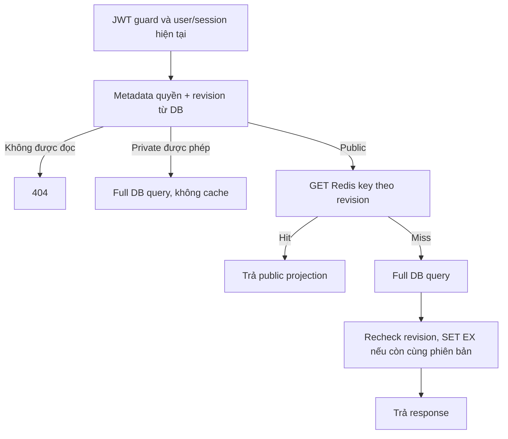

# 02 — Cache-aside và write-through

## Cache-aside

Ứng dụng quản lý vòng đọc: check cache → miss → đọc DB → SET có TTL → trả kết quả.
Hit bỏ bước đọc dữ liệu đầy đủ. Khi ghi DB, ứng dụng invalidates/update cache theo
hợp đồng. DB vẫn là nguồn sự thật; cache có thể mất mà dữ liệu nghiệp vụ không mất.

Bài có thêm bước metadata quyền/revision trước lookup để tránh phục vụ public cache
khi tài nguyên đã private/deleted. Đây là trade-off bảo mật, không phải ví dụ bỏ mọi
DB query trên hit.

## Write-through

Luồng ghi đi qua một lớp cache/storage quản lý cập nhật nguồn và cache theo hợp
đồng trước khi xác nhận. Có thể tăng hit rate sau write nhưng thêm chi phí ghi và
phải xử lý failure/consistency. Hai lệnh độc lập “UPDATE DB rồi SET Redis” không tự
trở thành một transaction atomic DB/Redis.

Write-behind/write-back trì hoãn ghi nguồn là chiến lược khác; cần xử lý mất dữ liệu,
retry và ordering. Bài không triển khai hai chiến lược này hoặc biến outbox email
thành cache write-behind.

## So sánh và lựa chọn

| Tiêu chí | Cache-aside trong bài | Write-through |
|---|---|---|
| Ai fill cache | Read miss | Lớp ghi theo hợp đồng |
| Read sau write | Có thể miss | Có thể đã được fill |
| Write overhead | DB + invalidation best effort | DB/cache update coordination |
| Cache không dùng lại | Tránh fill trước | Có thể ghi cache không cần thiết |

EruSentia dùng cache-aside vì public template read-heavy và cache là tùy chọn. Ghi
DB xong DEL key cũ; DB revision mới bảo vệ ngay cả DEL thất bại. Không cam kết mạnh
hơn ranh giới request: GET đã đọc quyền trước mutation vẫn có thể hoàn tất bản trước.

Nguồn: [Redis cache-aside](https://redis.io/docs/latest/develop/use-cases/cache-aside/),
[SET với TTL](https://redis.io/docs/latest/commands/set/).

[Trước](01_caching_basics.md) · [Tiếp: Redis](03_redis_data_types.md)
