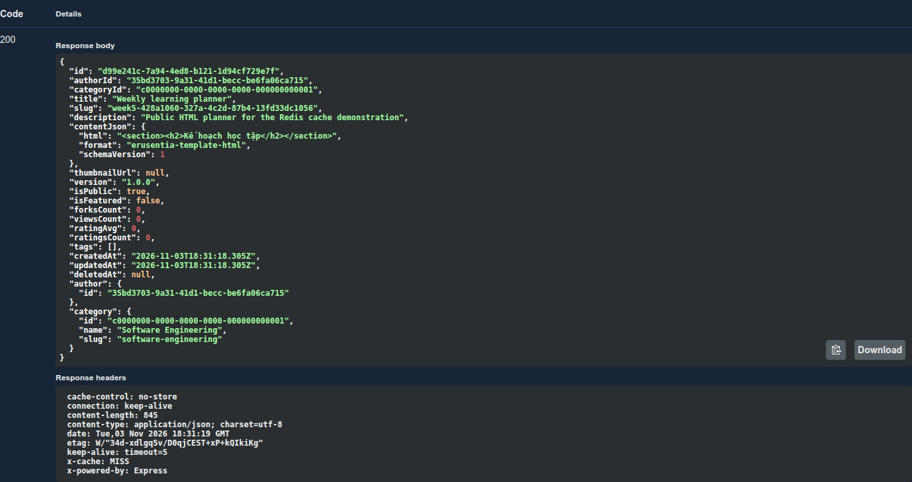
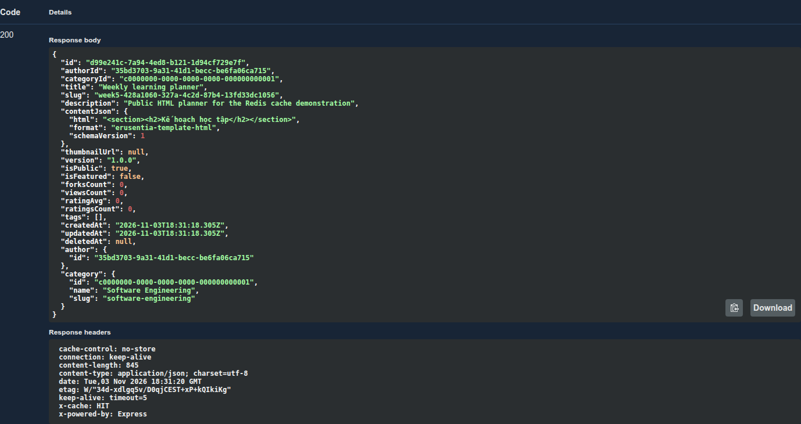
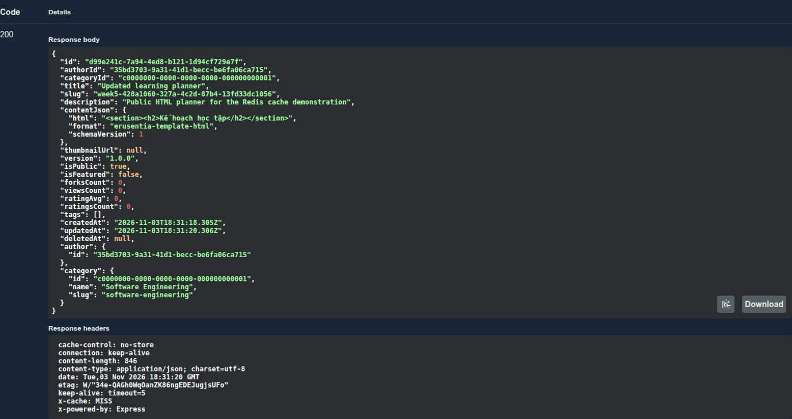
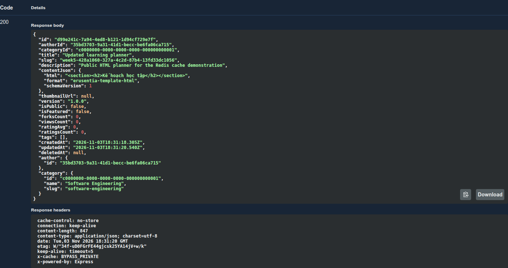
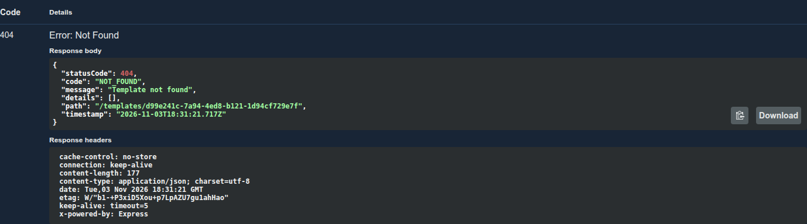

# 07 — Demo Swagger: cache miss → hit → invalidation

**Ngày kiểm chứng:** 04/11/2026, Asia/Bangkok. API thật với PostgreSQL/Redis Docker,
App chưa tích hợp API. 5 ảnh lấy từ bảng Server response của Swagger, không khoanh
vùng, không sửa dữ liệu. Vùng JSON được mở rộng khi chụp để thấy đủ nội dung/header;
không chụp cURL hoặc Authorization. Timestamp Z/GMT là UTC, khác giờ local UTC+7.

## 1. Chuẩn bị DB riêng

Chạy trong erusentia-server. PostgreSQL dev đã được chuẩn bị như tuần trước; ví dụ
này tạo DB mới, không reset sentia_hub_db:

```bash
pnpm install --frozen-lockfile
docker compose -f docker/docker-compose.cache.yml up -d --wait
docker exec sentia_postgres_dev createdb -U postgres week5_test_local
export DB_HOST=127.0.0.1 DB_PORT=5432 DB_USERNAME=postgres
export DB_PASSWORD=postgres_dev_password DB_DATABASE=week5_test_local
export QUEUE_ENABLED=false CACHE_ENABLED=true CACHE_NAMESPACE=week5demo
pnpm db:schema
pnpm db:indexes
pnpm db:seed
pnpm db:auth
pnpm db:cache
pnpm dev
```

Cache tests/benchmark không cần migration queue khi QUEUE_ENABLED=false. Với DB đã
có migrations tuần trước, chỉ áp 07 để bật cache; kiểm tra DB_* trước lệnh ghi.
Đặt JWT_SECRET riêng ổn định nếu cần giữ JWT qua restart. Không đưa key vào báo cáo.

## 2. Login và tạo Template

Mở http://127.0.0.1:3001/docs. POST /auth/register bằng email demo mới, login rồi
Authorize accessToken như tuần 3, không thêm chữ Bearer trong ô Value. POST /templates
với example hiện tại, slug mới, isPublic=true; server lấy author từ JWT. Lưu id.

Bản demo ảnh dùng HTML ngắn để dễ đọc; benchmark dùng payload riêng lớn hơn.
Không lấy template hoặc source App để làm minh chứng. Memory + CACHE_ENABLED=true
bị từ chối vì thiết kế kiểm tra metadata/revision PostgreSQL.

## 3. GET đầu: MISS

Mở GET /templates/{id}, nhập id → Try it out → Execute. Header x-cache: MISS;
response đúng Template vừa tạo. Public projection được fill với TTL sau khi kiểm
tra lại revision. GET không tăng views_count hay sửa timestamp.



Có thể đối chiếu Redis bằng đúng namespace/ID của lượt mình chạy:

```bash
docker exec sentia_redis_dev redis-cli --scan --pattern 'week5demo:template:v1:*'
# Dùng đúng key được tìm thấy, không copy UUID trong ảnh:
docker exec sentia_redis_dev redis-cli TTL 'KEY_FROM_SCAN'
```

TTL default nằm trong 60–71 giây lúc SET và giảm dần; key có thể evict trước TTL.
Không dùng KEYS hoặc FLUSHDB trên Redis dùng chung trong thực hành vận hành.

## 4. GET lại: HIT

Execute cùng route trước expiry. Body giữ nguyên, header x-cache: HIT. HTTP vẫn có
Cache-Control:no-store; Redis là cache nội bộ. Bộ test xác nhận hai GET chỉ có một
full store.find; quyền/user/session/metadata vẫn được query.



## 5. PATCH rồi GET

PATCH /templates/{id} đổi title, không gửi authorId/metrics. GET lại phải hiện title
mới với MISS, sau đó mới có HIT. Revision DB đổi và key cũ bị DEL best effort.



Tests còn cố ý giữ/khôi phục key revision cũ và cập nhật SQL trực tiếp; phiên bản
cũ không được chọn ở lần đọc revision mới. Đây không chỉ là chờ TTL để dữ liệu đúng.

## 6. Chuyển private và đổi người gọi

PATCH isPublic=false. Owner GET vẫn 200 nhưng x-cache: BYPASS_PRIVATE, không cache
private projection. Response body vẫn dùng hợp đồng Template cũ.



Đăng ký/login user khác, thay token trong Authorize rồi GET cùng ID → 404. Metadata
DB chặn trước Redis, kể cả public key cũ còn tồn tại. Private của người khác dùng
404 theo hợp đồng tuần 3, không đổi thành public chỉ vì đã từng được cache.



## 7. TTL, Redis outage và kiểm thử

pnpm test:cache với RUN_CACHE_TESTS=1, DB mới/rỗng week5_test_* và Redis đang chạy.
Suite tự nạp schema/auth/cache, chạy 13 test tính cả parent. Có expire/rebuild,
corrupt JSON, 8 concurrent misses, GET/SQL race, soft-delete, client disconnect,
startup với Redis port không truy cập được và mode disabled. Không dừng Redis của
người dùng chỉ để tạo lỗi test; test client/URL riêng đã kiểm chứng fallback.

Chạy pnpm cache:types trên DB đã chuẩn bị để xem String/Hash/List/Set/Sorted Set;
scratch keys có TTL và được DEL. Ranking dùng views_count public thật, không phải
feature App đã tích hợp. Chạy pnpm cache:benchmark để đo HTTP như [bài 06](06_performance.md).

## 8. Dọn dẹp

Lượt chụp/test đã đóng API/browser, dọn namespace cache và DB thử đúng tên. Chỉ DEL
keys của lượt mình tạo; không FLUSHDB, không xóa Docker volume của các tuần trước.
Redis dev container được giữ để tái hiện; cache không có persistence và có thể dựng lại.
Dùng ID/credential/timestamp mới khi chạy lại, không coi ảnh là fixture SQL.

[Mục lục](00_GUIDE_INDEX.md) · [Báo cáo](../WEEK5_REPORT.md) · [Nguồn](../SOURCE_SNAPSHOT.md).
