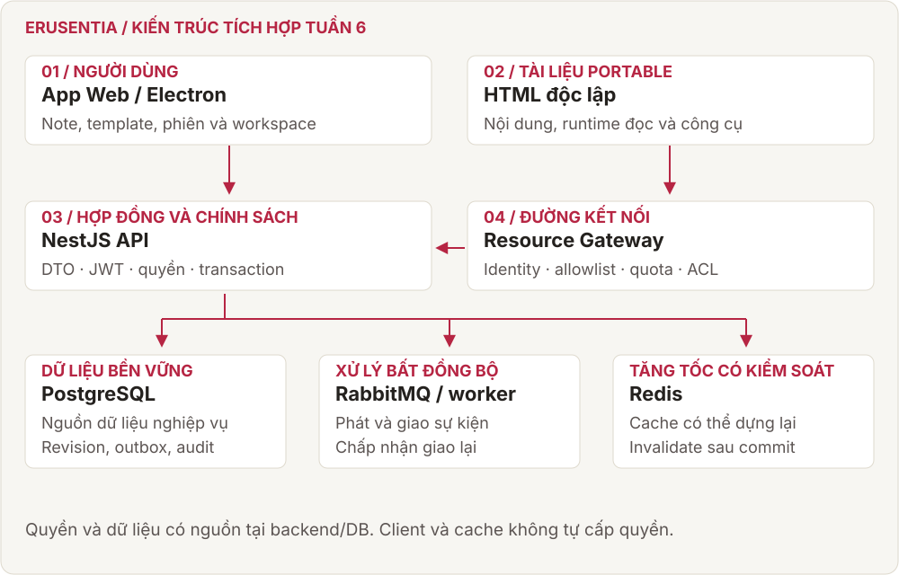
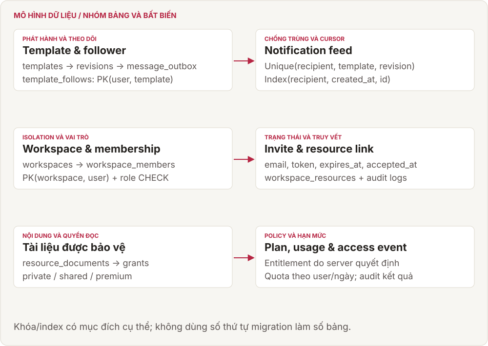
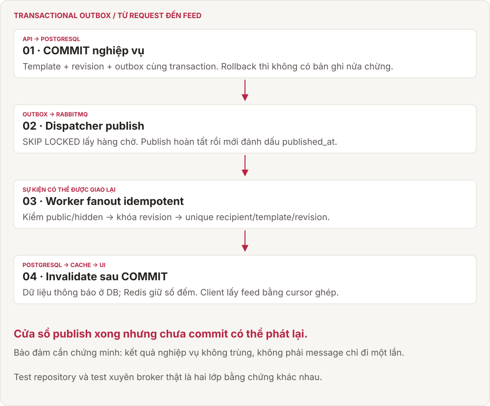
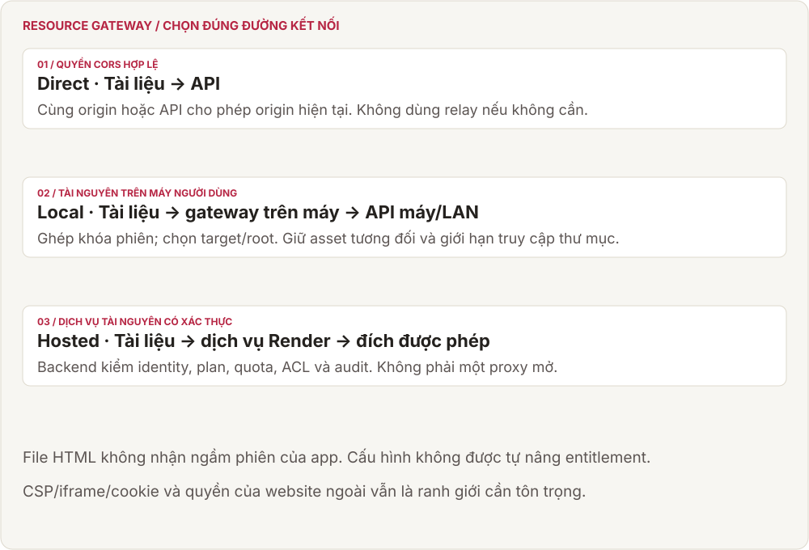
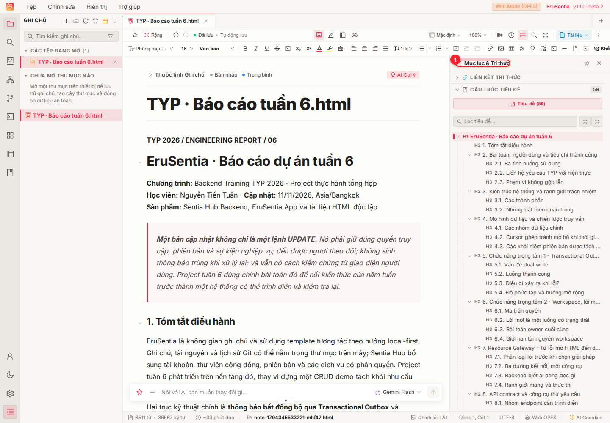
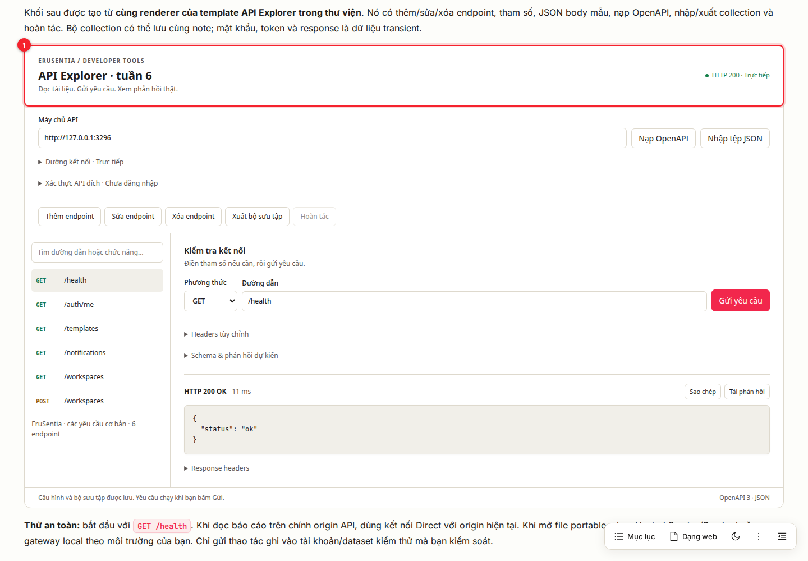

# EruSentia · Báo cáo dự án tuần 6

**Chương trình:** Backend Training TYP 2026 · Project thực hành tổng hợp<br>
**Học viên:** Nguyễn Tiến Tuấn · **Cập nhật:** 11/11/2026, Asia/Bangkok<br>
**Sản phẩm:** Sentia Hub Backend, EruSentia App và tài liệu HTML độc lập

> **Một bản cập nhật không chỉ là một lệnh UPDATE.** Nó phải giữ đúng quyền truy cập, phiên bản và sự kiện nghiệp vụ; đến được người theo dõi; không sinh thông báo trùng khi xử lý lại; và vẫn có cách kiểm chứng từ giao diện người dùng. Project tuần 6 dùng chính bài toán đó để nối kiến thức của năm tuần trước thành một hệ thống có thể trình diễn và kiểm tra lại.

## 1. Tóm tắt điều hành

EruSentia là không gian ghi chú và sử dụng template tương tác theo hướng local-first. Ghi chú, tài nguyên và lịch sử Git có thể nằm trong thư mục trên máy; Sentia Hub bổ sung tài khoản, thư viện cộng đồng, phiên bản và các dịch vụ có phân quyền. Project tuần 6 phát triển trên nền tảng đó, thay vì dựng một CRUD demo tách khỏi nhu cầu sử dụng.

Hai trục kỹ thuật chính là **thông báo bất đồng bộ qua Transactional Outbox** và **workspace có phân quyền nhiều vai trò**. Resource Gateway bổ sung một bài toán tích hợp thực tế: tài liệu HTML mở ngoài app vẫn cần gọi API hoặc đọc tài nguyên được cấp quyền, trong giới hạn origin, mạng, phiên và hạn mức của backend.

| Đầu ra | Giá trị có thể quan sát |
|---|---|
| Backend NestJS, TypeORM, PostgreSQL | API có DTO, quyền, transaction, truy vết và kiểm thử trên database tạm |
| Outbox, dispatcher, notification worker | Bản cập nhật tạo sự kiện bền vững; giao lại cùng revision không tạo thông báo trùng |
| Workspace và lời mời | Owner/editor/viewer; email mời được ràng buộc; không làm mất owner cuối cùng trong các luồng đã kiểm tra |
| Resource Gateway và tài liệu được bảo vệ | Backend quyết định plan, quota và quyền đọc; client không tự nâng quyền bằng cấu hình |
| API Explorer và Hộp thông báo | Hai Full Template có mục đích riêng; gọi API thật, có trạng thái tải/lỗi và giữ bí mật trong phiên |
| Bộ example và báo cáo này | Đọc trong app, mở HTML độc lập, thao tác công cụ, đối chiếu dữ liệu và dùng kịch bản demo |

**Kết luận trong phạm vi bằng chứng:** các hợp đồng và luồng cục bộ được mô tả dưới đây có mã nguồn và kiểm chứng tương ứng. Kết quả này không được đổi thành nhãn “100% production-ready”: chuỗi RabbitMQ/Redis thực, tranh chấp nhiều tiến trình và quyền tài nguyên workspace xuyên suốt còn có các cổng nghiệm thu riêng.

## 2. Bài toán, người dùng và tiêu chí thành công

### 2.1. Ba tình huống sử dụng

1. **Tác giả và người theo dõi.** Tác giả phát hành bản mới của template. Người theo dõi cần nhận đúng một thông báo nghiệp vụ cho revision đó, kể cả khi hạ tầng phải xử lý lại sự kiện.
2. **Nhóm làm việc.** Owner tạo workspace, mời đúng email và cấp quyền phù hợp. Một viewer không được tự thành editor; một lời mời quyền thấp không được hạ quyền owner đã tồn tại.
3. **Người nhận tài liệu.** Người dùng mở HTML từ file hoặc từ một website. Công cụ cần chọn đúng đường kết nối; tài liệu có quyền riêng phải được backend kiểm tra, thay vì dựa vào một nút bị ẩn trên UI.

### 2.2. Liên hệ yêu cầu TYP với hiện thực

| Kiến thức | Áp dụng trong project | Bằng chứng và điểm cần kiểm |
|---|---|---|
| Tuần 1 · Database, OOP, DI | Khóa ghép, unique index, transaction, row lock; controller/service/repository | SQL migration, test PostgreSQL; không suy diễn tốc độ chỉ từ việc có index |
| Tuần 2 · REST, ORM | DTO, HTTP status, OpenAPI, truy vấn có tham số, phân trang | Contract API và luồng API Explorer; tài liệu schema phải lấy từ backend đang chạy |
| Tuần 3 · Auth, authorization | JWT, phiên, ownership; vai trò hệ thống và vai trò workspace riêng biệt | Kiểm tra 401/403/404, đổi tài khoản, hạn phiên và thư mời đúng email |
| Tuần 4 · Message Queue | Transactional Outbox, dispatcher, RabbitMQ, worker và idempotency | Test repository/dispatcher/fanout; chuỗi broker thật phải được ghi là một phép kiểm khác |
| Tuần 5 · Caching | Cache-aside, revision, TTL và invalidation sau commit; cache số chưa đọc | Kiểm tra mất cache, đánh dấu đọc và thu hồi quyền; role workspace hiện có cache riêng cần nghiệm thu |
| Tuần 6 · Tích hợp | App, Electron bridge, API, template, file HTML và dịch vụ tài nguyên | Demo có bước, đầu vào, kết quả mong đợi và bằng chứng được lưu |

### 2.3. Phạm vi không gộp lẫn

Workspace quản lý thành viên và các liên kết tài nguyên; mô hình này chưa đồng nghĩa với đồng biên tập tài liệu thời gian thực. Hộp thông báo lấy dữ liệu qua API, tải thêm và làm mới; báo cáo không mô tả nó là một hệ thống WebSocket push đã nghiệm thu. Mẫu offline và dữ liệu demo vẫn tách khỏi template cộng đồng hoặc nội dung riêng tư được xuất bản.

## 3. Kiến trúc hệ thống và ranh giới trách nhiệm



### 3.1. Các thành phần

| Thành phần | Trách nhiệm | Không nên nhận trách nhiệm |
|---|---|---|
| App Web / Electron | Soạn ghi chú, thư viện, phiên người dùng, thông báo và workspace UI | Quyết định premium hoặc quyền đọc chỉ từ state phía client |
| HTML standalone | Mang nội dung và runtime; mục lục, theme, chế độ giấy, các công cụ được nhúng | Kế thừa ngầm token của app hoặc được tự do gọi mọi địa chỉ mạng |
| NestJS API | DTO, identity, quyền, chính sách, HTTP contract, điều phối transaction | Chạy HTML do người dùng tạo trên origin chứa quyền của API |
| PostgreSQL | Dữ liệu nghiệp vụ, revision, outbox, thông báo, membership, ACL và audit | Bị thay thế bởi số đếm cache hoặc trạng thái giao diện |
| RabbitMQ / worker | Tách xử lý hậu kỳ; chuyển và giao sự kiện | Bảo đảm nghiệp vụ “exactly once” chỉ bằng một lần ACK |
| Redis | Cache có thể bỏ và dựng lại; giảm việc tính lặp | Nguồn duy nhất của thông báo hoặc quyền truy cập |
| Resource Gateway | Relay trong chính sách, quota, hủy/timeout; phục vụ tài nguyên theo quyền | Proxy mở cho mọi host, mọi header, cookie hoặc nội dung bên thứ ba |

### 3.2. Những bất biến quan trọng

- Nội dung và sự kiện cùng transaction khi phát hành revision; không gửi message trước rồi mới hy vọng database ghi thành công.
- Quyền của người gọi được kiểm tra trên backend. Khác vai trò hệ thống không đồng nghĩa có quyền trong mọi workspace.
- Cache được invalidate sau khi dữ liệu đã commit; lỗi Redis không được biến một transaction thành công thành dữ liệu nghiệp vụ chưa tồn tại.
- Message có thể được giao lại. Khóa và unique constraint giữ kết quả fanout không trùng theo người nhận, template và revision.
- File HTML giữ state của công cụ và runtime đọc, nhưng không lưu token/mật khẩu/response transient vào nguồn ghi chú.

## 4. Mô hình dữ liệu và chiến lược truy vấn



### 4.1. Các nhóm dữ liệu chính

| Nhóm | Bảng/khóa đáng chú ý | Lý do thiết kế |
|---|---|---|
| Template và phiên bản | `templates`, lịch sử revision, `message_outbox` | Truy vết thay đổi; giữ dữ liệu và ý định phát sự kiện nhất quán |
| Theo dõi | `template_follows(user_id, template_id)` | Khóa chính ghép ngăn follow trùng; index theo template phục vụ fanout |
| Thông báo | `notifications`, unique một người nhận/template/revision | Chống giao trùng ở cấp nghiệp vụ; lưu trạng thái đã đọc và thời điểm đọc |
| Feed | Index `(recipient_id, created_at DESC, id DESC)` | Khớp điều kiện lọc người nhận và thứ tự cursor |
| Thành viên | `workspace_members(workspace_id, user_id)` và `role` | Một membership trên mỗi người/workspace; vai trò có CHECK constraint |
| Lời mời | Token duy nhất, email, role, expires_at, accepted_at | Kiểm tra đúng người, hạn dùng và trạng thái nhận lời mời |
| Tài nguyên workspace | `workspace_resources(workspace_id, template_id)` | Tránh liên kết trùng; lưu ý nghĩa quyền `read_only/read_write` |
| Dịch vụ tài nguyên | `resource_documents`, grants, account plans, daily usage, access events | Tách nội dung, entitlement, quota và lịch sử truy cập |

Schema project gồm nhiều migration kế thừa tuần trước. Báo cáo tập trung các nhóm bảng cần giải thích, không gán số “14 bảng” cho toàn bộ hệ thống khi 14 thực chất cũng là số thứ tự một migration.

### 4.2. Cursor ghép tránh mơ hồ khi thời gian trùng nhau

Feed sắp xếp giảm dần theo `(created_at, id)`. Cursor tiếp theo mang cả hai trường. Khi `created_at` bằng nhau, `id` quyết định thứ tự; chỉ lấy thời gian hoặc chỉ lấy một offset có thể làm mất/rơi trùng mục khi dữ liệu thay đổi.

```sql
WHERE recipient_id = $1
  AND (created_at < $2 OR (created_at = $2 AND id < $3))
ORDER BY created_at DESC, id DESC
LIMIT $4;
```

Server đọc nhiều hơn giới hạn một hàng để xác định còn dữ liệu, rồi trả `nextCursor`. Client dùng nguyên cursor do server trả về; không tự phân tích hoặc thay bằng `beforeId`. Cursor không tạo snapshot bất biến giữa nhiều request: mục mới đến trong lúc đọc vẫn cần được làm mới từ đầu feed.

### 4.3. Các khái niệm phiên bản được tách riêng

`schemaVersion` mô tả cấu trúc dữ liệu; version của nội dung là thông tin nghiệp vụ; revision là mốc phục vụ kiểm tra xung đột/lịch sử; cache revision phục vụ tính đúng của cache. Việc các trường đều liên quan đến “phiên bản” không cho phép dùng chúng thay nhau trong một request cập nhật.

## 5. Chức năng trọng tâm 1 · Transactional Outbox và thông báo

### 5.1. Vấn đề dual write

Nếu API ghi database xong rồi gửi message trực tiếp, tiến trình có thể chết giữa hai việc: bản sửa đã có nhưng không có thông báo. Đảo thứ tự cũng không giải quyết được: message có thể được gửi trong khi UPDATE sau đó thất bại. Outbox giữ **ý định phát sự kiện** trong cùng transaction với bản sửa.



Ở đây, **template** là nội dung mẫu đang dùng; **revision** là mốc và bản lưu lịch sử để đối chiếu thay đổi; **outbox** là hàng dữ liệu ghi ý định phát sự kiện, chưa phải thông báo đã giao. Ví dụ cập nhật revision 7 thành 8: nội dung mới, lịch sử revision và sự kiện phải cùng được ghi hoặc cùng bị hủy. Nếu ghi outbox lỗi, transaction rollback và template vẫn ở revision 7.

Khối bên dưới là bài giảng tương tác bốn bước, không tự chạy transaction hay gửi thông báo. Dùng Trước/Sau để theo dõi từng chặng; mở ghi chú để xem ví dụ và giới hạn. Trong mã hiện tại, hàng outbox được ghi cho thao tác cập nhật template công khai, không bị moderation ẩn, khi bảng `message_outbox` đã được migrate. Template riêng tư không phát sự kiện này.

[Mở công cụ tương tác tương ứng trong bản HTML của báo cáo](WEEK6_REPORT.html).

### 5.2. Luồng thành công

1. Tác giả gửi bản cập nhật; API kiểm tra phiên, quyền và revision theo contract cập nhật.
2. Transaction ghi bản mới/lịch sử và hàng `message_outbox`. COMMIT thành công mới trả kết quả nghiệp vụ.
3. Dispatcher lấy các outbox chưa phát, theo thứ tự, bằng `FOR UPDATE SKIP LOCKED` để tránh cùng giữ một hàng đang được xử lý.
4. Hàm publish hoàn tất thì dispatcher cập nhật `published_at` trong transaction của mình.
5. Worker kiểm tra template còn tồn tại, công khai và không bị moderation ẩn; lấy danh sách follower.
6. Repository khóa theo template/revision và INSERT thông báo. Unique index cùng `ON CONFLICT DO NOTHING` chống trùng khi giao lại.
7. Sau COMMIT, invalidate cache số chưa đọc của người vừa có thông báo mới. Feed đọc dữ liệu bền vững từ PostgreSQL.

### 5.3. Điều gì xảy ra khi lỗi?

| Điểm lỗi | Trạng thái bền vững | Cách xử lý / điều cần quan sát |
|---|---|---|
| Trước COMMIT bản sửa | Transaction rollback | Không có bản sửa/sự kiện nửa chừng được coi là thành công |
| Sau COMMIT, trước dispatch | Outbox còn chờ | Dispatcher có thể lấy lại sau khi tiến trình chạy trở lại |
| Publish thành công, transaction đánh dấu chưa commit | Broker có thể đã nhận sự kiện | Có thể publish lại; phía giao thông báo phải idempotent |
| Worker nhận lại cùng revision | Đã có thông báo với khóa unique | Không thêm một thông báo nghiệp vụ trùng |
| Template đã chuyển private/hidden | Bản public không còn hợp lệ | Worker bỏ qua fanout thay vì làm lộ thông tin qua thông báo |
| Redis lỗi sau COMMIT | Thông báo vẫn nằm trong database | Cache là phụ trợ; log/khôi phục và lần đọc lại phải dựa vào dữ liệu bền vững |

**Phạm vi đã chứng minh:** test PostgreSQL gọi dispatcher với publisher kiểm thử, chạy repository fanout, phát lại và truy vấn cursor. Đây là bằng chứng của logic và transaction. Kiểm tra xuyên qua broker thật, restart, retry/DLQ và nhiều worker cần chạy như một lượt tích hợp hạ tầng riêng; không gộp vào con số test repository.

### 5.4. Độ phức tạp và hướng mở rộng

Fanout hiện đọc toàn bộ danh sách follower rồi chia vòng lặp thành nhóm 100 người, thực hiện INSERT từng người. Đây chưa phải truy vấn follower phân trang hoặc một phép bulk INSERT cho cả batch. Với quy mô lớn cần đo bộ nhớ, thời gian transaction, số query, độ trễ outbox và hàng đợi trước khi chọn bulk insert, tách job theo lô hoặc giới hạn fanout. Không suy ra throughput từ một bộ test có vài người theo dõi.

## 6. Chức năng trọng tâm 2 · Workspace, lời mời và RBAC

### 6.1. Ma trận quyền

| Hành động | Owner | Editor | Viewer | Không phải thành viên |
|---|---|---|---|---|
| Đọc workspace mà mình thuộc về | Có | Có | Có | Bị từ chối |
| Mời thành viên / đổi vai trò | Có | Không | Không | Không |
| Sửa thông tin hoặc xóa workspace | Có | Không | Không | Không |
| Thêm liên kết tài nguyên theo API hiện có | Có | Có | Không | Không |
| Tự nâng quyền bằng payload client | Không được phép | Không được phép | Không được phép | Không được phép |
| Rời/xóa/hạ quyền owner cuối cùng | Bị chặn | Không áp dụng | Không áp dụng | Không áp dụng |

Quyền hệ thống (`user`, `creator`, `admin`) và membership (`owner`, `editor`, `viewer`) giải quyết hai phạm vi khác nhau. Quyền chỉnh sửa một template riêng tư còn phải đi qua contract của tài nguyên đó, không tự suy ra chỉ từ việc đã được thêm vào workspace.

### 6.2. Lời mời là một luồng có trạng thái

1. Owner tạo lời mời cho **một email cụ thể**, chọn editor hoặc viewer.
2. Người nhận đăng nhập bằng email đó, gửi token còn hạn để chấp nhận.
3. Transaction khóa bản ghi lời mời, kiểm tra workspace chưa bị xóa và lời mời chưa được dùng.
4. Thành viên mới được thêm theo role đã mời. Nếu đã là thành viên, quyền hiện có được giữ; lời mời viewer không hạ một owner thành viewer.
5. Token đã dùng không tiếp tục tạo một lần nhận mới. Log/audit hỗ trợ đối chiếu diễn biến.

### 6.3. Bài toán owner cuối cùng

Kiểm tra `COUNT(owner) > 1` ở ngoài transaction không đủ: hai owner có thể cùng thấy hai người rồi cùng rời nhóm. Service đặt các kiểm tra và cập nhật trong transaction, khóa các hàng owner và membership liên quan bằng `FOR UPDATE`.

Điểm quan trọng khi bảo vệ: **khóa đang bảo vệ bất biến nào, ai cùng cạnh tranh trên hàng nào và khi nào khóa được nhả?** Bộ test hiện kiểm tra hợp đồng bảo vệ owner qua các bước thay đổi vai trò. Nó chưa thay cho phép thử hai connection thực hiện đồng thời trong mọi thứ tự, cũng chưa chứng minh không có deadlock khi khóa nhiều hàng theo thứ tự khác nhau.

### 6.4. Giới hạn tài nguyên workspace

Workspace có API liên kết template và trường permission. Việc nối các quyền này xuyên suốt mọi đường đọc/sửa template riêng tư, thu hồi quyền, cache và UI tài nguyên vẫn là phần cần nghiệm thu tiếp. Vì vậy project được mô tả là **quản lý workspace và membership đã tích hợp**, không biến thành tuyên bố đồng biên tập hay chia sẻ tài nguyên đầy đủ.

`resolveRole` hiện ưu tiên role được cache trong Redis với TTL **600 giây**, rồi mới query membership khi miss. Luồng thay đổi quyền có invalidate, nhưng lỗi Redis khi xóa cache đang được bỏ qua. Do đó không thể tuyên bố quyền workspace luôn được đọc mới từ DB hoặc thu hồi có hiệu lực tức thì trong mọi lỗi hạ tầng. Cổng nghiệm thu cần thêm ca cache còn role cũ sau khi hạ quyền/xóa thành viên; quyết định tiếp theo là đọc DB ở thao tác nhạy cảm hoặc thiết kế invalidation/phiên bản quyền có thể kiểm chứng.

## 7. Resource Gateway · Từ lỗi mở HTML đến dịch vụ có kiểm soát

### 7.1. Phân loại lỗi trước khi chọn giải pháp

| Hiện tượng | Nguyên nhân thường gặp | Hướng xử lý trong sản phẩm |
|---|---|---|
| File HTML đọc được nhưng fetch API thất bại | Origin `null`, CORS, URL không đúng hoặc server chưa chạy | Chọn Hosted Service hoặc gateway cục bộ; hiển thị lỗi và hướng dẫn kiểm tra kết nối |
| HTML và ảnh/asset tương đối bị thiếu | Chỉ copy một file, đường dẫn hoặc thư mục gốc sai | Giữ gói tài nguyên; dùng dịch vụ hosting thư mục có kiểm tra traversal/symlink |
| Một trang ngoài không cho nhúng iframe | CSP, X-Frame-Options, cookie hoặc flow đăng nhập | Dùng API/chế độ embed được hỗ trợ hoặc mở bằng trình duyệt; relay không tự tái tạo mọi website |
| API chạy trên localhost/LAN | Không thể được một backend công khai gọi thay một cách an toàn | Dùng gateway trên máy người dùng với đích được chọn và khóa phiên |
| Tài liệu chỉ dành cho một số tài khoản | Cần identity, ACL, entitlement và audit | Backend kiểm tra quyền đọc, ghi nhận lượt truy cập và trả dữ liệu theo contract |

### 7.2. Ba đường kết nối, một công cụ



| Đường kết nối | Dùng khi | Cần chuẩn bị |
|---|---|---|
| Direct | Cùng origin hoặc API chủ động cho phép origin của tài liệu | Base URL đúng; CORS hợp lệ; phiên độc lập nếu endpoint cần auth |
| Gateway cục bộ | API ở máy/LAN, cần phục vụ HTML cùng asset | Chạy gateway, chọn target/root, ghép khóa phiên; không chia sẻ khóa vào note |
| Hosted Service / Render | Tài liệu portable cần dịch vụ công khai có auth, quota và policy | Đăng nhập trong khung kết nối; đích phải nằm trong allowlist; plan do server quyết định |

Khung Resource Gateway trong extension quản lý cấu hình và profile dùng lại. Các extension chưa có chức năng thực vẫn cần được ghi đúng trạng thái phát triển; một card trong marketplace không tự tạo ra năng lực backend.

[Mở công cụ tương tác tương ứng trong bản HTML của báo cáo](WEEK6_REPORT.html).

Điểm trong ma trận là **dữ liệu thảo luận có thể chỉnh**, không phải kết quả benchmark. Tiêu chí “API trong LAN” làm gateway local phù hợp; yêu cầu quản lý plan và quota tập trung làm hosted phù hợp. Không có đường kết nối nào tối ưu cho mọi tài nguyên.

### 7.3. Backend biết ai đang đọc gì

`resource_account_plans` giữ entitlement; `resource_daily_usage` giữ số request theo người dùng/ngày; `resource_documents` và `resource_document_grants` giữ nội dung và quyền. Audit lưu hành động/kết quả phục vụ điều tra lỗi và xem lịch sử truy cập.

- `private`: chủ sở hữu hoặc người có thẩm quyền theo policy của service.
- `shared`: tài khoản được grant cụ thể; thu hồi grant ảnh hưởng lần lấy dữ liệu tiếp theo.
- `premium`: entitlement hợp lệ do server kiểm tra; gói hết hạn trở về chính sách free.
- Quota mặc định trong mã là **30 request/ngày cho free, 500 cho premium**, có cấu hình môi trường. Đây là chính sách kỹ thuật hiện tại, không phải gói thương mại đã công bố.
- Ghi quota dùng câu lệnh UPSERT có điều kiện và `RETURNING`, tránh kiểu client đọc số cũ rồi tự cộng. Không tin payload `plan=premium` do client gửi.

Quyền backend kiểm soát việc lấy tài liệu và API. Nếu một bản HTML đã được tải xuống hoặc sao chép, việc thu hồi quyền không làm bản offline tự biến mất. Muốn yêu cầu kiểm tra quyền ở mọi lần mở phải thiết kế chế độ online tương ứng và chấp nhận đánh đổi với khả năng offline.

### 7.4. Ranh giới mạng và thực thi

Hosted relay có allowlist origin, kiểm tra địa chỉ mạng/DNS, giới hạn payload/response/timeout, lọc header và xử lý hủy. Chế độ cho phép đích local phục vụ test/dev bị chặn trong production. Không chuyển cookie hoặc mọi header của trang cha sang upstream.

HTML do người dùng tạo được đọc qua contract dữ liệu, không chạy trực tiếp trên origin đặc quyền của API. Runner cộng đồng có ranh giới cô lập riêng. Một template hệ thống được chọn chạy có quyền gọi API không có nghĩa mọi template cộng đồng nhận cùng quyền đó.

## 8. API contract và công cụ thử yêu cầu

### 8.1. Nhóm endpoint cần trình diễn

| Nghiệp vụ | Request chính | Dấu hiệu quan sát |
|---|---|---|
| Khả dụng và schema | `GET /health`, `GET /docs-json` khi bật Swagger | Phản hồi thực; danh sách operation lấy từ schema đang chạy |
| Phiên | `POST /auth/login`, `GET /auth/me` | Identity đúng tài khoản; không dùng nhầm phiên app/khung tài liệu |
| Theo dõi | `POST /templates/{id}/follow`, `GET /templates/{id}/follow-status`, `DELETE /templates/{id}/follow` | `isFollowing` và follower count; không follow mẫu của chính mình |
| Feed | `GET /notifications`, `GET /notifications/unread-count` | `items`, `nextCursor`, `unreadCount`/`count` theo đúng từng DTO |
| Đã đọc | `PATCH /notifications/{id}/read` | HTTP 204; số chưa đọc được tải lại theo dữ liệu server |
| Workspace | `POST /workspaces`, danh sách/chi tiết/members/invites | Slug duy nhất, role đúng, email mời và trạng thái membership |
| Hosted resource | `GET /resource-gateway/me`, `POST /resource-gateway/requests` | Identity, plan, quota và relay trong chính sách |
| Tài liệu | `/resource-documents` và grants/access-events | Chủ sở hữu, danh sách cấp quyền, đọc được phép và audit |

Các endpoint bảo mật dùng Bearer token. Swagger có thể được tắt theo môi trường; báo cáo không hardcode số “48/49 endpoint” như một bất biến của sản phẩm. Nạp `/docs-json` của phiên demo để biết tập operation thực tế.

### 8.2. API Explorer hoạt động thật

Khối sau được tạo từ **cùng renderer của template API Explorer trong thư viện**. Nó có thêm/sửa/xóa endpoint, tham số, JSON body mẫu, nạp OpenAPI, nhập/xuất collection và hoàn tác. Bộ collection có thể lưu cùng note; mật khẩu, token và response là dữ liệu transient.

[Mở công cụ tương tác tương ứng trong bản HTML của báo cáo](WEEK6_REPORT.html).

**Thử an toàn:** bắt đầu với `GET /health`. Khi đọc báo cáo trên chính origin API, dùng kết nối Direct với origin hiện tại. Khi mở file portable, chọn Hosted Service/Render hoặc gateway local theo môi trường của bạn. Chỉ gửi thao tác ghi vào tài khoản/dataset kiểm thử mà bạn kiểm soát.

### 8.3. Ví dụ tạo workspace

```http
POST /workspaces
Authorization: Bearer <access-token-của-phiên-kiểm-thử>
Content-Type: application/json

{"name":"Nhóm bảo vệ tuần 6","slug":"typ-week6-demo-<mốc-riêng>"}
```

Kỳ vọng HTTP 201 và đối tượng workspace có `currentUserRole: "owner"`. Dùng ID vừa trả về cho các bước tiếp theo; không copy UUID minh họa thành một tài nguyên có thật. Tạo lại slug cũ là một ca 409 cần quan sát, không phải lỗi giao diện để âm thầm bỏ qua.

### 8.4. Phân biệt response và lỗi

| Tình huống | Cách diễn giải | Thao tác tiếp theo |
|---|---|---|
| 401 | Chưa có phiên hợp lệ hoặc phiên hết hạn | Kiểm tra/đăng nhập lại; không in token vào ảnh báo cáo |
| 403 | Identity có nhưng thiếu quyền | Kiểm tra vai trò/entitlement; không tự refresh vô hạn |
| 404 | Không có hoặc không được phép tiết lộ tài nguyên | Đối chiếu ID và người dùng theo contract |
| 409 | Xung đột slug/revision/trạng thái | Giữ nháp và cho người dùng quyết định; không ghi đè mù |
| 429 hoặc quota từ chối | Chạm giới hạn của service | Hiển thị lý do, không tự chuyển đường khác để gửi lại mutation |
| Timeout/cancel | Chưa chắc server đã xử lý đến đâu | Đối chiếu trạng thái trước khi thử lại một thao tác ghi |

## 9. Tích hợp App, Electron và template

### 9.1. Phiên và IPC

Web client quản lý phiên theo adapter của app. Electron đưa các thao tác được phép qua bridge có kiểm tra sender/session và danh sách hành động. Các nhóm thông báo/workspace được nối vào cùng ranh giới này, thay vì để renderer gọi tùy ý mọi endpoint qua một IPC “fetch bất kỳ”.

Khi đổi tài khoản hoặc workspace, request cũ và dữ liệu transient phải được dọn/hủy phù hợp. UI tách trạng thái đang tải, chưa có dữ liệu và lỗi; không hiển thị “rỗng” trong khi request còn chạy. Một mutation không được tự gửi lại qua nhiều transport vì có thể tạo kết quả lặp.

### 9.2. Hai Full Template có công dụng riêng

| Template | Có gì | Cách kiểm chứng |
|---|---|---|
| API Explorer | Operation collection, form tham số/body, OpenAPI, request/response, auth trong phiên | Sửa endpoint, undo; lưu/mở lại collection; gửi API thật; xuất lại không chứa credential |
| Thông báo trực tiếp | Đăng nhập riêng, feed, cursor, làm mới và đánh dấu đã đọc | Nhiều trang dữ liệu seed; tải trang tiếp; đánh dấu đọc và kiểm số đếm |

Hai công cụ chia sẻ transport và style nền, nhưng không còn là cùng một màn hình đổi tab mặc định. Khi chèn vào note, mỗi instance có cấu hình riêng. Hộp thông báo không chứa trình quản lý endpoint.

### 9.3. Tái sử dụng template để trình bày kỹ thuật

Báo cáo dùng lại bài giảng, ma trận quyết định, bài ghép cặp và checklist với **dữ liệu tuần 6**, không đăng ký thêm bản sao chỉ khác tiêu đề trong catalog. Cùng dữ liệu instance được dùng cho markup ban đầu và runtime để bản xem trước/bản in không hiện nhầm dữ liệu workshop mặc định.

[Mở công cụ tương tác tương ứng trong bản HTML của báo cáo](WEEK6_REPORT.html).

Đây là bài tự kiểm tra khái niệm, không phải bằng chứng hệ thống đã xử lý các tình huống đó. Bằng chứng chạy phần mềm nằm trong chương kiểm chứng và các tệp kết quả.

## 10. UI/UX, khả năng đọc và file standalone

### 10.1. Những thay đổi đã được đối chiếu

- Ghi chú mới mặc định rộng. Standalone ở dạng web có các độ rộng dùng chung định nghĩa với editor: Chuẩn (794 px), Rộng (1200 px), Tràn viền (100% cửa sổ) và Tùy chỉnh (320–2560 px). Chế độ Tùy chỉnh có tay nắm kéo hai mép, thanh kéo và ô nhập số; app lưu vào ghi chú và mang giá trị theo khi xuất HTML. Mặc định dùng Tràn viền với lề đọc; độ rộng độc lập với zoom, còn trang giấy giữ khổ đã chọn.
- Khi dùng giấy, thông số khổ, lề và cỡ chữ được giữ. Vị trí ngắt trang đo trong editor được dùng cho đường xuất thực tế; khung template dùng cùng cách thu vừa trang.
- Mục lục editor/standalone dùng chung style: cây H1–H6, nhãn cấp, đường nối, thu/mở nhánh, bộ lọc và tab Trang. Nút ghim, tab và nhánh gấp có state riêng theo file.
- Engine 3.4.0 là bản minor cho đợt thay đổi hiện tại. File HTML có manifest schema 1, capability/patch IDs và dấu nguồn SHA-256; xem trong menu Tùy chọn → Engine. Phiên bản App độc lập với phiên bản engine.
- Tệp → Mở tệp… (Ctrl+O) mở HTML/Markdown riêng lẻ, không chuyển vault. Electron và trình duyệt có quyền file lưu về file gốc; trình duyệt không hỗ trợ quyền trực tiếp mở bản sao và thông báo rõ.
- Heading H1–H6 trong standalone gập/mở được nội dung, giữ trạng thái nhánh con và nhớ theo file. Chọn mục lục tự mở phần đang ẩn; A4 tính lại số trang. Bản in mở đầy đủ nội dung rồi khôi phục trạng thái đọc.
- Blockquote dùng cùng lề, padding và khoảng cách đoạn trên app/standalone; khoảng trắng định dạng mã HTML không làm khối phình cao. Typography tài liệu không áp vào tiêu đề bên trong template; slide A4 dùng đủ hai cột và mở ghi chú theo chiều cao nội dung.
- Mở mục lục trên desktop chừa chỗ cho nội dung. Đã sửa lỗi khung chia editor không co lại, làm chữ bị khuất ở lề trái.
- Thanh công cụ giữ kích thước khi zoom, thu gọn được; menu và focus hoạt động trên màn hình hẹp. Đổi theme/chế độ đọc giữ nguyên iframe và dữ liệu đang nhập của template.
- PDF dùng đúng cỡ chữ của editor; các ca đoạn dài, danh sách lồng và bảng nhiều hàng được đối chiếu bằng nội dung thực, không chỉ bằng số trang.

### 10.2. Bằng chứng hình học được diễn giải đúng phạm vi

Mẫu đối chiếu đã đo có **9 trang, 32 đoạn được đánh dấu, 17 tiêu đề**, bảng và template tương tác. Các số đo font, lề, phân bố đoạn theo trang và số dòng khớp; lệch vị trí đoạn tối đa dưới 1 px trong mẫu. Đây là một phép đo cụ thể trên Chromium, không phải chứng minh mọi HTML có CSS riêng và mọi trình duyệt đều giống từng pixel.

Nội dung báo cáo này được kiểm thêm ở desktop, 390 px, sáng/tối, trong editor và file độc lập. Hình và bảng có chú thích hoặc nội dung giải thích bằng chữ để người đọc không phải dựa hoàn toàn vào sơ đồ thu nhỏ trên điện thoại.

### 10.3. Ảnh từ luồng sử dụng thực tế



**Hình 5.** Cùng báo cáo mở trong editor: 16 chương, phụ lục và các tiêu đề con xuất hiện trong cây mục lục. Ảnh giữ giao diện ứng dụng và trạng thái thực, không phải bản thiết kế minh họa.



**Hình 6.** API Explorer trong báo cáo nhận HTTP 200 và JSON `status: "ok"` từ backend kiểm thử. Địa chỉ cổng trong ảnh thuộc phiên thử cục bộ; ảnh không chứng minh một deployment công khai đang hoạt động.

## 11. Phương pháp kiểm chứng và kết quả

### 11.1. Tách lớp bằng chứng

1. **Đọc mã và contract:** xác định chính xác cơ chế đã cài, DTO, quyền, SQL và ranh giới thực thi.
2. **Unit/contract:** kiểm tra transport, session, IPC, quota/policy hoặc callback trong môi trường kiểm soát.
3. **PostgreSQL thật trong database tạm:** migrate, seed riêng, chạy nghiệp vụ/transaction và dọn database do runner tạo.
4. **Browser trên API thật:** form → request → response → trạng thái UI; không coi một mock DTO là toàn bộ hệ thống đã deploy.
5. **Editor/file/print:** mở thực tế, đổi chế độ, giữ state, kiểm dữ liệu và đối chiếu xuất file.

### 11.2. Kết quả có nguồn

| Bộ kiểm chứng | Kết quả ghi nhận | Phạm vi |
|---|---|---|
| Server tuần 6 · PostgreSQL tạm | 44 đạt · 0 lỗi · 11/11/2026 | notifications, outbox/fanout, cursor, workspace và resources; Redis/publisher kiểm thử không thay service thật |
| App session / gateway | 91 đạt · 0 lỗi · 11/11/2026 | hợp đồng session, bridge, policy và transport; không gộp thành desktop E2E |
| Reader / HTML / PDF | 41 đạt · 0 lỗi · 11/11/2026 | mục lục, state, HTML/ZIP, giấy, font, bảng dài và PDF |
| Template audit | 75 đạt · 0 lỗi · 10/11/2026 | bộ kiểm chứng ngày 10/11 và ảnh 24 mẫu; giữ đúng ngày/nguồn của bằng chứng |
| Báo cáo và example mới | 12 đạt · 0 lỗi · 11/11/2026 | mở editor/file, tương tác instance, mobile và nội dung bản in của gói mới |

Các bộ có phạm vi giao nhau, vì vậy **không cộng số pass thành một tổng “ca độc lập”**. Bộ ảnh template cũ được ghi đúng ngày kiểm tra; các ảnh và kết quả cập nhật riêng của báo cáo/example đi cùng gói bàn giao mới. Build thành công chứng minh biên dịch/đóng gói, không thay kiểm tra chức năng.

### 11.3. Các ca tiêu biểu cần giải thích khi bảo vệ

| Mã | Tình huống | Điều kiện đạt |
|---|---|---|
| N01 | Phát hành bản mới rồi xem outbox | Bản sửa và sự kiện phù hợp cùng hiện diện sau commit |
| N02 | Giao cùng event/revision lần hai | Không tăng số thông báo nghiệp vụ trùng |
| N03 | Hai mục có cùng created_at | Cursor vẫn có thứ tự xác định, không bỏ mục trong dữ liệu thử |
| W01 | Email khác nhận token còn hạn | Bị từ chối; lời mời chưa bị sử dụng thay người nhận |
| W02 | Viewer invitation áp vào owner hiện có | Membership owner giữ nguyên |
| W03 | Owner duy nhất rời/hạ vai trò | Bị chặn; không tạo workspace vô chủ trong luồng kiểm tra |
| G01 | Client tự gửi plan cao hơn | Backend không tin trường nâng quyền đó |
| G02 | Đích relay, redirect hoặc khóa không hợp lệ | Từ chối theo policy, không dùng proxy như cửa thoát mọi origin |
| D01 | Lưu/xuất note sau khi dùng API Explorer | Collection còn; credential và response transient không lọt vào nguồn |
| D02 | Chuyển theme/giấy, gấp mục lục, mở lại file | Công cụ giữ state; navigation và nội dung vẫn đủ |

## 12. Kịch bản demo có thể làm lại

### 12.1. Chuẩn bị

Dùng database và tài khoản kiểm thử riêng. Đóng gói sẵn báo cáo HTML, bộ example, ảnh bằng chứng và kết quả JSON. Kiểm tra trước cổng server, Swagger, gateway nếu cần; với preview do script tạo, lấy tài khoản từ terminal thay vì dùng một mật khẩu chung trong báo cáo.

### 12.2. Chạy demo trong khoảng 12–15 phút

| Thời lượng | Thao tác | Kết quả phải nói rõ |
|---|---|---|
| 0–2 phút | Mở báo cáo, cây mục lục, sáng/tối; xem kiến trúc | Phạm vi local-first và ranh giới client/API/database |
| 2–4 phút | API Explorer: `/health`, nạp OpenAPI, đăng nhập và `/auth/me` | Response thật của tài khoản kiểm thử, không phải log tĩnh |
| 4–7 phút | Tạo workspace với slug riêng; mời đúng email; thử vai trò thấp | RBAC, lỗi 409/403, chống nhận lời mời sai người |
| 7–9 phút | Xem outbox/fanout test và feed nhiều trang; đánh dấu đọc | Tách repository test khỏi live broker; giải thích chống trùng và cursor |
| 9–11 phút | Mở HTML ngoài app; chọn đúng đường kết nối | Vì sao file-origin, hosted service và gateway local là các bài toán khác nhau |
| 11–13 phút | Sửa instance template, undo, lưu/mở lại; xem bản xuất | Dữ liệu hữu ích, state thực và ranh giới transient |
| 13–15 phút | Mở kết quả kiểm thử, giới hạn và bước tiếp theo | Điều đã đo, điều chưa đo và cách hoàn tất cổng nghiệm thu |

### 12.3. Checklist cho người thực hiện

[Mở công cụ tương tác tương ứng trong bản HTML của báo cáo](WEEK6_REPORT.html).

Checklist này bắt đầu chưa được đánh dấu: người chạy demo tự nhập bằng chứng sau khi làm lại. Điểm theo trọng số chỉ áp dụng danh sách đã khai báo, không phải tỷ lệ hoàn thiện của toàn EruSentia.

### 12.4. Khi môi trường không sẵn sàng

- API chưa chạy: trình bày kiến trúc, dữ liệu offline và kết quả kiểm chứng đã lưu; ghi rõ không có request live trong phiên đó.
- Không có RabbitMQ/Redis thật: giải thích và chạy test repository/transaction; không thay một hàm publisher kiểm thử bằng nhãn “broker thật”.
- Mạng ngoài không khả dụng: dùng example offline và server kiểm thử cục bộ; không tự gửi mutation sang một server khác để tạo hình minh họa.
- Lỗi quyền hoặc quota: giữ nguyên lỗi để giải thích policy; chỉ đổi dữ liệu/cấu hình trong phạm vi tài khoản thử được phép.

## 13. Hướng dẫn chạy lại và vận hành kiểm thử

### 13.1. Kiểm chứng server có database riêng

```sh
cd erusentia-server
pnpm install --frozen-lockfile
pnpm build
pnpm test:week6
```

Runner tuần 6 yêu cầu PostgreSQL local, tạo database có tiền tố kiểm thử, migrate/seed và xóa đúng database do nó tạo. Đọc cấu hình DB trước khi chạy. Không dùng `db:fresh` như một cách tiện tay sửa database có dữ liệu cần giữ.

### 13.2. App và tài liệu

```sh
cd erusentia-app
pnpm install --frozen-lockfile
pnpm typecheck
pnpm test:session
pnpm docs:week6
pnpm test:api-tools
pnpm exec playwright test -c playwright.reader.config.ts
```

`pnpm api-tools:preview` mở phiên review có API và database tạm riêng; dừng bằng Ctrl+C để runner dọn tài nguyên. `pnpm samples:export --output <thư-mục-mới>` tạo một gói mới, không ghi đè vault người dùng đã sửa.

### 13.3. Gateway cho API trong máy

```sh
pnpm resource:gateway --target http://127.0.0.1:3001
```

Ghép URL và khóa phiên do terminal cung cấp trong khung kết nối. Chỉ chọn thư mục/đích mà bạn có quyền phục vụ. Khi cần asset tương đối, giữ cấu trúc gói thay vì chỉ lấy một file HTML rời. URL, khóa và token trong phiên kiểm thử không phải dữ liệu cấu hình được phép xuất bản.

### 13.4. Các tín hiệu nên theo dõi khi nâng cấp vận hành

Outbox đang chờ và tuổi sự kiện lâu nhất; số lần giao lại; thông báo được insert/bỏ trùng; độ trễ feed; lỗi và thời gian invalidate cache; request relay được phép/từ chối/hủy; quota bị chặn; lỗi quyền và các thay đổi membership. Đây là danh sách tín hiệu cần tổ chức quan sát tiếp, không phải một dashboard telemetry đã triển khai đủ trong bản này.

## 14. Quyết định kỹ thuật và đánh đổi

| Quyết định | Lý do | Chi phí/giới hạn |
|---|---|---|
| Giữ local-first, cloud theo từng năng lực | Note vẫn đọc/sửa được khi không có Hub; người dùng chọn nội dung chia sẻ | Phải quản lý provenance, phiên bản, offline state và xung đột |
| Outbox thay cho gửi message trực tiếp trong request | Tránh mất ý định phát sự kiện sau commit | Có dispatcher, độ trễ hậu kỳ và cửa sổ giao lại cần idempotency |
| Unique constraint là lớp bảo vệ cuối | Chống trùng ngay tại dữ liệu bền vững | Cần khóa nghiệp vụ đúng; không thay thế xử lý lỗi hoặc đo fanout |
| Cursor ghép cho notification feed | Hợp với luồng dữ liệu thêm liên tục và tie-break rõ | Không nhảy đến “trang 50” như offset; không có snapshot xuyên request |
| Redis là cache, invalidate sau commit | Dữ liệu và quyền có nguồn đáng tin cậy ở DB | Cache miss vẫn phải đọc/tính; cần kiểm retry và quan sát lỗi |
| Hosted gateway có allowlist, local gateway cho máy/LAN | Giải quyết nhiều môi trường mà vẫn giữ ranh giới mạng | Không biến mọi website thành nội dung nhúng hoàn hảo |
| Tái sử dụng template hiện có bằng instance config | Cùng renderer, form, lưu/undo và style; tránh catalog trùng công dụng | Phải kiểm markup ban đầu và dữ liệu runtime cùng một cấu hình |
| Dùng chung style mục lục với editor | Giảm lệch typography/spacing khi xuất standalone | Khác môi trường vẫn cần kiểm viewport, font, nội dung và browser |

## 15. Giới hạn còn mở và kế hoạch nghiệm thu tiếp

| Ưu tiên | Công việc | Bằng chứng cần có để đóng |
|---|---|---|
| Cao | Chuỗi publish → RabbitMQ → worker → Redis → app bằng service thật | Trace/event ID từ commit đến feed; restart, retry/DLQ và phát lại; không trùng nghiệp vụ |
| Cao | Quyền tài nguyên workspace xuyên suốt | Ma trận đọc/sửa/thu hồi/private/cache cho từng role trên mọi endpoint liên quan |
| Cao | Concurrency bằng nhiều connection/tiến trình | Hai owner đổi/rời đồng thời; thứ tự khóa, rollback/deadlock; không mất owner cuối |
| Trung bình | Đo tải fanout và relay | Dữ liệu, môi trường, p50/p95, query count, hàng đợi và giới hạn tài nguyên rõ ràng |
| Trung bình | Quan sát và phục hồi vận hành | Dashboard/log có correlation, diễn tập lỗi, backup/restore và policy lưu audit |
| Trước phát hành | Kiểm tra bản deploy và desktop đóng gói | Đúng build/source, hợp đồng môi trường, đường kết nối thực và ảnh/trace mới |

## 16. Tổng kết kiến thức và giá trị của project

Giá trị chính của tuần 6 nằm ở việc nối các lớp tưởng như độc lập: một transaction DB ảnh hưởng đến hàng đợi; một cache invalidation sai thời điểm làm giao diện báo số sai; một quyền workspace chưa nối đến tài nguyên tạo ra kỳ vọng sai; một file HTML đẹp vẫn có thể không gọi được API do khác origin.

Project đã có cả mã backend, công cụ tương tác, ví dụ và các phép kiểm cụ thể cho các vấn đề đó. Những giới hạn được giữ trong báo cáo để người đọc phân biệt **triển khai**, **kiểm chứng trong môi trường thử** và **nghiệm thu vận hành**. Cách trình bày này giúp buổi bảo vệ có thể đi từ bài toán đến cơ chế, thao tác thật và bằng chứng, thay vì chỉ liệt kê công nghệ.

## Phụ lục A · Điểm đọc mã nguồn

| Chủ đề | Đường dẫn trong repo |
|---|---|
| Outbox và giao thông báo | Server: `src/messaging/notification-repository.ts`, `notification-worker.ts` |
| Feed và số chưa đọc | Server: `src/notifications/notifications.service.ts`, DTO và controller cùng thư mục |
| Workspace và lời mời | Server: `src/workspaces/workspaces.service.ts`, `dto/workspace.dto.ts` |
| Hosted resources | Server: `src/resources/resources.service.ts`, `resource-relay.ts`, controllers và settings |
| Schema tuần 6 | Server: `sql/12_template_notifications.sql`, `13_workspaces_rbac.sql`, `14_resource_gateway.sql` |
| Test database tạm | Server: `scripts/check-week6-readiness.cjs`, các test notification/workspace/resources |
| Client và bridge | App: `shared/hub-notifications.mjs`, `shared/hub-workspaces.mjs`, `electron/hub-bridge.mjs` |
| Template API và feed | App: `src/config/defaultTemplates/templates/api/` |
| Gateway và extension | App: `shared/resources/`, `ResourceGatewayExtension` trong MarketPanel |
| Reader và đường xuất | App: `standaloneReader.ts`, `standaloneToc.scss`, `htmlWrapper.ts`, `printSnapshot.ts` |
| Nguồn báo cáo và example | App: `docs/week-6/report.md`, `scripts/week6/`, `scripts/showcase/` |

Mốc nguồn và trạng thái working tree được ghi trong `SOURCE_SNAPSHOT.md` và manifest của gói example. Khi chưa commit/push các thay đổi, commit nền không đại diện toàn bộ bytes của bản xuất; không gắn nhãn một SHA cũ như thể nó đã chứa bản báo cáo mới.
