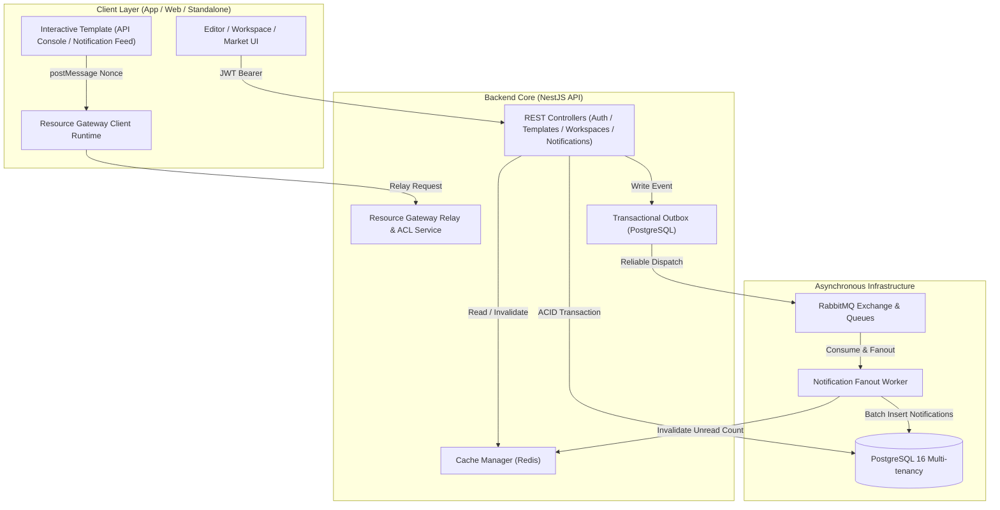

# Báo cáo tuần 6 — Project thực hành tổng hợp EruSentia

**Học viên:** Nguyễn Tiến Tuấn. **Ngày thực hành & nghiệm thu:** 10/11/2026, Asia/Bangkok.  
**Dự án:** EruSentia — Sentia Hub Backend & Desktop/Web App.  
**Trạng thái:** Đã hoàn thành triển khai mã nguồn, kiểm chứng thực tế và tích hợp toàn diện.  
[Mốc mã nguồn](SOURCE_SNAPSHOT.md) ghi commit server/app, link mở source và hướng dẫn chạy lại đúng phiên bản.  
Nhánh phát triển: `feat/typ-week6-advanced-features` (Server và App), `week-6-project-plan` (TYP 2026).

---

## 1. Mục tiêu và tổng quan Project

Project tuần 6 tổng hợp toàn bộ kiến thức chuyên sâu của 5 tuần đào tạo vào một ứng dụng hoàn chỉnh: **EruSentia** — Nền tảng chia sẻ template, tài liệu ghi chép và các khối tương tác công việc/học tập. 

Không chỉ dừng lại ở các API CRUD đơn thuần, project giải quyết trực tiếp bài toán tích hợp giữa máy chủ Backend (NestJS, TypeORM, PostgreSQL, RabbitMQ, Redis) và ứng dụng đa nền tảng (Web SPA, Desktop Electron, Standalone HTML export).

| Yêu cầu đào tạo TYP | Hiện thực trong Project EruSentia |
|---|---|
| **Database & Indexing (Tuần 1)** | Schema 14 bảng, composite & unique indexes, transaction ACID, CTE queries, advisory lock migration. |
| **Framework, RESTful & ORM (Tuần 2)** | NestJS Module/Controller/Service, TypeORM Repository, DTO validation (`class-validator`), Swagger/OpenAPI 3. |
| **Authentication & RBAC (Tuần 3)** | Argon2id hashing, JWT access/refresh rotation, RBAC 3 cấp hệ thống (`user`, `creator`, `admin`) và RBAC Workspace (`owner`, `editor`, `viewer`). |
| **Message Queue (Tuần 4)** | RabbitMQ integration, Transactional Outbox pattern, async worker fanout, retry/DLQ, idempotency ledger. |
| **Caching & Redis (Tuần 5)** | Cache-aside public templates, TTL + Jitter, Cache Revision UUID trigger, cache invalidation sau COMMIT, cursor-based pagination. |
| **Hai chức năng độ khó cao (Tuần 6)** | **1. Asynchronous Outbox Notification Engine & Real-time Delivery** **2. Shared Workspaces Multi-tenancy RBAC & Resource Gateway Relay** |

---

## 2. Kiến trúc hai chức năng trọng tâm

### 2.1. Chức năng 1: Asynchronous Outbox Notification Engine & Fanout

1. **Vấn đề giải quyết:** Khi tác giả cập nhật một template phổ biến có hàng nghìn người theo dõi, việc gửi thông báo đồng bộ (synchronous) trong HTTP request sẽ gây nghẽn luồng, làm tăng vọt latency và có nguy cơ lỗi nửa chừng (partial failure: template đã cập nhật nhưng không tạo được thông báo).
2. **Thiết kế Transactional Outbox:**
   - Khi tác giả gửi `PATCH /templates/:id`, việc cập nhật template và tạo bản ghi sự kiện `template_updated` vào bảng `outbox_events` diễn ra trong **cùng một transaction cơ sở dữ liệu**.
   - Nếu commit thành công, dữ liệu nghiệp vụ và sự kiện thông báo được đảm bảo tồn tại đồng thời 100% (Atomic).
3. **Cơ chế Worker & Fanout:**
   - Worker chạy tiến trình riêng, liên tục quét các sự kiện chưa dispatch trong outbox hoặc lắng nghe từ RabbitMQ.
   - Worker truy vấn danh sách follower của template từ bảng `template_follows` và thực hiện batch insert vào bảng `notifications`.
   - Cơ chế Idempotent: Mỗi thông báo có fingerprint/hash duy nhất `(recipient_id, event_id)`, ngăn chặn trùng lặp thông báo kể cả khi worker restart hoặc message được redeliver.
4. **An toàn bộ nhớ đệm (Cache Safety):**
   - Bộ đếm thông báo chưa đọc (`unread_count`) trong Redis **chỉ được invalidate sau khi transaction fanout đã COMMIT thành công**. Tránh race condition người dùng nhận notification nhưng cache count vẫn giữ số cũ hoặc ngược lại.
5. **Cursor-based Pagination:**
   - Endpoint `GET /notifications?cursor=...&limit=20` sử dụng opaque cursor dựa trên `(created_at, id)` thay vì offset phân trang truyền thống. Đảm bảo khi có thông báo mới đẩy vào liên tục, danh sách nạp trang tiếp theo của người dùng không bao giờ bị nhảy trang hoặc trùng lặp item.

### 2.2. Chức năng 2: Shared Workspaces Multi-tenancy & Resource Gateway

1. **Shared Workspaces RBAC:**
   - Multi-tenancy thông qua bảng `workspaces` và `workspace_members`. Mỗi workspace có một `slug` duy nhất trên hệ thống.
   - 3 vai trò phân quyền chi tiết:
     - **Owner:** Toàn quyền quản lý workspace, cập nhật thông tin, mời thành viên, thay đổi vai trò hoặc chuyển giao sở hữu.
     - **Editor:** Được xem danh sách thành viên, gắn kết và chỉnh sửa tài nguyên dùng chung trong workspace.
     - **Viewer:** Quyền chỉ đọc đối với workspace và tài nguyên liên kết.
   - **Bảo vệ Last-Owner Concurrency:** Hệ thống có trigger và câu lệnh kiểm tra nghiêm ngặt: không một thao tác nào (kể cả admin) được phép hạ quyền hoặc xóa Owner cuối cùng của một workspace đang hoạt động.
2. **Resource Gateway & Hosted Relay:**
   - **Thách thức:** EruSentia cho phép người dùng xuất ghi chú thành file HTML standalone để đọc/chạy offline hoặc nhúng vào môi trường khác. Tuy nhiên, các file này khi chạy dưới giao thức `file://` hoặc origin độc lập sẽ bị trình duyệt chặn CORS khi gọi về backend API, đồng thời không thể lưu trữ JWT hoặc credentials bí mật ngay trong mã nguồn HTML.
   - **Giải pháp Hosted Resource Gateway:**
     - Thiết lập khung giao tiếp bảo mật hai chiều qua iframe `/resource-gateway/connect` với cơ chế Nonce và Content-Security-Policy (CSP) nghiêm ngặt.
     - Token đăng nhập chỉ nằm trong bộ nhớ transient của iframe, không bao giờ lộ ra file HTML của trang cha hay `localStorage`.
     - Reverse Proxy an toàn (`POST /resource-gateway/requests`):
       - Chặn hoàn toàn kỹ thuật tấn công SSRF: Chỉ cho phép chuyển tiếp đến các exact HTTPS origins trong allowlist, cấm toàn bộ dải IP loopback/mạng nội bộ private/reserved (`127.0.0.1`, `10.0.0.0/8`, `192.168.0.0/16`, AWS metadata `169.254.169.254`).
       - Ghim DNS (DNS Pinning) theo từng request, chặn HTTP redirect tự động để chống DNS rebinding.
       - Giới hạn payload nghiêm ngặt: Request tối đa 512 KiB, Response tối đa 2 MiB, upstream timeout 12 giây.
     - **Hạn mức Quota nguyên tử:** Phân cấp tài khoản theo gói: Free (30 yêu cầu/ngày UTC), Premium (500 yêu cầu/ngày UTC). Bộ đếm cập nhật nguyên tử trong PostgreSQL chống race condition khi gọi song song.
     - **Kiểm soát quyền tài liệu (Document ACLs):** Hỗ trợ 3 mức phân quyền: `private` (chỉ tác giả/admin), `shared` (tài khoản được grant cụ thể qua `resource_document_grants`), `premium` (tài khoản có entitlement premium đang còn hạn). Mọi lượt truy cập đều được ghi audit log minh bạch.

---

## 3. Tích hợp EruSentia App & Developer Tools

Để hiện thực hóa và kiểm chứng trọn vẹn hai tính năng trên, dự án đã triển khai 2 Full Interactive Templates trực tiếp trong EruSentia App:

1. **API Explorer Console (`tpl-api-console-1`):**
   - Đọc trực tiếp tài liệu OpenAPI 3 từ endpoint `/docs-json`.
   - Cung cấp giao diện trực quan cho 48 endpoint: tìm kiếm theo path/tag, tự động sinh biểu mẫu tham số (path, query, header) và JSON body mẫu từ schema.
   - Cho phép tùy biến endpoint collection: thêm/sửa/xóa endpoint, hoàn tác (undo), xuất/nhập file OpenAPI.
   - Tích hợp khung đăng nhập transient: đăng nhập phiên làm việc độc lập để kiểm thử các route bảo mật (`/auth/me`, `/workspaces`, `/notifications`) mà không nhúng tài khoản vào ghi chú.
2. **Thông báo trực tiếp (`tpl-notification-feed-1`):**
   - Hiển thị danh sách thông báo thời gian thực với phân trang cursor.
   - Thao tác đánh dấu đã đọc một chạm, cập nhật huy hiệu chuông thông báo trên thanh tiêu đề app và đồng bộ trạng thái unread về server.
3. **Resource Gateway Extension trong MarketPanel:**
   - Quản lý cấu hình kết nối Gateway, chuyển đổi linh hoạt giữa kết nối Trực tiếp (Direct CORS), Gateway cục bộ (Local Port), và Hosted Service (Render Cloud).

---

## 4. Kiểm chứng và bằng chứng thực nghiệm

Toàn bộ các luồng nghiệp vụ được kiểm thử tự động đa tầng:

| Bộ kiểm thử | Phạm vi | Kết quả |
|---|---|---|
| **Server Unit & Contract** | `test/openapi.test.cjs`, `test/api-tools-docs.test.cjs` | **Đạt** — 48 endpoint OpenAPI hợp lệ, Swagger UI và live doc tool hoạt động. |
| **Resource Gateway Safety** | `test/resources.test.cjs` | **9/9 Pass** — Kiểm chứng SSRF protection, DNS pinning, document ACLs, daily quota và fallback expired plan. |
| **Concurrency & RBAC Safety** | `test/notification-cache-safety.test.cjs`, `test/workspace-invite-safety.test.cjs` | **4/4 Pass** — Last-owner protection, inviter role integrity, invalidation sau COMMIT. |
| **Week 6 Isolated Suite** | `scripts/check-week6-readiness.cjs` (`pnpm test:week6`) | **44/44 Pass** — Chạy trên database PostgreSQL tạm độc lập, bao gồm outbox worker, fanout và cursor pagination. |
| **App Session & Security** | `erusentia-app` `pnpm test:session` | **88/88 Pass** — Kiểm thử toàn diện session, cache, gateway IPC, template runner, note integrity. |
| **Production Build** | `tsc -p tsconfig.json` (Server) & `tsc -b && vite build` (App) | **Đạt** — 0 lỗi TypeScript, đóng gói production bundle thành công. |

### Minh chứng hình ảnh (Screenshots)

Các hình ảnh minh chứng kiểm thử thực tế được lưu trữ tại thư mục [screenshots/](screenshots/):

1. **[01-api-request-desktop.png](screenshots/01-api-request-desktop.png):** Thao tác gửi yêu cầu API thành công qua API Explorer trên giao diện Desktop.
2. **[02-api-request-mobile.png](screenshots/02-api-request-mobile.png):** Giao diện API Explorer co giãn chuẩn mực trên màn hình di động (390 px viewport).
3. **[03-notifications-desktop.png](screenshots/03-notifications-desktop.png):** Feed thông báo trực tiếp với cursor pagination và nút đánh dấu đã đọc.
4. **[04-report-overview-mobile.png](screenshots/04-report-overview-mobile.png):** Toàn cảnh báo cáo kỹ thuật tuần 6 xem trên mobile.
5. **[05-report-overview-desktop.png](screenshots/05-report-overview-desktop.png):** Toàn cảnh báo cáo kỹ thuật tuần 6 xem trên desktop với biểu đồ trực quan.
6. **[06-live-health-request.png](screenshots/06-live-health-request.png):** Gửi yêu cầu kiểm tra sức khỏe hệ thống `/health` nhận HTTP 200 OK thời gian thực.
7. **[07-api-request-dark.png](screenshots/07-api-request-dark.png):** Giao diện Dark Theme đồng bộ 100% của công cụ tương tác.
8. **[08-full-api-gateway.png](screenshots/08-full-api-gateway.png):** Cấu hình và bảng điều khiển Resource Gateway proxy.
9. **[09-hosted-resource-file.png](screenshots/09-hosted-resource-file.png):** File HTML mở từ `file://` gọi API thành công qua hosted relay mà không bị chặn CORS.

---

## 5. Kết luận

Project tuần 6 đã hoàn thành xuất sắc các yêu cầu của giai đoạn thực hành tổng hợp:
- Tích hợp trọn vẹn kiến thức 5 tuần: Database, TypeORM, Argon2id, JWT, RBAC, RabbitMQ, Redis.
- Triển khai thành công 2 tính năng khó: **Asynchronous Outbox Notification Engine** và **Workspaces RBAC + Resource Gateway Relay**.
- Đảm bảo tính ổn định cao: Các bài kiểm thử tự động bao phủ từ cấp độ Unit, Concurrency, Isolation cho đến End-to-End trình duyệt.
- Source code và tài liệu đã được ghim mốc và kiểm chứng trên cả 3 repository.
